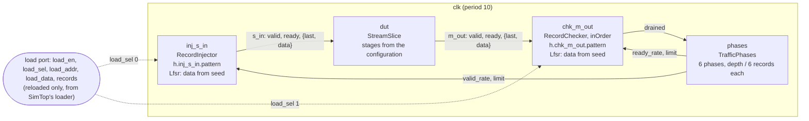

# TB Specification: `StreamSlice`

> **DUT:** `StreamSlice`, a test-only valid/ready register slice (`ts/test/tb/streamDuts.ts`). It
> has no module spec; its class comment is its spec.
> **Testbenches:** `SliceOrder` (harness `SliceOrderHarness`, `ts/test/tb/RecordStreamHarness.ts`)
> **Runner:** `ts/test/tb/test_SliceOrderTB.ts`, writing `sv-examples/tb/StreamSlice/SliceOrder/`
> **Status:** Example. The testbench generator's example (TSSV#200), written from
> [the TB spec template](../../templates/tb-spec-template.md).

StreamSlice's other testbench, `tb_RecordStream_cycle` (`SliceCycleHarness`), checks the slice
cycle by cycle against a table. Its cycle tables are preloaded only, and it is written by
`test_tbExamples.ts`, not the generator, so it isn't covered here.

---

## Overview

SliceOrder checks that a StreamSlice of 2 or 3 stages carries every record once, in order,
unchanged, while traffic phases throttle both ends: at full rate, at random rates, under heavy
backpressure, with occasional stalls, and with sparse traffic. It is the generator's example, so
the harness holds no test content: the stages and depths come from configuration files, and the
records from testcase files, in either run mode.

| What the class comment promises | Testcases | Checks |
|---|---|---|
| Nothing is lost, duplicated or reordered | `seeded_packets`, `continued` | `order` |
| The output holds while `out_ready` is low, and `in_ready` falls once the stages fill | `seeded_packets`, `continued` (phases R1–R4) | `order`, `progress` |
| A word every cycle at full rate | `seeded_packets`, `continued` (phases F1, F2) | `progress` (rate is not checked; see Limitations) |

---

## Block diagram



`done` is `inj_done && phases_done`: every record sent, every phase drained, then 16 quiet cycles.

---

## Clocks and resets

One clock, `clk`, period 10, and one reset, `rst_b`, held for 4 cycles. In reloaded mode the reset
is also held until SimTop's loader has loaded both memories on `clk`.

---

## Configurations

| Configuration | `parameters` | `depths` | `maxCycles` |
|---|---|---|---|
| `stages2` | `{ "stages": 2 }` | `h.inj_s_in.pattern`: 48, `h.chk_m_out.pattern`: 48 | 2000 |
| `stages3` | `{ "stages": 3 }` | `h.inj_s_in.pattern`: 48, `h.chk_m_out.pattern`: 48 | 2000 |

`stages` is the only parameter (`sliceOrderParameters()` refuses any other). Both memories need
one depth, a multiple of 6, since each phase sends depth / 6 records.

Fixed in every configuration:

- **The record:** `last` (1 bit) and `data` (32 bits), `SLICE_FIELDS`, carried as a 33-bit word.
- **LFSR payloads:** `SLICE_LFSR`, a 64-bit xorshift Lfsr with reset seed `0x5eed5eed5eed5eed`,
  fills `data`. A record stores a `seed`: non-zero restarts the Lfsr there, 0 continues it.
- **Traffic:** the standard phases without `full_rate` (F1 full rate, R1 random, R2 heavy
  backpressure, R3 occasional stalls, R4 sparse, F2 full rate), depth / 6 records each, a phase
  timeout of 25 cycles per record, and throttle seed `0xC0FFEE`.

---

## Interfaces and pattern formats

Both memories hold the same record: `last` in one hex digit, then the 64-bit `seed` in four groups,
a 68-bit word. The slice changes nothing, so a testcase's expected file holds the same packets as
its stimulus.

### `s_in`

| | |
|---|---|
| Component | `inj_s_in`, RecordInjector, throttled by `valid_rate`, stopped at `limit` |
| Memory | `h.inj_s_in.pattern` |
| Record | `last` (1 bit), `seed` (64 bits), in place of `data` |
| Radix | `$readmemh` |
| Payload | `data` from the Lfsr, restarted at each non-zero seed |

```text
// StreamSlice, testcase seeded_packets: stimulus for s_in, a seed per packet
// $readmemh, one record per line: last _ seed[63:48] _ seed[47:32] _ seed[31:16] _ seed[15:0]
//   last: 1 bit, one hex digit; seed: 64 bits
// 48 records in 22 packets
// packet 0: 1 record
1_3c1e_ba8b_4dcc_c148
```

### `m_out`

| | |
|---|---|
| Component | `chk_m_out`, RecordChecker in inOrder mode, ready at `ready_rate`, `drained` at `limit` |
| Memory | `h.chk_m_out.pattern` |
| Record | as `s_in` |
| Radix | `$readmemh` |
| Payload | `data` regenerated by the checker's own Lfsr from the expected seeds |

```text
// StreamSlice, testcase continued: expected on m_out: the packets as sent
// $readmemh, one record per line: last _ seed[63:48] _ seed[47:32] _ seed[31:16] _ seed[15:0]
//   last: 1 bit, one hex digit; seed: 64 bits
// 44 records in 21 packets
// packet 0: 4 records
0_0000_0000_0000_0000
```

---

## Testcases

| Testcase | Records | Made by | Exercises |
|---|---|---|---|
| `seeded_packets` | 48 in both memories | `sliceOrderTestcase(48)` | Packets of 1 to 4 records, each packet's first record seeded: every phase gets its 8 records |
| `continued` | 44 in both memories | `sliceContinuedTestcase(44)` | Packets of other lengths, a seed on every third packet from packet 1 only. Record 0 continues from the Lfsr's reset seed, and payloads continue across packets. Fewer records than the depth, so the last phase sends 4 |

---

## Checks

| Check | Component | Requires | Detail line |
|---|---|---|---|
| `order` | `chk_m_out` | the slice carries every record once, in order, unchanged | `record %0d: got %h, expected %h` |
| `progress` | `phases` | every phase drains within its timeout | `phase %0d did not drain within its timeout` |

StreamSlice declares no port contracts: its ready chain is combinational by design.

---

## How outputs are matched across interfaces

One output, matched in order: the checker compares each record on `m_out` with the next expected
record, `last` and `data`, the data regenerated from the expected seeds. A record after the last
expected one, a missing record, and a reordered record all fail `order` or, if a record never
arrives, `progress`. Timing is not checked: the cycle a record appears in is `tb_RecordStream_cycle`'s
job.

---

## Run modes

| Mode | Supported | Builds | Notes |
|---|---|---|---|
| `preloaded` | yes | one per configuration and testcase: 4 | each testcase's files and counts compiled in |
| `reloaded` | yes | one per configuration: 2, each run with both testcases | SimTop loads `patterns/load.txt` |

A testcase may hold up to 48 records per memory, the configured depth.

---

## Running

```bash
npx tsc && node out/test/tb/test_SliceOrderTB.js   # writes sv-examples/tb/StreamSlice/SliceOrder/
make -C verilatorTB tb_regression_sim              # builds and runs every line of its regression.txt
```

Each run passes in the same number of cycles in both modes:

| Run | preloaded | reloaded |
|---|---|---|
| `stages2 seeded_packets` | 148 | 148 |
| `stages2 continued` | 144 | 144 |
| `stages3 seeded_packets` | 155 | 155 |
| `stages3 continued` | 151 | 151 |

`stages2 seeded_packets` is the content of the earlier `tb_RecordStream_order`, which passed in 148
cycles too.

---

## Evidence

Each break was seen to fail, on `reloaded stages2 seeded_packets`. The pattern-file and load-list
breaks need no rebuild.

| Break | Result |
|---|---|
| Expected record 0's lowest digit changed | `FAIL order`, record 0: got `14dccc148`, expected `14dccc140` |
| The injector's count in the load list one short, 47 | `FAIL progress`, phase 5 |
| The checker's count in the load list one short, 47 | `FAIL order`, record 47 |
| The load list's two memory lines swapped | `$fatal`: line 2 of `patterns/load.txt` isn't for `h.inj_s_in.pattern` |
| SimTop's loader writes the checker's record i at address i + 1 | `FAIL order`, record 0 |

---

## Limitations and open points

- **Rate isn't checked.** No phase raises `full_rate`, so the full-rate phases show only that the
  records get through, not that one arrives every cycle.
- **No stored payloads.** Every record's data comes from an Lfsr. Stored payloads are covered by
  `tb_RecordStream_tied` and `tb_AFIFOStream_two_domains`.
- **A loader shifting every memory alike goes unseen.** Loading every record at i + 1 shifts the
  stimulus and the expected records together, and both read the same unwritten word 0.
- **The high bits of a seed may not reach the payload.** The data is the Lfsr's low 32 bits, so
  changing a seed's top bits can leave the first records' data as it was.
