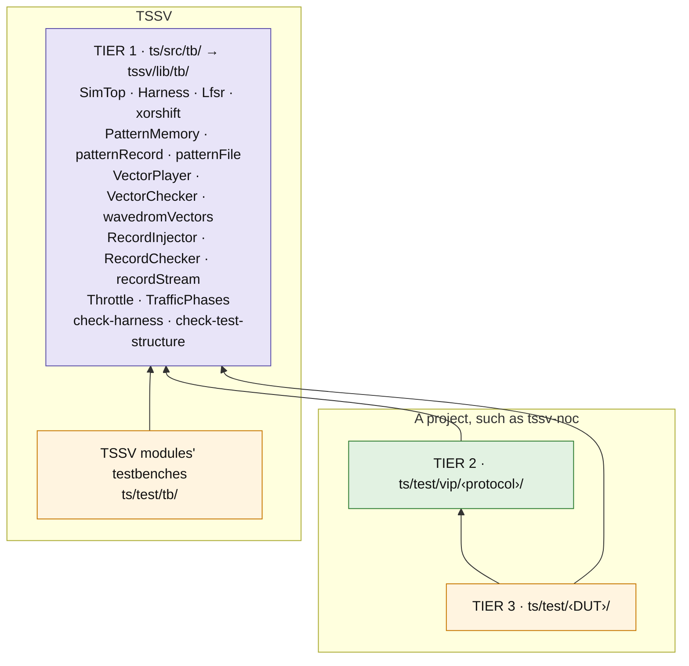
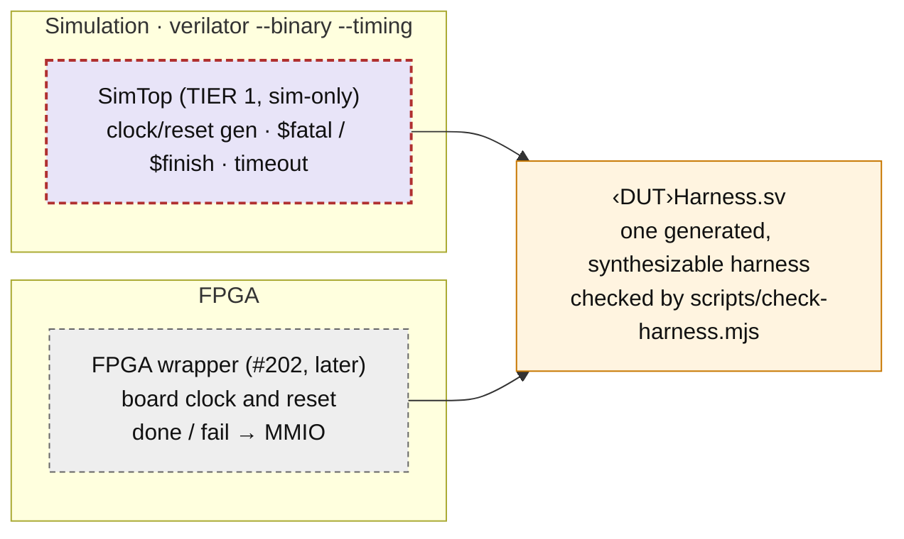

# Block testbench framework

> **Status:** tier 1 of the testbench framework (tssv-noc#207, TSSV#196), with pattern memories
> loaded from files (TSSV#197), and a generic injector, checker and scoreboard for valid/ready
> record streams (TSSV#198). Still to come: clocks and resets for several domains (#199), the TB
> generator and TB spec template (#200), the port-contract check (#201), and an FPGA wrapper
> (#202).
> **Code:** `ts/src/tb/`, imported as `tssv/lib/tb/<file>`
> **Checks:** `scripts/check-harness.mjs`, `scripts/check-test-structure.mjs`
> **Examples:** `ts/test/tb/`, run by `make -C verilatorTB tb_examples_sim` and
> `make -C verilatorTB pattern_memory_sim`
> **Pattern file format:** [pattern-files.md](pattern-files.md)

How a block testbench is put together, in TSSV or in a project built on it. The aim is a
testbench that a reviewer can read top to bottom, that an agent can follow without inventing a
new style, and whose harness could run on an FPGA unchanged.

---

## Two layers: a synthesizable harness under SimTop

Every testbench has the same two layers.

- **The harness** is synthesizable. It is built only from TSSV constructs: `addRegister`,
  `addAssign`, `addMux`, `addSubmodule`, interfaces. It instantiates the DUT, the components that
  drive it, and the checkers that watch it. The test's content, its stimulus and its expected
  values, is in pattern memories loaded from pattern files, not in the RTL. Its ports are always
  the same:
  - `clk` and `rst_b` (active low, asynchronous) in;
  - `done` and `fail`, one bit per check, out.
- **SimTop** is the simulation-only top, and the only raw SV in a testbench. One class,
  `SimTop` (`ts/src/tb/SimTop.ts`), wraps every harness. It does three things:
  - generates the clock and reset;
  - reports the result: a named FAIL line per failed check, or one PASS line;
  - enforces a cycle timeout.

**Diagram 1: the SFIFO example testbench.** It replays a timing diagram from the SFIFO spec
against the RTL (`ts/test/tb/SFIFOWaveHarness.ts`). The test writes the diagram's lanes to two
pattern files, which the player's and the checker's pattern memories load. Fill color is the tier,
grey is offline, and a red dashed border marks a sim-only block; everything else is synthesizable.
A block inside another is instantiated in it: SimTop instantiates the harness as `h`. Solid arrows
are ports; the dotted arrows are files, and a hierarchical read.


Lavender is tier 1 (`ts/src/tb/`), amber tier 3, and blue the DUT.

---

## Three tiers

What a piece of testbench code knows about decides where it lives. **A tier may depend only on
the tiers below it, and must not name anything above it.**

| Tier | Where | Knows about | Must not know about |
|---|---|---|---|
| 1 · Framework | TSSV's `ts/src/tb/`, imported as `tssv/lib/tb/<file>` | TSSV's core | any protocol, any DUT |
| 2 · Protocol package | a project's `ts/test/vip/<protocol>/` | tier 1, and one interface | any DUT |
| 3 · Per-DUT testbench | a project's `ts/test/<DUT>/` | tiers 1 and 2, and its one DUT | other DUTs |

- **A TSSV module's testbench uses tier 1 directly.** TSSV has no tier 2: its modules' ports
  are plain signals and AMBA interfaces. The examples are in `ts/test/tb/`.
- **Tier 3 is wiring only.** A harness instantiates, binds, and picks check parameters. If it
  needs logic of its own, that logic is something a protocol or the framework is missing: add
  it to tier 2 or 1 without naming the DUT.
- **New reusable code goes in the lowest tier that doesn't need to know more.** A random
  sequence is tier 1. A checker for one interface's protocol is tier 2. A DUT's latency is a
  tier-3 parameter.
- **`scripts/check-test-structure.mjs` enforces the rule** for tiers 1 and 2:
  - A tier-1 file may import only Node, `tssv/lib/core/`, `tssv/lib/tb/` and its own files.
  - A tier-2 file may also import `tssv/lib/interfaces/`, and the project's `ts/test/vip/`,
    `ts/src/interfaces/` and `ts/src/tools/`.
  - So neither can import a DUT: neither TSSV's (`tssv/lib/modules/`) nor the project's
    (`ts/src/modules/`).

**Diagram 2: the tiers across TSSV and a project.**



---

## Components

Tier 1, in `ts/src/tb/`:

| Component | Ports | Parameters | What it does |
|---|---|---|---|
| `SimTop` | none (top) | `name`, `harness`, `maxCycles`, `resetCycles` (4) | The sim-only top. Clock (period 10); `rst_b` low for `resetCycles` rising edges, released at a falling edge. It reads `fail`, then `done`, at every rising edge after reset |
| `Harness` | `clk`, `rst_b` → `done`, `fail[N-1:0]` | `name` | Base class of every harness. Its helpers:<br/>• `check(name, description, detail?)` adds a check and returns its fail net<br/>• `tap(path, width)` reads a DUT signal by hierarchical reference<br/>• `finish()` builds `fail` |
| `Lfsr` | `clk`, `rst_b`, `step` → `value`; loadable: `load`, `seed_in` in | `width` (32 or 64), `seed`, `outWidth`, `loadable` | A xorshift sequence that steps on `step`. Two Lfsrs with one seed produce the same values, which is how a source and its checker agree on what was sent. A loadable Lfsr restarts at `seed_in` while `load` is high, showing it on `value` in that cycle |
| `xorshift` | (TypeScript) | | `xorshift(width, seed, outWidth, n)` and `xorshiftNext()`: the model of an Lfsr's sequence, for generators and tests. Its shift triples are written apart from `Lfsr`'s, so a test of one against the other catches a wrong triple |
| `PatternMemory` | `clk`, `rd_addr` → one output per field; reloaded only: `load_en`, `load_addr`, `load_data` in | `name`, `layout`, `depth`, `mode` (`preloaded` or `reloaded`), `file` (preloaded) | Holds a test's content, one record per word ([pattern-files.md](pattern-files.md)). The read is synchronous, the block-RAM form. Preloaded: one `initial $readmemh("<file>", mem);` loads the file at configuration, the one `initial` SYN-1 allows. Reloaded: a host writes each word through the load port, and there is no `$readmem` |
| `patternRecord` | (TypeScript) | | `recordFields(intf, names)` takes a record's fields from an interface; `recordLayout(fields, radix)` gives each its slot in a word, padded to whole hex digits for `$readmemh`; `packRecord()` and `unpackRecord()` |
| `patternFile` | (TypeScript) | | `writePatternFile()` writes a pattern file a person can read (header comment, a comment per object, `_` between fields), and `writeManifest()` the testcase's JSON manifest |
| `VectorPlayer` | `clk`, `rst_b` → `row`, `fetch`, `run`, `done`, one output per lane | `name`, `rows`, `lanes`, `file`, `radix` | Drives a table one row per cycle from a `PatternMemory` loaded with the table's pattern file. Every lane comes from the memory's read register, a flop, so a lane may drive a reset (SV guide RST-4). `done` rises after the last row. `layout()` and `records()` give a generator the file's layout and records. Timing: [below](#cycle-tables-and-their-timing) |
| `VectorChecker` | `clk`, `rst_b`, `row`, `fetch`, `run`, one input per lane → `fail_<lane>` | `name`, `rows`, `lanes`, `file`, `radix`, `firstRow` | Compares each lane with its row of a table of expected values, read from a `PatternMemory` at the player's `fetch`. A `care` bit per lane in each row marks the don't-cares. It latches the first mismatch per lane in `err_row_`, `err_got_` and `err_want_<lane>`; `firstError()` is the detail line that prints them |
| `wavedromVectors` | (TypeScript) | | Reads a spec's WaveDrom diagrams. `diagramLanes()` gives one diagram on one clock as values per cycle per lane, for a `VectorPlayer` and a `VectorChecker`. `diagramTasks()` gives every diagram with a prefix, on a fast and a slow clock, as SV tasks for a hand-written testbench |
| `testbench` | (TypeScript) | | `markTestbench(module)` marks a module as simulation-only, so the SYN-1 scan skips it. SimTop marks itself |
| `RecordInjector` | `clk`, `rst_b`, `ready` → `valid`, one output per field, `done`; options add `valid_rate`, `limit`, and in reloaded mode the load port and `records` | `name`, `fields`, `depth`, `memory`, `file`, `radix`, `records`, `lfsr`, `throttle`, `limitWidth` | Drives a valid/ready stream of records from one pattern memory, `pattern`, in order, each until it is accepted ([Record streams](#record-streams)) |
| `RecordChecker` | `clk`, `rst_b`, `valid`, one input per field → `ready`, `fail`, `drained`; options add `ready_rate`, `limit`, the load port, and for a tie `peer_count` in, `fail_after` and `count` out | `name`, `mode`, `fields`, `depth`, `memory`, `file`/`files`, `records`, `sourceField`, `sources`, `lfsr`, `throttle`, `limitWidth`, `tie`; cycleExact: `rows`, `readyFile`, `file` | Checks a valid/ready stream against expected records, as a scoreboard: `inOrder`, `perSource` or `cycleExact` ([Record streams](#record-streams)). `firstError()`, `firstAfterError()` and `firstCycleError()` are its detail lines |
| `recordStream` | (TypeScript) | | What an injector and a checker share: `injectorLayout()` and `checkerLayout()` for their pattern files, `lfsrPayloads()`, the model of LFSR payloads, and `mixSeed()` |
| `Throttle` | `clk`, `rst_b`, `rate` → `pass` | `seed` | Passes in a cycle with a chance of `rate` in 256. `drawSeed(seed, salt)` gives its seed from a stream's |
| `TrafficPhases` | `clk`, `rst_b`, `drained` → `valid_rate`, `ready_rate`, `limit`, `done`, `stuck`; `full_rate` when a phase sets `fullRate` | `phases` (`STANDARD_PHASES`), `recordsPerPhase`, `timeout`, `quietCycles` (16) | Steps a harness's injectors and checkers through phases of valid and ready rates, a phase's records at a time. `stuck` rises if a phase doesn't drain within `timeout` cycles; `stuckDetail()` is its detail line |

### Pattern memories

A test's stimulus and expected values are content, not structure, so they live in pattern files
([pattern-files.md](pattern-files.md)), not in the harness's RTL. A generator writes them
offline, in any language. Each `PatternMemory` in the harness holds one file, with its record
layout taken from an interface or from a table's lanes. A build picks one of two modes:

- **Preloaded:** the memory loads its file at configuration, with `initial $readmemh`, as FPGA
  block RAM can be. New content needs a new bitstream on an FPGA, but in simulation only the new
  files, because `$readmem` reads them at run time.
- **Reloaded:** one build per DUT configuration. A host writes new content through the memory's
  load port between testcases or batches (tssv-noc `NP_VIP_REQ_028`–`031` and `033`). The load
  port is built only in this mode. Carrying the load ports out of a harness to a host is the FPGA
  wrapper's job (#202). Until then, `tb_PatternMemory_reloaded` loads a memory in simulation.

### Cycle tables and their timing

`VectorPlayer` and `VectorChecker` read their tables from pattern memories. A memory's read is
synchronous, so a record appears one rising edge after its address. The player therefore fetches
one row ahead, and needs one priming cycle after reset:

- Through reset, every flop holds its reset value, so the tables' address is row 0's, and the
  memories' read registers already hold row 0 when reset is released. The address can't move to
  row 1 before the first rising edge after release. Using `rst_b` in the address would make it a
  data signal as well as a reset, which lint `-Wall` reports (SYNCASYNCNET).
- So `run` is low for one cycle after reset is released, the priming cycle, and `row` holds at 0
  through it. From the first rising edge after release, `run` is high. `row` then counts up by one
  per edge, and `fetch`, the row the memories read, is one ahead of it.
- Row 0 lasts two cycles: the priming cycle and the next one. A checker compares only while `run`
  is high. A DUT that should start at row 0 takes its reset from a table lane, as the SFIFO does,
  or steps on `run`, as the Lfsrs in `tb_Lfsr` do.

A table of four rows, records m0 to m3:

<!-- wavedrom table-timing.svg
{
  "signal": [
    {"name": "clk",   "wave": "p......."},
    {"name": "rst_b", "wave": "0.1....."},
    {"name": "run",   "wave": "0..1...."},
    {"name": "row",   "wave": "=...====", "data": ["0", "1", "2", "3", "4"]},
    {"name": "fetch", "wave": "=..===..", "data": ["0", "1", "2", "3"]},
    {"name": "done",  "wave": "0......1"},
    {"name": "lane",  "wave": "=...===.", "data": ["m0", "m1", "m2", "m3"]},
    {"name": "check", "wave": "0..1...0"}
  ]
}
-->


`check` is high in the cycles a checker compares. SimTop releases `rst_b` at a falling edge, half
a cycle before the priming cycle; the diagram draws it at the edge. `fetch` stops at the last row,
so every lane holds its last value from `done` on.

---

## Record streams

Most DUT ports are valid/ready streams. Tier 1 drives and checks one with a `RecordInjector` and
a `RecordChecker`, each holding its records in pattern memories. A protocol package (tier 2)
adds only what its protocol needs beyond that, such as FlitStream's packet framing. The
examples are the five `tb_RecordStream_*` testbenches ([below](#the-examples-tstesttb)).

### Names

A protocol package and a TB spec use these names, so that a protocol's injector reads as
"generic injector plus framing":

| Thing | Name |
|---|---|
| A record | One value per field, as in [pattern-files.md](pattern-files.md). A record leaves out `valid` and `ready` |
| A stream's ports, on an injector or checker | `valid`, `ready`, and one port per field, named after the field |
| The injector of a DUT input `<port>` | instance `inj_<port>`; its memory `inj_<port>.pattern` |
| The checker of a DUT output `<port>` | instance `chk_<port>`; its memory `chk_<port>.pattern`, or `chk_<port>.pattern_<k>` for source k, or `chk_<port>.play.pattern` and `chk_<port>.chk.pattern` in cycleExact mode |
| A checker's checks | `order` for `fail` (with a suffix per output when there are several), `after` for `fail_after`, `progress` for TrafficPhases' `stuck` |
| A manifest's memory paths | the instance paths above, under `h.`: `h.inj_s_in.pattern`, `h.chk_m_out.pattern_1` |

The tier-1 components have plain ports, not interfaces. A tier-2 or tier-3 harness binds a
field's port to an interface signal (`s_in.data`), or packs several fields into one
(`{src, payload}`), so tier 1 needs no stream interface of its own.

### The injector

`RecordInjector` holds one pattern memory, `pattern`, and offers its records in order. It holds
each one, `valid` high and the fields steady, until a cycle with `ready` high accepts it.

- **No priming cycle.** The memory reads the next record as soon as one is accepted, so a
  record is at the fields when `valid` rises, and the stream can carry a record every cycle.
  Through reset the memory reads record 0, which is at the fields when reset is released.
- **`valid` comes from a flop**, and so do the stored fields (the memory's read registers).
  `ready` reaches only flops, so a DUT may compute `ready` from `valid`.
- **`done`** rises when every record has been accepted: the preloaded `records`, or in reloaded
  mode the `records` input.
- **Options:** `throttle` offers at random ([Throttling](#throttling)); `limitWidth` adds
  `limit`, a cap on the records sent so far, for TrafficPhases; `lfsr` fills payload fields from
  seeds ([LFSR payloads](#lfsr-payloads)).
- **Reloaded mode** adds the memory's load port and `records`. Load while `rst_b` is low.
  tssv-noc#216 shows it in simulation.

### The checker

`RecordChecker` takes a record in each cycle with `valid` and `ready` high, and compares it with
what it expects. Its `mode` says what it requires:

| Mode | Memories | Requires |
|---|---|---|
| `inOrder` | one, `pattern` | Every expected record arrives once, in order, unchanged |
| `perSource` | one per source, `pattern_<k>` | The same within each source, the source being the value of `sourceField`. The order across sources isn't checked (tssv-noc `NP_VIP_REQ_036`). Each source's file leaves out the source field |
| `cycleExact` | the cycle table's two, `play.pattern` and `chk.pattern` | In each cycle, `valid` and the record have the table's values, and `ready` is the table's ([Cycle tables](#cycle-tables-and-their-timing)) |

In `inOrder` and `perSource` modes:

- **`fail`** rises at the first record that differs from the next one expected of its source,
  comes from an unknown source, or arrives after its source's last expected record. It stays
  high. `err_index`, `err_source` (perSource), `err_got` and `err_want` hold that record: its
  number within its source (the source's record count for a record after the last), and the
  record's fields but the source, in order, as one value. `firstError()` prints them:
  `source 0, record 8: got 12e7a, expected 0d615`.
- **A record that never arrives** keeps `drained` low, so the testbench never ends, and SimTop's
  timeout, or TrafficPhases' `progress`, fails it.
- **`drained`** rises once the records delivered reach the records expected, or `limit` if that is
  fewer.
- **`ready`** is always high, or with `throttle`, high at random, from a flop.
- **Reloaded mode** adds the load port and `records`, with one count per source, source 0's in
  the low bits. With several sources, `load_src` picks the memory a word goes to.

In `cycleExact` mode, a VectorPlayer, `play`, drives `ready` from the table's first file, and a
VectorChecker, `chk`, checks two lanes: `valid`, and the record, its fields in order as one
value. The record is a don't-care in a row that expects no record. It reports per lane,
`fail_valid` and `fail_record` (`firstCycleError()`), and `done` rises after the last row.
`RecordChecker.cycleRecords()` writes both files from a list of rows, each with `ready` and the
record it expects, if any.

### LFSR payloads

With `lfsr`, a record stores a seed in place of its payload fields, and an Lfsr fills them in. The
injector and its checker are given the same `lfsr`, so the checker regenerates what the injector
sent, and no payload is stored on either side.

- **A non-zero seed restarts the Lfsr at that seed, and a seed of 0 continues** from the previous
  record. A stream seeded once in its first record is the shared-seed scheme of tssv-noc's spike
  (`FlitStreamSource`); a seed in each packet's first record is the per-packet scheme of tssv-noc's
  `doc/ideas/fpga-harness-sequence-memory.md`.
- **The record's layout** has a field `seed`, as wide as the Lfsr, where its first payload field
  was (`injectorLayout()`, `checkerLayout()`). The payload fields are at most the Lfsr's width
  together: 32 or 64 bits.
- **A seed's record shows the seed's low bits** as its payload, and each record after it the next
  value of the sequence. `lfsrPayloads()` gives a generator the payloads, for a cycle table or a
  comment.
- **Mix small seeds.** xorshift takes several steps to leave a state with few bits set, so seeds
  1, 2, 3 would give sparse, alike payloads. `mixSeed(n, width)` turns a packet number into a
  dense, non-zero seed (splitmix64).

### Ties: order across outputs

A DUT with several outputs may promise an order across them, such as a response after the request
it answers. Checkers on those outputs can be tied, each given `tie: { peers, countWidth }`:

- Every tied checker outputs `count`, the records it has delivered, from a flop.
- `RecordChecker.peerCounts()` adds a net to the harness that carries every tied checker's count,
  peer 0's in the low bits, and each tied checker takes it as `peer_count`.
- Each expected record also holds `after_peer` and `after_count`. The record may arrive only once
  peer `after_peer` has delivered `after_count` records. The counts come from flops, so "once"
  means in an earlier cycle, and an `after_count` of 0 asks nothing.
- A record that arrives too early raises `fail_after`, apart from `fail`. `err_after_*` hold it, and
  `firstAfterError()` prints it:
  `record 1: arrived before peer 0 had delivered 6 records; it had 4`.

`tb_RecordStream_tied` ties the two outputs of a split that keeps its input order:


The generator knows the input order, so for each record it counts the records sent to the other
output before it. With r0→A, r1→B, r2→B, r3→A:

| File | Record | `after_peer` | `after_count` | Meaning |
|---|---|---|---|---|
| expected a | r0 | 1 | 0 | no constraint |
| expected a | r3 | 1 | 2 | only after B has delivered 2 (r1, r2) |
| expected b | r1 | 0 | 1 | only after A has delivered 1 (r0) |
| expected b | r2 | 0 | 1 | the same; r1 before it is on its own output, which `order` covers |

```text
the split keeps its order (passes)       out_b buffered: r1, r2 wait, r3 passes them
cycle      1   2   3   4                 cycle      1   2   3   4
out_a      r0  .   .   r3                out_a      r0  r3  .   .
out_b      .   r1  r2  .                 out_b      .   .   r1  r2
count_a    0   1   1   1                 count_a    0   1   2   2
count_b    0   0   1   2                 count_b    0   0   0   1
r1: count_a 1 ≥ 1                        r3 in cycle 2: count_b 0 < 2 → fail_after on out_a
r3: count_b 2 ≥ 2
```

A DUT that may deliver two dependent records in the same cycle fails this check by design.

### Throttling

`Throttle` makes a random choice each cycle: `pass` is high with a chance of `rate` in 256 (rate
0 never, 256 always). It draws 8 bits from a 32-bit Lfsr that steps every cycle, and tests
`{1'b0, draw} < rate`. An injector with `throttle` uses one to decide when to offer a record
(`valid_rate`), and a checker one to decide when to be ready (`ready_rate`). Their seeds come from
`drawSeed(seed, salt)`, with a different salt for each, so an injector and a checker given one
seed draw apart.

**The distribution.** The draws are uniform: xorshift32 visits every non-zero state once in its
period of 2^32 − 1, so each 8-bit value is equally likely, to within 2^−24. Two draws in a row are
independent: the next draw's bits include state bits the current one doesn't. So each cycle passes
as an independent coin with p = rate / 256. The sequence is linear, with 32 bits of state, so five
or more draws in a row are linearly dependent; only a linear-complexity test would notice. With
p_v = valid_rate / 256 and p_r = ready_rate / 256:

- a checker's `ready` is high in each cycle with chance p_r, and an offered record waits for it
  a geometric number of cycles, (1 − p_r) / p_r on average;
- after each record is accepted, an injector stays idle a geometric number of cycles,
  (1 − p_v) / p_v on average;
- an injector straight into a checker carries 1 / (1/p_v + 1/p_r − 1) records a cycle. A DUT that
  buffers between them raises that toward min(p_v, p_r).

A Python model of 10^6 cycles gave P(pass) within 0.0006 of rate / 256, and a pass in two cycles
in a row within 0.0009 of p², for rates 64, 128 and 224. Its throughput in the four random
standard phases came within 0.0007 of the formula.

**`TrafficPhases`** steps a harness through phases of rates. Phase p sends records until
`limit` = (p + 1) · `recordsPerPhase` have been sent, at its valid and ready rates, and moves on
once the checker's `drained` says they have all arrived. After the last phase it waits
`quietCycles` with checkers ready and nothing offered, so that a late record is still taken and
checked, and raises `done`. `stuck` rises if a phase runs `timeout` cycles; a harness binds it to
a `progress` check, with `TrafficPhases.stuckDetail()` as its detail line, which names the phase. Choose `timeout` well below SimTop's `maxCycles`, or a stuck phase fails as a
SimTop timeout instead. `STANDARD_PHASES` are full rate, four random phases, then full rate
again. A phase with `fullRate` raises `full_rate`, for a check that holds only at full rate; a
table with none has no `full_rate` port.

---

## Pass and fail

- **A check is one requirement and one fail bit.** Each `Harness.check()` call adds one bit to
  `fail`. The harness doesn't evaluate the check: a component it instantiates does, such as a
  VectorChecker comparing a DUT output with its expected value each cycle. That component sets
  the bit at the first violation and holds it.
- **A check has a name and a description.** SimTop prints both:
  `FAIL x64: a 64-bit Lfsr from seed 0x123456789abcdef gives xorshift64's low 64 bits`.
- **A check may have a detail line**, a `$display` format over signals inside the harness. A
  checker that latches its first error supplies one (`VectorChecker.firstError('chk', port)`):
  `first differs in cycle 1: 1e2b7e2ad5623bc2, expected 3f2800d6569e01b4`.
- **The order of the reads matters.** At every rising edge after reset, SimTop reads `fail`
  first, then `done`, then the cycle count. So a check that fails in the last cycle still fails
  the run.
- **The exit status is the result.** Failures end in `$fatal`, never `$finish(1)`, because
  Verilator discards the `$finish` argument. A testbench built with `verilator --binary` exits
  with status 1 on a failure and 0 on a pass.
- **Shared values come from shared seeds.** A source and its checker can agree on a sequence
  through a shared `Lfsr` seed rather than a channel between them, as a `RecordInjector` and a
  `RecordChecker` with one `lfsr` do. That's why the harness is the only thing that has to know
  both.

---

## The sim-only boundary

- **What is sim-only.** Clock generation, reset sequencing, `$display` and `$fatal`/`$finish`
  all live in SimTop, which is marked as a testbench (`markTestbench()`). Nothing else in a
  testbench may use `initial`, `#`, `force` or a system task. There is one exception: a
  `PatternMemory`'s preload, the single line `initial $readmemh("<file>", mem);`. FPGA tools
  build it as block RAM contents (SV guide SYN-1).
- **`scripts/check-harness.mjs` checks the boundary.** For each testbench it finds the harness
  (the one file the SimTop includes) and runs two checks on it:
  - `verilator --lint-only -Wall --no-timing`, which reports any delay or event control. Without
    `--no-timing`, lint accepts both;
  - the SV guide's SYN-1 scan, over every file the harness reaches.

  `doc/rtl-style/sv-style/harness_waivers.vlt` waives one warning: nothing in the harness reads
  the `err_*` first-error registers, because SimTop reads them from outside (SV guide,
  section 8).
- **Ready isolation is not a simulation check.** That an output doesn't depend combinationally
  on an input is a property of the structure, so the port-contract check (#201) checks it, not
  SimTop.
- **Taps.** A spec diagram can show a DUT's internal state. `Harness.tap('dut.valid_0', 1)` reads
  it by downward hierarchical reference. This synthesizes in Vivado as long as the path names a
  signal, not a member reached through an interface port.

**Diagram 3: the same harness in simulation and on an FPGA.**



---

## Running the checks

In TSSV:

```bash
npm run check:test-structure                      # tier 1 imports nothing above it
npm run check:harness -- sv-examples/tb/<tb>/<tb>.sv ...
make -C verilatorTB tb_examples_sim               # the examples: generate, check-harness, run
make -C verilatorTB pattern_memory_sim            # PatternMemory, preloaded and reloaded
```

In a project, through its link to TSSV, from the project's root:

```bash
node node_modules/tssv/scripts/check-test-structure.mjs .    # TSSV's tier 1 and the project's tier 2
node node_modules/tssv/scripts/check-harness.mjs sv-examples/<DUT>/<tb>/<tb>.sv ...
```

`check-harness` takes `--harness <harness.sv>...` to name harness files directly instead of
testbenches; given a SimTop that way, it fails, as it should. Both scripts exit 1 on a failure.

---

## Writing a block testbench

1. **The harness.** Create `<DUT>Harness.ts`, a `Harness` subclass: in a project, in
   `ts/test/<DUT>/`. Its header comment says:
   - what it verifies;
   - which spec section it verifies against;
   - a small block diagram of its wiring;
   - the list of checks.
2. **Its body is wiring.** It creates the interface instances and nets, then adds each submodule
   with explicit bindings. Pass `autoBind = false`: auto-binding would short two same-named
   `fail` outputs together. It binds each component's fail output to
   `this.check(name, description)`, and calls `this.finish()` last. It takes the paths of its
   pattern files as parameters, and holds only the shape of the content: which lanes or fields,
   and how many rows or records.
3. **The testcase.** A generator writes the pattern files and their manifest
   ([pattern-files.md](pattern-files.md)). In TypeScript it uses `writePatternFile()` and
   `writeManifest()`, with a table's `VectorPlayer.records()` and `VectorChecker.records()`, or a
   record stream's `injectorLayout()`, `checkerLayout()` and `RecordChecker.cycleRecords()`. Put
   the files in `patterns/` beside the testbench's SV, and give the harness paths relative to
   that folder (`patterns/stimulus.hex`).
4. **The runner.** A test script wraps each harness in a `SimTop` and writes it with
   `writeSystemVerilogFiles()` to `sv-examples/<DUT>/<testbench>/`, on a path that starts at the
   repo's root (`` `${TSSV_ROOT}/sv-examples/...` `` in TSSV). Pick `maxCycles` well above the
   cycles the test needs: it is the only timeout.
5. **Build and run.** `verilator --binary --timing +define+USE_INCLUDES -I<dir> <dir>/<tb>.sv`
   builds a testbench. Run it from `<dir>`, where its pattern file paths lead; its exit status is
   the result. Run `check-harness` on it too. In TSSV, add it to `TB_EXAMPLES` in
   `verilatorTB/Makefile`.
6. **Show that each check can fail.** Break the DUT on purpose, one way per check, and record in
   the PR which testbench and check caught each break ([Evidence](#evidence-that-a-check-works)).

Expected values come from the spec, from a model of what the DUT is meant to do, or from a shared
seed, written into pattern files by a generator. Never derive them by re-implementing the
generator's expressions.

---

## What TS-side tests may check

A test that runs in Node without a simulator, for a module tested this way, uses `node:test` and
`node:assert`. It checks only what the TSSV object model or the module's TypeScript exposes:

- **Parameter validation:** `assert.throws` with the error message the spec promises.
- **Port and modport shape**, where the spec defines it (TSSV guide TEST-2).
- **Derived names and other TypeScript-visible results.**

**It never reads, regexes or string-matches the generated SV.** Behaviour is checked in
simulation, by a harness. People read the generated SV in the PR comments
(`doc/process/issue-workflow.md` §5), and no test parses it. TSSV's older tests, which read
emitted SV through `ts/test/models/emitted.ts`, predate this framework; moving them onto it is
separate work.

---

## Evidence that a check works

A testbench that passes proves nothing until each of its checks has been seen to fail. Before a
PR adds or changes a check, break the DUT once per check. For each break, record which
testbench caught it and on which check, then restore the DUT. The PR shows the table.

For the examples, each break below was made in the source and run against both testbenches. It
was run first on case tables (#196), and again on pattern memories (#197), with the same results.
Each was caught by exactly the check it targets, and the other testbench passed:

| Break | Caught by | On |
|---|---|---|
| SFIFO `full` one entry early (`fifo_cnt_q == depth - 1`) | `tb_SFIFOWave_dual_port` | `full`, cycle 5 |
| SFIFO `empty` never set | `tb_SFIFOWave_dual_port` | `empty`, cycle 0 |
| SFIFO `curr_depth` with bit 0 flipped | `tb_SFIFOWave_dual_port` | `curr_depth`, cycle 0 |
| SFIFO `bypass_q` never loaded | `tb_SFIFOWave_dual_port` | `pop_data`, cycle 3 |
| `Lfsr` xorshift32 triple (13, 17, 6) | `tb_Lfsr` | `x32_8`, cycle 1 |
| `Lfsr` xorshift64 triple (13, 8, 17) | `tb_Lfsr` | `x64`, cycle 1 |

A failure reads, for example:

```text
FAIL x64: a 64-bit Lfsr from seed 0x123456789abcdef gives xorshift64's low 64 bits
  first differs in cycle 1: 1e2b7e2ad5623bc2, expected 3f2800d6569e01b4
[75] %Fatal: tb_Lfsr.sv:47: Assertion failed in tb_Lfsr: tb_Lfsr failed in cycle 3
```

The detail line counts the table's rows, and the last line counts SimTop's cycles after reset,
which include the priming cycle.

The tables themselves were checked the same way, by editing a pattern file and running the
testbench again. `$readmemh` reads the file at run time, so this needs no rebuild:

| Change to a pattern file | Result |
|---|---|
| `expected.hex`: `pop_data` 43 → 4f in row 9 | `pop_data` fails, cycle 9 |
| `stimulus.hex`: the second push 42 → 52 | `pop_data` fails, cycle 8 |
| `expected.hex`: row 0's `pop_data` ff, with its care bit 0 | passes: not checked |
| `expected.hex`: row 0's `pop_data` ff, with its care bit 1 | `pop_data` fails, cycle 0 |
| `expect_x32_8.hex`: the last row changed | `x32_8` fails, cycle 63 |

The loadable Lfsr (#198), in `tb_Lfsr`'s case `load32`:

| Break | On |
|---|---|
| `value` from the state, not the seed being loaded | `load32`, cycle 10, the first load |
| The step mixes the state, not the loaded seed | `load32`, cycle 11 |

The record streams (#198). Each break was made once and restored; the pattern-file changes were
made in `sv-examples/tb/<tb>/patterns/`, which needs no rebuild:

| Break | Testbench | Caught by |
|---|---|---|
| One bit of an expected payload | `stored` | `order`, record 7 |
| A packet's seed, wrong in the expected file | `order` | `order`, record 4 |
| A continuing record given a seed of its own | `order` | `order`, record 3 |
| Source 0's records 0 and 1 swapped in its expected file | `sources` | `order`, source 0, record 0 |
| An `after_count` 2 above what the split sent before it | `tied` | `after_b`, record 1 (it had 4) |
| `valid` expected in row 1 | `cycle` | `valid`, cycle 1 |
| One data bit in row 4 | `cycle` | `record`, cycle 4 |
| The slice's `in_ready` port low; it still takes words, and the injector offers record 0 again | `order` | `order`, record 1 |
| The slice never shows `valid` | `order` | `progress` |
| The slice's last stage overwrites its word while stalled | `order` | `order`, record 14 |
| The same, unthrottled | `stored` | passes: never stalled |
| The merge takes a's record when it picked b's | `sources` | `order`, source 0, record 8 |
| The merge under an `inOrder` checker, expecting source 0's records, then 1's | `sources` | `order`, record 0 |
| A 1-stage buffer on `out_a`, so `out_b` gets ahead | `tied` | `after_b`, record 0 (it had 0) |
| A 3-stage slice for the 2-stage table | `cycle` | `valid` and `record`, cycle 2 |
| `RecordChecker` loads its Lfsr on every record | `order` | `order`, record 3 |
| `RecordInjector` moves on whether or not a record is accepted | `order` | `order`, record 19 |
| The tie compares `>` for `>=` | `tied` | `after_a`, record 0 |
| `perSource` compares every record with source 0's queue | `sources` | `order`, source 1, record 0 |

The unthrottled `stored` testbench missed the stall break that `order` caught: a check needs
traffic that reaches the state it guards.

---

## The examples: `ts/test/tb/`

| File | What it is |
|---|---|
| `SFIFOWaveHarness.ts` | Replays the SFIFO spec's dual-port timing diagram: `sfifoWaveTable()` reads it with `diagramLanes()`, a `VectorPlayer` drives the four input lanes, and a `VectorChecker` checks the four output lanes, one check each, from the two pattern files written from the diagram |
| `LfsrHarness.ts` | Three `Lfsr`s, 64 bits, 32 bits with an 8-bit output, and a loadable 32-bit one, each stepping on the player's `run`, checked by a `VectorChecker` against the xorshift model for 64 cycles, written to a pattern file per Lfsr. The player drives the loadable one's `load` and `seed_in` from `LOADS` |
| `streamDuts.ts` | Small valid/ready DUTs for the record streams: `StreamSlice` (register stages, full rate), `StreamMerge` (two streams into one, in turn) and `StreamSplit` (one into two by a bit of the word, in input order) |
| `RecordStreamHarness.ts` | The record-stream harnesses and their generators: `SliceOrderHarness` (inOrder, with LFSR payloads and TrafficPhases, or stored payloads), `SliceCycleHarness` (cycleExact), `MergeSourcesHarness` (perSource) and `SplitTiedHarness` (two tied checkers) |
| `test_tbExamples.ts` | The generator and runner: writes each testcase's pattern files and manifest to `patterns/`, wraps each harness in a `SimTop`, and writes `tb_SFIFOWave_dual_port`, `tb_Lfsr` and the five `tb_RecordStream_*` to `sv-examples/tb/` |
| `test_RecordStream.ts` | The record-stream components' ports per option, their record layouts, the payload model and their refusals, in Node |
| `test_Lfsr.ts` | The xorshift model against Marsaglia's paper, and `Lfsr`'s ports, name and refusals, in Node |
| `test_PatternMemory.ts` | `PatternMemory` in both modes, with the lead's burst_mix pattern file: `tb_PatternMemory_preloaded` reads the memory back after it loads the file itself, and in `tb_PatternMemory_reloaded` the testbench loads it through the load port, twice. Run by `make -C verilatorTB pattern_memory_sim` |
| `test_patternFile.ts` | The record layouts and the pattern file writer, against the format in [pattern-files.md](pattern-files.md), including the lead's example byte for byte |
