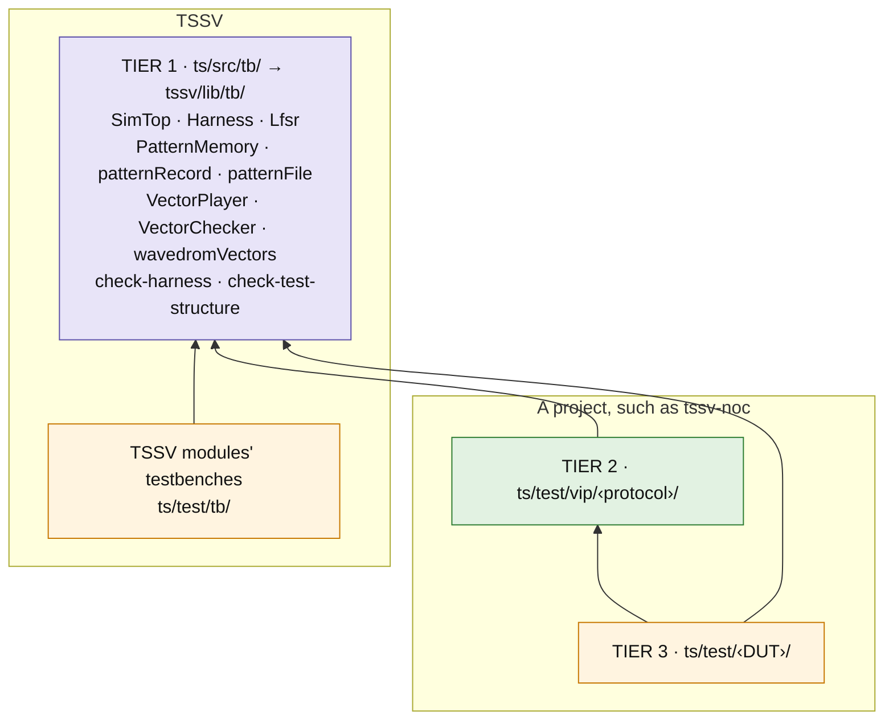
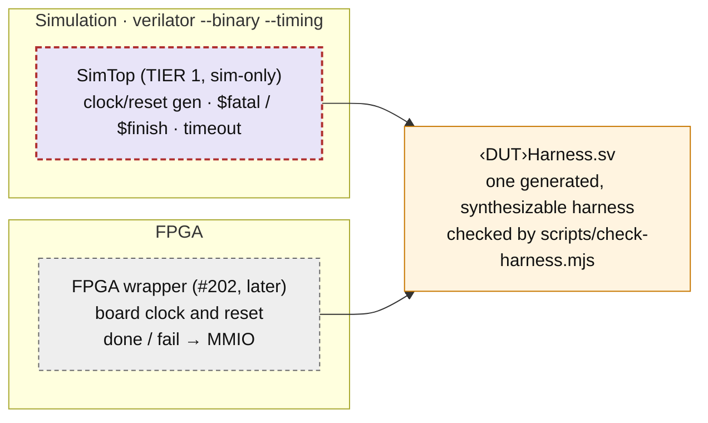

# Block testbench framework

> **Status:** tier 1 of the testbench framework (tssv-noc#207, TSSV#196), with pattern memories
> loaded from files (TSSV#197). Still to come: a generic injector, checker and scoreboard (#198),
> clocks and resets for several domains (#199), the TB generator and TB spec template (#200),
> the port-contract check (#201), and an FPGA wrapper (#202).
> **Code:** `ts/src/tb/`, imported as `tssv/lib/tb/<file>`
> **Checks:** `scripts/check-harness.mjs`, `scripts/check-test-structure.mjs`
> **Examples:** `ts/test/tb/`, run by `make -C verilatorTB tb_examples_sim` and
> `make -C verilatorTB pattern_memory_sim`
> **Pattern file format:** [pattern-files.md](pattern-files.md)

How a block testbench is put together, in TSSV or in a project built on it. The aim is a
testbench that a reviewer can read top to bottom, that an agent can follow without inventing a
new style, and whose harness could run on an FPGA unchanged.

---

## Two layers: a synthesizable harness under SimTop

Every testbench has the same two layers.

- **The harness** is synthesizable. It is built only from TSSV constructs: `addRegister`,
  `addAssign`, `addMux`, `addSubmodule`, interfaces. It instantiates the DUT, the components that
  drive it, and the checkers that watch it. The test's content, its stimulus and its expected
  values, is in pattern memories loaded from pattern files, not in the RTL. Its ports are always
  the same:
  - `clk` and `rst_b` (active low, asynchronous) in;
  - `done` and `fail`, one bit per check, out.
- **SimTop** is the simulation-only top, and the only raw SV in a testbench. One class,
  `SimTop` (`ts/src/tb/SimTop.ts`), wraps every harness. It does three things:
  - generates the clock and reset;
  - reports the result: a named FAIL line per failed check, or one PASS line;
  - enforces a cycle timeout.

**Diagram 1: the SFIFO example testbench.** It replays a timing diagram from the SFIFO spec
against the RTL (`ts/test/tb/SFIFOWaveHarness.ts`). The test writes the diagram's lanes to two
pattern files, which the player's and the checker's pattern memories load. Fill color is the tier,
grey is offline, and a red dashed border marks a sim-only block; everything else is synthesizable.
A block inside another is instantiated in it: SimTop instantiates the harness as `h`. Solid arrows
are ports; the dotted arrows are files, and a hierarchical read.

```mermaid
flowchart LR
  SPEC["SFIFO-spec.md<br/>dual-port timing diagram"]
  PAT["patterns/stimulus.hex<br/>patterns/expected.hex"]
  subgraph SIM["SimTop · TIER 1 · sim-only · the only raw SV in a testbench"]
    direction TB
    CRG["Clock / reset generator<br/>always #5 clk = ~clk · rst_b low 4 cycles"]
    REP["End-of-test reporter<br/>fail ≠ 0 → one named FAIL line per check → $fatal<br/>done → PASS → $finish · maxCycles → $fatal"]

    subgraph H["h: SFIFOWaveHarness · TIER 3 · wiring only<br/>extends Harness (TIER 1): ports clk, rst_b → done, fail[]"]
      direction LR
      PLAY["VectorPlayer · TIER 1<br/>input lanes, one row per cycle<br/>from its PatternMemory"]
      DUT(["SFIFO<br/>the DUT"])
      CHK["VectorChecker · TIER 1<br/>one check per output lane<br/>expected values from its PatternMemory<br/>first mismatch held in err_*"]
      FAIL["Harness.finish() · TIER 1<br/>fail = { fail_curr_depth, …, fail_pop_data }"]
    end
  end

  SPEC -. "sfifoWaveTable(), writePatternFile() at generation" .-> PAT
  PAT -. "$readmemh" .-> PLAY
  PAT -. "$readmemh" .-> CHK
  CRG -- "clk, rst_b" --> H
  PLAY -- "rst_n, push_en, pop_en, push_data" --> DUT
  PLAY -- "row, fetch, run" --> CHK
  DUT -- "pop_data, empty, full, curr_depth" --> CHK
  CHK -- "fail_‹lane›" --> FAIL
  FAIL -- "fail[]" --> REP
  PLAY -- "done" --> REP
  CHK -. "first-error record (hierarchical read)" .-> REP

  classDef t1 fill:#e8e4f8,stroke:#5b4fa8,color:#111
  classDef t1sim fill:#e8e4f8,stroke:#b03030,color:#111,stroke-width:2px,stroke-dasharray:5 3
  classDef dut fill:#dde8fa,stroke:#1f5fbf,color:#111
  classDef off fill:#eeeeee,stroke:#666666,color:#111
  class CRG,REP t1sim
  class PLAY,CHK,FAIL t1
  class DUT dut
  class SPEC,PAT off
  style SIM fill:#f6f4fd,stroke:#b03030,stroke-width:2px,stroke-dasharray:5 3,color:#111
  style H fill:#fff4e0,stroke:#c77700,color:#111
```



Lavender is tier 1 (`ts/src/tb/`), amber tier 3, and blue the DUT.

---

## Three tiers

What a piece of testbench code knows about decides where it lives. **A tier may depend only on
the tiers below it, and must not name anything above it.**

| Tier | Where | Knows about | Must not know about |
|---|---|---|---|
| 1 · Framework | TSSV's `ts/src/tb/`, imported as `tssv/lib/tb/<file>` | TSSV's core | any protocol, any DUT |
| 2 · Protocol package | a project's `ts/test/vip/<protocol>/` | tier 1, and one interface | any DUT |
| 3 · Per-DUT testbench | a project's `ts/test/<DUT>/` | tiers 1 and 2, and its one DUT | other DUTs |

- **A TSSV module's testbench uses tier 1 directly.** TSSV has no tier 2: its modules' ports
  are plain signals and AMBA interfaces. The examples are in `ts/test/tb/`.
- **Tier 3 is wiring only.** A harness instantiates, binds, and picks check parameters. If it
  needs logic of its own, that logic is something a protocol or the framework is missing: add
  it to tier 2 or 1 without naming the DUT.
- **New reusable code goes in the lowest tier that doesn't need to know more.** A random
  sequence is tier 1. A checker for one interface's protocol is tier 2. A DUT's latency is a
  tier-3 parameter.
- **`scripts/check-test-structure.mjs` enforces the rule** for tiers 1 and 2:
  - A tier-1 file may import only Node, `tssv/lib/core/`, `tssv/lib/tb/` and its own files.
  - A tier-2 file may also import `tssv/lib/interfaces/`, and the project's `ts/test/vip/`,
    `ts/src/interfaces/` and `ts/src/tools/`.
  - So neither can import a DUT: neither TSSV's (`tssv/lib/modules/`) nor the project's
    (`ts/src/modules/`).

**Diagram 2: the tiers across TSSV and a project.**



---

## Components

Tier 1, in `ts/src/tb/`:

| Component | Ports | Parameters | What it does |
|---|---|---|---|
| `SimTop` | none (top) | `name`, `harness`, `maxCycles`, `resetCycles` (4) | The sim-only top. Clock (period 10); `rst_b` low for `resetCycles` rising edges, released at a falling edge. It reads `fail`, then `done`, at every rising edge after reset |
| `Harness` | `clk`, `rst_b` → `done`, `fail[N-1:0]` | `name` | Base class of every harness. Its helpers:<br/>• `check(name, description, detail?)` adds a check and returns its fail net<br/>• `tap(path, width)` reads a DUT signal by hierarchical reference<br/>• `finish()` builds `fail` |
| `Lfsr` | `clk`, `rst_b`, `step` → `value` | `width` (32 or 64), `seed`, `outWidth` | A xorshift sequence that steps on `step`. Two Lfsrs with one seed produce the same values, which is how a source and its checker agree on what was sent |
| `PatternMemory` | `clk`, `rd_addr` → one output per field; reloaded only: `load_en`, `load_addr`, `load_data` in | `name`, `layout`, `depth`, `mode` (`preloaded` or `reloaded`), `file` (preloaded) | Holds a test's content, one record per word ([pattern-files.md](pattern-files.md)). The read is synchronous, the block-RAM form. Preloaded: one `initial $readmemh("<file>", mem);` loads the file at configuration, the one `initial` SYN-1 allows. Reloaded: a host writes each word through the load port, and there is no `$readmem` |
| `patternRecord` | (TypeScript) | | `recordFields(intf, names)` takes a record's fields from an interface; `recordLayout(fields, radix)` gives each its slot in a word, padded to whole hex digits for `$readmemh`; `packRecord()` and `unpackRecord()` |
| `patternFile` | (TypeScript) | | `writePatternFile()` writes a pattern file a person can read (header comment, a comment per object, `_` between fields), and `writeManifest()` the testcase's JSON manifest |
| `VectorPlayer` | `clk`, `rst_b` → `row`, `fetch`, `run`, `done`, one output per lane | `name`, `rows`, `lanes`, `file`, `radix` | Drives a table one row per cycle from a `PatternMemory` loaded with the table's pattern file. Every lane comes from the memory's read register, a flop, so a lane may drive a reset (SV guide RST-4). `done` rises after the last row. `layout()` and `records()` give a generator the file's layout and records. Timing: [below](#cycle-tables-and-their-timing) |
| `VectorChecker` | `clk`, `rst_b`, `row`, `fetch`, `run`, one input per lane → `fail_<lane>` | `name`, `rows`, `lanes`, `file`, `radix`, `firstRow` | Compares each lane with its row of a table of expected values, read from a `PatternMemory` at the player's `fetch`. A `care` bit per lane in each row marks the don't-cares. It latches the first mismatch per lane in `err_row_`, `err_got_` and `err_want_<lane>`; `firstError()` is the detail line that prints them |
| `wavedromVectors` | (TypeScript) | | Reads a spec's WaveDrom diagrams. `diagramLanes()` gives one diagram on one clock as values per cycle per lane, for a `VectorPlayer` and a `VectorChecker`. `diagramTasks()` gives every diagram with a prefix, on a fast and a slow clock, as SV tasks for a hand-written testbench |
| `testbench` | (TypeScript) | | `markTestbench(module)` marks a module as simulation-only, so the SYN-1 scan skips it. SimTop marks itself |

### Pattern memories

A test's stimulus and expected values are content, not structure, so they live in pattern files
([pattern-files.md](pattern-files.md)), not in the harness's RTL. A generator writes them
offline, in any language. Each `PatternMemory` in the harness holds one file, with its record
layout taken from an interface or from a table's lanes. A build picks one of two modes:

- **Preloaded:** the memory loads its file at configuration, with `initial $readmemh`, as FPGA
  block RAM can be. New content needs a new bitstream on an FPGA, but in simulation only the new
  files, because `$readmem` reads them at run time.
- **Reloaded:** one build per DUT configuration. A host writes new content through the memory's
  load port between testcases or batches (tssv-noc `NP_VIP_REQ_028`–`031` and `033`). The load
  port is built only in this mode. Carrying the load ports out of a harness to a host is the FPGA
  wrapper's job (#202). Until then, `tb_PatternMemory_reloaded` loads a memory in simulation.

### Cycle tables and their timing

`VectorPlayer` and `VectorChecker` read their tables from pattern memories. A memory's read is
synchronous, so a record appears one rising edge after its address. The player therefore fetches
one row ahead, and needs one priming cycle after reset:

- Through reset, every flop holds its reset value, so the tables' address is row 0's, and the
  memories' read registers already hold row 0 when reset is released. The address can't move to
  row 1 before the first rising edge after release. Using `rst_b` in the address would make it a
  data signal as well as a reset, which lint `-Wall` reports (SYNCASYNCNET).
- So `run` is low for one cycle after reset is released, the priming cycle, and `row` holds at 0
  through it. From the first rising edge after release, `run` is high. `row` then counts up by one
  per edge, and `fetch`, the row the memories read, is one ahead of it.
- Row 0 lasts two cycles: the priming cycle and the next one. A checker compares only while `run`
  is high. A DUT that should start at row 0 takes its reset from a table lane, as the SFIFO does,
  or steps on `run`, as the Lfsrs in `tb_Lfsr` do.

A table of four rows, records m0 to m3:

<!-- wavedrom table-timing.svg
{
  "signal": [
    {"name": "clk",   "wave": "p......."},
    {"name": "rst_b", "wave": "0.1....."},
    {"name": "run",   "wave": "0..1...."},
    {"name": "row",   "wave": "=...====", "data": ["0", "1", "2", "3", "4"]},
    {"name": "fetch", "wave": "=..===..", "data": ["0", "1", "2", "3"]},
    {"name": "done",  "wave": "0......1"},
    {"name": "lane",  "wave": "=...===.", "data": ["m0", "m1", "m2", "m3"]},
    {"name": "check", "wave": "0..1...0"}
  ]
}
-->


`check` is high in the cycles a checker compares. SimTop releases `rst_b` at a falling edge, half
a cycle before the priming cycle; the diagram draws it at the edge. `fetch` stops at the last row,
so every lane holds its last value from `done` on.

---

## Pass and fail

- **A check is one requirement and one fail bit.** Each `Harness.check()` call adds one bit to
  `fail`. The harness doesn't evaluate the check: a component it instantiates does, such as a
  VectorChecker comparing a DUT output with its expected value each cycle. That component sets
  the bit at the first violation and holds it.
- **A check has a name and a description.** SimTop prints both:
  `FAIL x64: a 64-bit Lfsr from seed 0x123456789abcdef gives xorshift64's low 64 bits`.
- **A check may have a detail line**, a `$display` format over signals inside the harness. A
  checker that latches its first error supplies one (`VectorChecker.firstError('chk', port)`):
  `first differs in cycle 1: 1e2b7e2ad5623bc2, expected 3f2800d6569e01b4`.
- **The order of the reads matters.** At every rising edge after reset, SimTop reads `fail`
  first, then `done`, then the cycle count. So a check that fails in the last cycle still fails
  the run.
- **The exit status is the result.** Failures end in `$fatal`, never `$finish(1)`, because
  Verilator discards the `$finish` argument. A testbench built with `verilator --binary` exits
  with status 1 on a failure and 0 on a pass.
- **Shared values come from shared seeds.** A source and its checker can agree on a sequence
  through a shared `Lfsr` seed rather than a channel between them. That's why the harness is the
  only thing that has to know both.

---

## The sim-only boundary

- **What is sim-only.** Clock generation, reset sequencing, `$display` and `$fatal`/`$finish`
  all live in SimTop, which is marked as a testbench (`markTestbench()`). Nothing else in a
  testbench may use `initial`, `#`, `force` or a system task. There is one exception: a
  `PatternMemory`'s preload, the single line `initial $readmemh("<file>", mem);`. FPGA tools
  build it as block RAM contents (SV guide SYN-1).
- **`scripts/check-harness.mjs` checks the boundary.** For each testbench it finds the harness
  (the one file the SimTop includes) and runs two checks on it:
  - `verilator --lint-only -Wall --no-timing`, which reports any delay or event control. Without
    `--no-timing`, lint accepts both;
  - the SV guide's SYN-1 scan, over every file the harness reaches.

  `doc/rtl-style/sv-style/harness_waivers.vlt` waives one warning: nothing in the harness reads
  the `err_*` first-error registers, because SimTop reads them from outside (SV guide,
  section 8).
- **Ready isolation is not a simulation check.** That an output doesn't depend combinationally
  on an input is a property of the structure, so the port-contract check (#201) checks it, not
  SimTop.
- **Taps.** A spec diagram can show a DUT's internal state. `Harness.tap('dut.valid_0', 1)` reads
  it by downward hierarchical reference. This synthesizes in Vivado as long as the path names a
  signal, not a member reached through an interface port.

**Diagram 3: the same harness in simulation and on an FPGA.**



---

## Running the checks

In TSSV:

```bash
npm run check:test-structure                      # tier 1 imports nothing above it
npm run check:harness -- sv-examples/tb/<tb>/<tb>.sv ...
make -C verilatorTB tb_examples_sim               # the examples: generate, check-harness, run
make -C verilatorTB pattern_memory_sim            # PatternMemory, preloaded and reloaded
```

In a project, through its link to TSSV, from the project's root:

```bash
node node_modules/tssv/scripts/check-test-structure.mjs .    # TSSV's tier 1 and the project's tier 2
node node_modules/tssv/scripts/check-harness.mjs sv-examples/<DUT>/<tb>/<tb>.sv ...
```

`check-harness` takes `--harness <harness.sv>...` to name harness files directly instead of
testbenches; given a SimTop that way, it fails, as it should. Both scripts exit 1 on a failure.

---

## Writing a block testbench

1. **The harness.** Create `<DUT>Harness.ts`, a `Harness` subclass: in a project, in
   `ts/test/<DUT>/`. Its header comment says:
   - what it verifies;
   - which spec section it verifies against;
   - a small block diagram of its wiring;
   - the list of checks.
2. **Its body is wiring.** It creates the interface instances and nets, then adds each submodule
   with explicit bindings. Pass `autoBind = false`: auto-binding would short two same-named
   `fail` outputs together. It binds each component's fail output to
   `this.check(name, description)`, and calls `this.finish()` last. It takes the paths of its
   pattern files as parameters, and holds only the shape of the content: which lanes or fields,
   and how many rows or records.
3. **The testcase.** A generator writes the pattern files and their manifest
   ([pattern-files.md](pattern-files.md)). In TypeScript it uses `writePatternFile()` and
   `writeManifest()`, with a table's `VectorPlayer.records()` and `VectorChecker.records()`. Put
   the files in `patterns/` beside the testbench's SV, and give the harness paths relative to
   that folder (`patterns/stimulus.hex`).
4. **The runner.** A test script wraps each harness in a `SimTop` and writes it with
   `writeSystemVerilogFiles()` to `sv-examples/<DUT>/<testbench>/`, on a path that starts at the
   repo's root (`` `${TSSV_ROOT}/sv-examples/...` `` in TSSV). Pick `maxCycles` well above the
   cycles the test needs: it is the only timeout.
5. **Build and run.** `verilator --binary --timing +define+USE_INCLUDES -I<dir> <dir>/<tb>.sv`
   builds a testbench. Run it from `<dir>`, where its pattern file paths lead; its exit status is
   the result. Run `check-harness` on it too. In TSSV, add it to `TB_EXAMPLES` in
   `verilatorTB/Makefile`.
6. **Show that each check can fail.** Break the DUT on purpose, one way per check, and record in
   the PR which testbench and check caught each break ([Evidence](#evidence-that-a-check-works)).

Expected values come from the spec, from a model of what the DUT is meant to do, or from a shared
seed, written into pattern files by a generator. Never derive them by re-implementing the
generator's expressions.

---

## What TS-side tests may check

A test that runs in Node without a simulator, for a module tested this way, uses `node:test` and
`node:assert`. It checks only what the TSSV object model or the module's TypeScript exposes:

- **Parameter validation:** `assert.throws` with the error message the spec promises.
- **Port and modport shape**, where the spec defines it (TSSV guide TEST-2).
- **Derived names and other TypeScript-visible results.**

**It never reads, regexes or string-matches the generated SV.** Behaviour is checked in
simulation, by a harness. People read the generated SV in the PR comments
(`doc/process/issue-workflow.md` §5), and no test parses it. TSSV's older tests, which read
emitted SV through `ts/test/models/emitted.ts`, predate this framework; moving them onto it is
separate work.

---

## Evidence that a check works

A testbench that passes proves nothing until each of its checks has been seen to fail. Before a
PR adds or changes a check, break the DUT once per check. For each break, record which
testbench caught it and on which check, then restore the DUT. The PR shows the table.

For the examples, each break below was made in the source and run against both testbenches. It
was run first on case tables (#196), and again on pattern memories (#197), with the same results.
Each was caught by exactly the check it targets, and the other testbench passed:

| Break | Caught by | On |
|---|---|---|
| SFIFO `full` one entry early (`fifo_cnt_q == depth - 1`) | `tb_SFIFOWave_dual_port` | `full`, cycle 5 |
| SFIFO `empty` never set | `tb_SFIFOWave_dual_port` | `empty`, cycle 0 |
| SFIFO `curr_depth` with bit 0 flipped | `tb_SFIFOWave_dual_port` | `curr_depth`, cycle 0 |
| SFIFO `bypass_q` never loaded | `tb_SFIFOWave_dual_port` | `pop_data`, cycle 3 |
| `Lfsr` xorshift32 triple (13, 17, 6) | `tb_Lfsr` | `x32_8`, cycle 1 |
| `Lfsr` xorshift64 triple (13, 8, 17) | `tb_Lfsr` | `x64`, cycle 1 |

A failure reads, for example:

```text
FAIL x64: a 64-bit Lfsr from seed 0x123456789abcdef gives xorshift64's low 64 bits
  first differs in cycle 1: 1e2b7e2ad5623bc2, expected 3f2800d6569e01b4
[75] %Fatal: tb_Lfsr.sv:47: Assertion failed in tb_Lfsr: tb_Lfsr failed in cycle 3
```

The detail line counts the table's rows, and the last line counts SimTop's cycles after reset,
which include the priming cycle.

The tables themselves were checked the same way, by editing a pattern file and running the
testbench again. `$readmemh` reads the file at run time, so this needs no rebuild:

| Change to a pattern file | Result |
|---|---|
| `expected.hex`: `pop_data` 43 → 4f in row 9 | `pop_data` fails, cycle 9 |
| `stimulus.hex`: the second push 42 → 52 | `pop_data` fails, cycle 8 |
| `expected.hex`: row 0's `pop_data` ff, with its care bit 0 | passes: not checked |
| `expected.hex`: row 0's `pop_data` ff, with its care bit 1 | `pop_data` fails, cycle 0 |
| `expect_x32_8.hex`: the last row changed | `x32_8` fails, cycle 63 |

---

## The examples: `ts/test/tb/`

| File | What it is |
|---|---|
| `SFIFOWaveHarness.ts` | Replays the SFIFO spec's dual-port timing diagram: `sfifoWaveTable()` reads it with `diagramLanes()`, a `VectorPlayer` drives the four input lanes, and a `VectorChecker` checks the four output lanes, one check each, from the two pattern files written from the diagram |
| `LfsrHarness.ts` | Two `Lfsr`s, 64 bits and 32 bits with an 8-bit output, each stepping on the player's `run`, checked by a `VectorChecker` against a TypeScript model of Marsaglia's xorshift for 64 cycles, written to a pattern file per Lfsr |
| `test_tbExamples.ts` | The generator and runner: writes each testcase's pattern files and manifest to `patterns/`, wraps each harness in a `SimTop`, and writes `tb_SFIFOWave_dual_port` and `tb_Lfsr` to `sv-examples/tb/` |
| `test_PatternMemory.ts` | `PatternMemory` in both modes, with the lead's burst_mix pattern file: `tb_PatternMemory_preloaded` reads the memory back after it loads the file itself, and in `tb_PatternMemory_reloaded` the testbench loads it through the load port, twice. Run by `make -C verilatorTB pattern_memory_sim` |
| `test_patternFile.ts` | The record layouts and the pattern file writer, against the format in [pattern-files.md](pattern-files.md), including the lead's example byte for byte |
