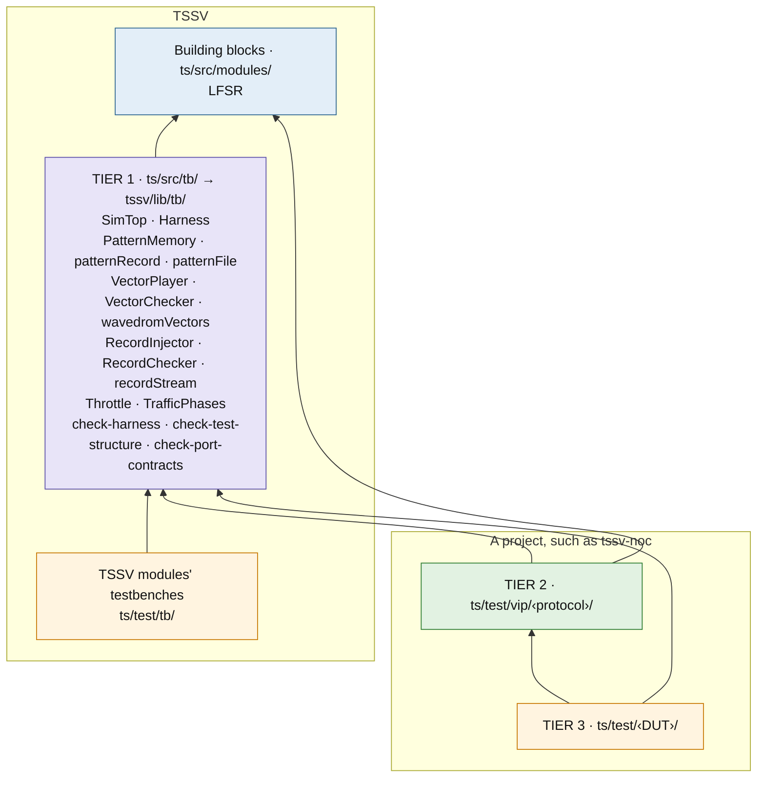
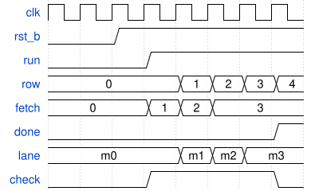
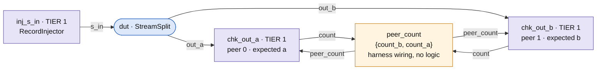
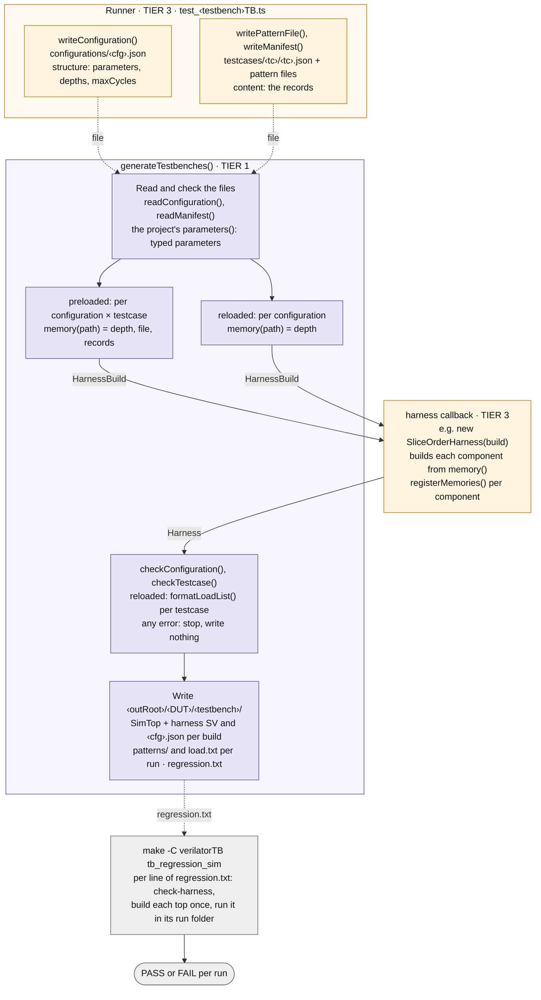
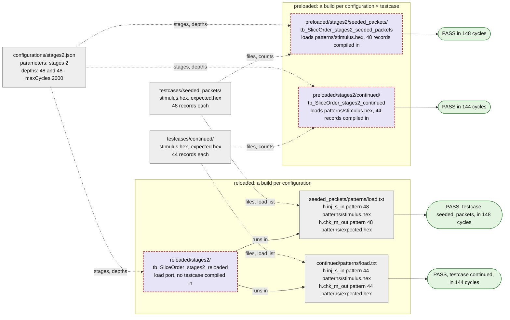
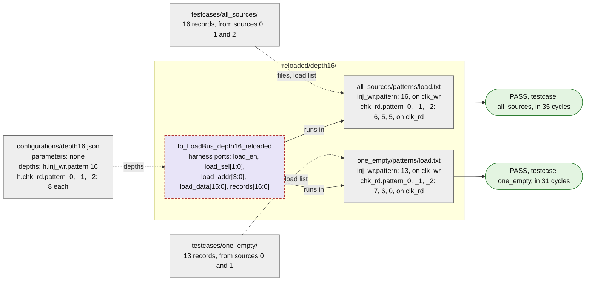
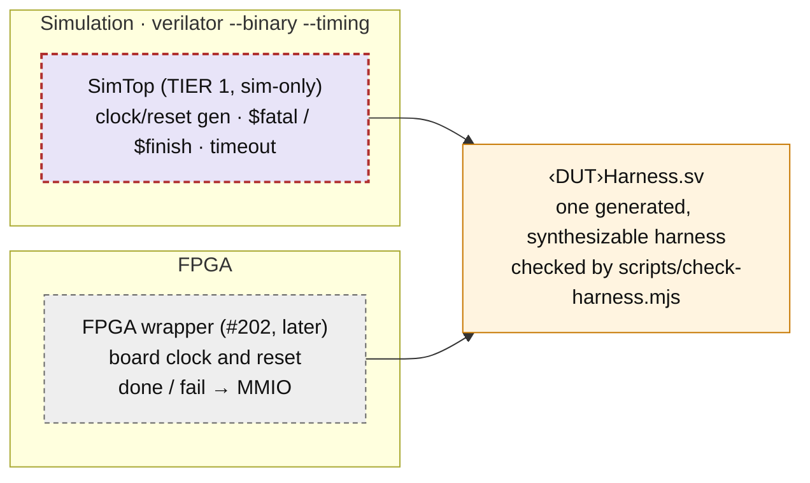

# Block testbench framework

> **Status:** tier 1 of the testbench framework (tssv-noc#207, TSSV#196), with pattern memories
> loaded from files (TSSV#197), a generic injector, checker and scoreboard for valid/ready record
> streams (TSSV#198), clocks and resets for several domains (TSSV#199), the port-contract
> check that takes over ready isolation (TSSV#201), and the testbench generator, with DUT
> configuration files, reloaded mode in simulation and the TB spec template (TSSV#200). Still to
> come: an FPGA wrapper (#202).
> **Code:** `ts/src/tb/`, imported as `tssv/lib/tb/<file>`
> **Checks:** `scripts/check-harness.mjs`, `scripts/check-test-structure.mjs`, and, for the DUT,
> `scripts/check-port-contracts.mjs`
> **Examples:** `ts/test/tb/`, run by `make -C verilatorTB tb_examples_sim`,
> `make -C verilatorTB tb_regression_sim` (the generated ones) and
> `make -C verilatorTB pattern_memory_sim`
> **Pattern file format:** [pattern-files.md](pattern-files.md)
> **TB spec template:** [doc/templates/tb-spec-template.md](../templates/tb-spec-template.md)

How a block testbench is put together, in TSSV or in a project built on it. The aim is a
testbench that a reviewer can read top to bottom, that an agent can follow without inventing a
new style, and whose harness could run on an FPGA unchanged.

---

## Two layers: a synthesizable harness under SimTop

Every testbench has the same two layers.

- **The harness** is synthesizable. It is built only from TSSV constructs: `addRegister`,
  `addAssign`, `addMux`, `addSubmodule`, interfaces. It instantiates the DUT, the components that
  drive it, and the checkers that watch it. The test's content, its stimulus and its expected
  values, is in pattern memories loaded from pattern files, not in the RTL. Its ports are always
  the same:
  - `clk` and `rst_b` (active low, asynchronous) in, or `clk_<d>` and `rst_b_<d>` for each
    domain of a harness with [clock domains](#clock-domains);
  - `done` and `fail`, one bit per check, out.
- **SimTop** is the simulation-only top, and the only raw SV in a testbench. One class,
  `SimTop` (`ts/src/tb/SimTop.ts`), wraps every harness. It does three things:
  - generates the clock and reset, or a clock and a reset per domain;
  - reports the result: a named FAIL line per failed check, or one PASS line;
  - enforces a cycle timeout.

**Diagram 1: the SFIFO example testbench.** It replays a timing diagram from the SFIFO spec
against the RTL (`ts/test/tb/SFIFOWaveHarness.ts`). The test writes the diagram's lanes to two
pattern files, which the player's and the checker's pattern memories load. Fill color is the tier,
grey is offline, and a red dashed border marks a sim-only block; everything else is synthesizable.
A block inside another is instantiated in it: SimTop instantiates the harness as `h`. Solid arrows
are ports; the dotted arrows are files, and a hierarchical read.


Lavender is tier 1 (`ts/src/tb/`), amber tier 3, and blue the DUT.

---

## Three tiers

What a piece of testbench code knows about decides where it lives. **A tier may depend only on
the tiers below it, and must not name anything above it.**

| Tier | Where | Knows about | Must not know about |
|---|---|---|---|
| 1 · Framework | TSSV's `ts/src/tb/`, imported as `tssv/lib/tb/<file>` | TSSV's core | any protocol, any DUT |
| 2 · Protocol package | a project's `ts/test/vip/<protocol>/` | tier 1, and one interface | any DUT |
| 3 · Per-DUT testbench | a project's `ts/test/<DUT>/` | tiers 1 and 2, and its one DUT | other DUTs |

- **A TSSV module's testbench uses tier 1 directly.** TSSV has no tier 2: its modules' ports
  are plain signals and AMBA interfaces. The examples are in `ts/test/tb/`.
- **Tier 3 is wiring only.** A harness instantiates, binds, and picks check parameters. If it
  needs logic of its own, that logic is something a protocol or the framework is missing: add
  it to tier 2 or 1 without naming the DUT.
- **New reusable code goes in the lowest tier that doesn't need to know more.** A random
  sequence is tier 1. A checker for one interface's protocol is tier 2. A DUT's latency is a
  tier-3 parameter.
- **`scripts/check-test-structure.mjs` enforces the rule** for tiers 1 and 2:
  - A tier-1 file may import only Node, `tssv/lib/core/`, `tssv/lib/tb/`, the building blocks
    below, and its own files.
  - A tier-2 file may also import `tssv/lib/interfaces/`, and the project's `ts/test/vip/`,
    `ts/src/interfaces/` and `ts/src/tools/`.
  - So neither can import a DUT: neither TSSV's (`tssv/lib/modules/`) nor the project's
    (`ts/src/modules/`).
  - **Building blocks** are the exception: TSSV design modules that a generic testbench
    component uses as a part, not as a DUT. Both tiers may import one as
    `tssv/lib/modules/<block>`, and tier 1 may reach it relatively, in `ts/src/modules/<block>/`.
    The list is the script's `BUILDING_BLOCKS`, and today it is just
    [`LFSR`](../modules/LFSR/LFSR-spec.md), which `Throttle` and the record streams use. A module
    joins only when a tier-1 or tier-2 component needs it, and it must import nothing those
    tiers may not. `ts/test/tb/test_checkTestStructure.ts` shows the script passing a building
    block and failing any other module, in each tier.

**Diagram 2: the tiers across TSSV and a project.**



---

## Components

Tier 1, in `ts/src/tb/`:

| Component | Ports | Parameters | What it does |
|---|---|---|---|
| `SimTop` | none (top) | `name`, `harness`, `maxCycles`, `resetCycles` (4), `loadList` (reloaded: `patterns/load.txt`) | The sim-only top. Clock (period 10); `rst_b` low for `resetCycles` rising edges, released at a falling edge. It reads `fail`, then `done`, at every rising edge after reset. With [clock domains](#clock-domains), it generates a clock and a reset for each domain. Each reset is released the same way, on its own clock, and a domain with `releaseAfter` is released after the domain it names. It reads `fail`, then `done`, at the report domain's rising edges, and counts `maxCycles` in that domain's cycles. For a reloaded harness, its loader loads every memory from the load list before any reset is released ([SimTop's loader](#simtops-loader)); `formatLoadList()` writes the list |
| `Harness` | `clk`, `rst_b` → `done`, `fail[N-1:0]`; with domains, `clk_<d>`, `rst_b_<d>` per domain in place of `clk`, `rst_b`; reloaded: `load_en`, `load_sel`, `load_addr`, `load_data`, `records` in | `name`, `domains` (`name`, `period`, `phase`, `releaseAfter`), `reportDomain` | Base class of every harness. Its helpers:<br/>• `check(name, description, detail?)` adds a check and returns its fail net<br/>• `tap(path, width)` reads a DUT signal by hierarchical reference<br/>• `registerMemories(instance, component, { domain })` records a component's pattern memories, and in reloaded mode returns its load bindings ([The load port](#the-load-port))<br/>• `finish()` builds `fail`, and in reloaded mode the load port |
| `PatternMemory` | `clk`, `rd_addr` → one output per field; reloaded only: `load_en`, `load_addr`, `load_data` in | `name`, `layout`, `depth`, `mode` (`preloaded` or `reloaded`), `file` (preloaded) | Holds a test's content, one record per word ([pattern-files.md](pattern-files.md)). The read is synchronous, the block-RAM form. Preloaded: one `initial $readmemh("<file>", mem);` loads the file at configuration, the one `initial` SYN-1 allows. Reloaded: a host writes each word through the load port, and there is no `$readmem` |
| `patternRecord` | (TypeScript) | | `recordFields(intf, names)` takes a record's fields from an interface; `recordLayout(fields, radix)` gives each its slot in a word, padded to whole hex digits for `$readmemh`; `packRecord()` and `unpackRecord()` |
| `patternFile` | (TypeScript) | | `writePatternFile()` writes a pattern file a person can read (header comment, a comment per object, `_` between fields), and `writeManifest()` the testcase's JSON manifest. `readManifest()` reads a manifest back and checks it, and `readPatternWords()` reads a file's records as `$readmem` does |
| `testbenchConfiguration` | (TypeScript) | | A DUT configuration file: `readConfiguration()`, `parseConfiguration()` and `writeConfiguration()`, checked against its schema ([The configuration file](#the-configuration-file)) |
| `testbenchGenerator` | (TypeScript) | | `generateTestbenches()` builds the project's harness under a SimTop for every configuration and testcase in each mode, checks them, and writes them with a regression index ([Configurations, testcases and the generator](#configurations-testcases-and-the-generator)) |
| `VectorPlayer` | `clk`, `rst_b` → `row`, `fetch`, `run`, `done`, one output per lane | `name`, `rows`, `lanes`, `file`, `radix` | Drives a table one row per cycle from a `PatternMemory` loaded with the table's pattern file. Every lane comes from the memory's read register, a flop, so a lane may drive a reset (SV guide RST-4). `done` rises after the last row. `layout()` and `records()` give a generator the file's layout and records. Timing: [below](#cycle-tables-and-their-timing) |
| `VectorChecker` | `clk`, `rst_b`, `row`, `fetch`, `run`, one input per lane → `fail_<lane>` | `name`, `rows`, `lanes`, `file`, `radix`, `firstRow` | Compares each lane with its row of a table of expected values, read from a `PatternMemory` at the player's `fetch`. A `care` bit per lane in each row marks the don't-cares. It latches the first mismatch per lane in `err_row_`, `err_got_` and `err_want_<lane>`; `firstError()` is the detail line that prints them |
| `wavedromVectors` | (TypeScript) | | Reads a spec's WaveDrom diagrams. `diagramLanes()` gives one diagram on one clock as values per cycle per lane, for a `VectorPlayer` and a `VectorChecker`. `diagramTasks()` gives every diagram with a prefix, on a fast and a slow clock, as SV tasks for a hand-written testbench |
| `testbench` | (TypeScript) | | `markTestbench(module)` marks a module as simulation-only, so the SYN-1 scan skips it. SimTop marks itself |
| `RecordInjector` | `clk`, `rst_b`, `ready` → `valid`, one output per field, `done`; options add `valid_rate`, `limit`, and in reloaded mode the load port and `records` | `name`, `fields`, `depth`, `memory`, `file`, `radix`, `records`, `lfsr`, `throttle`, `limitWidth` | Drives a valid/ready stream of records from one pattern memory, `pattern`, in order, each until it is accepted ([Record streams](#record-streams)) |
| `RecordChecker` | `clk`, `rst_b`, `valid`, one input per field → `ready`, `fail`, `drained`; options add `ready_rate`, `limit`, the load port, and for a tie `peer_count` in, `fail_after` and `count` out | `name`, `mode`, `fields`, `depth`, `memory`, `file`/`files`, `records`, `sourceField`, `sources`, `lfsr`, `throttle`, `limitWidth`, `tie`; cycleExact: `rows`, `readyFile`, `file` | Checks a valid/ready stream against expected records, as a scoreboard: `inOrder`, `perSource` or `cycleExact` ([Record streams](#record-streams)). `firstError()`, `firstAfterError()` and `firstCycleError()` are its detail lines |
| `recordStream` | (TypeScript) | | What an injector and a checker share, for generators: `injectorLayout()` and `checkerLayout()`, the record layout of an injector's or a checker's pattern file, given the stream's fields and its options; `lfsrPayloads()`, the model of LFSR payloads; and `mixSeed()` |
| `LFSR` (building block, `ts/src/modules/LFSR/`) | `clk`, `rst_n`, `step` → `value`; loadable: `load`, `seed_in` in | `width`, `polynomial` (default `MAXIMAL_LENGTH[width]`), `seed`, `advance`, `outWidth`, `loadable` | A linear-feedback shift register, a design module that tier 1 uses as a part ([LFSR spec](../modules/LFSR/LFSR-spec.md)). Two LFSRs with one seed produce the same values, which is how a source and its checker agree on what was sent. `LFSRModel` predicts them, for generators and tests. A loadable LFSR restarts at `seed_in` while `load` is high, showing it on `value` in that cycle |
| `Throttle` | `clk`, `rst_b`, `rate` → `allow` | `seed` | Allows a cycle with a chance of `rate` in 256. `drawSeed(seed, salt)` gives its seed from a stream's |
| `TrafficPhases` | `clk`, `rst_b`, `drained` → `valid_rate`, `ready_rate`, `limit`, `done`, `stuck`; `full_rate` when a phase sets `fullRate` | `phases` (`STANDARD_PHASES`), `recordsPerPhase`, `timeout`, `quietCycles` (16) | Steps a harness's injectors and checkers through phases of valid and ready rates, a phase's records at a time. `stuck` rises if a phase doesn't drain within `timeout` cycles; `stuckDetail()` is its detail line |

### Pattern memories

A test's stimulus and expected values are content, not structure, so they live in pattern files
([pattern-files.md](pattern-files.md)), not in the harness's RTL. A generator writes them
offline, in any language. Each `PatternMemory` in the harness holds one file, with its record
layout taken from an interface or from a table's lanes. A build picks one of two modes:

- **Preloaded:** the memory loads its file at configuration, with `initial $readmemh`, as FPGA
  block RAM can be. New content needs a new bitstream on an FPGA. In simulation `$readmem` reads
  the files at run time, but an injector's or checker's record count is compiled in, so the
  generator builds one testbench per configuration and testcase.
- **Reloaded:** one build per DUT configuration. A host writes new content through the memory's
  load port between testcases or batches (tssv-noc `NP_VIP_REQ_028`–`031` and `033`). The load
  port is built only in this mode. The harness gathers its memories' load ports into one
  ([The load port](#the-load-port)), which SimTop's loader drives in simulation and the FPGA
  wrapper (#202) will carry to a host.

### Cycle tables and their timing

`VectorPlayer` and `VectorChecker` read their tables from pattern memories. A memory's read is
synchronous, so a record appears one rising edge after its address. The player therefore fetches
one row ahead, and needs one priming cycle after reset:

- Through reset, every flop holds its reset value, so the tables' address is row 0's, and the
  memories' read registers already hold row 0 when reset is released. The address can't move to
  row 1 before the first rising edge after release. Using `rst_b` in the address would make it a
  data signal as well as a reset, which lint `-Wall` reports (SYNCASYNCNET).
- So `run` is low for one cycle after reset is released, the priming cycle, and `row` holds at 0
  through it. From the first rising edge after release, `run` is high. `row` then counts up by one
  per edge, and `fetch`, the row the memories read, is one ahead of it.
- Row 0 lasts two cycles: the priming cycle and the next one. A checker compares only while `run`
  is high. A DUT that should start at row 0 takes its reset from a table lane, as the SFIFO does,
  or steps on `run`, as the LFSRs in `tb_LFSR` do.

A table of four rows, records m0 to m3:

<!-- wavedrom table-timing.svg
{
  "signal": [
    {"name": "clk",   "wave": "p......."},
    {"name": "rst_b", "wave": "0.1....."},
    {"name": "run",   "wave": "0..1...."},
    {"name": "row",   "wave": "=...====", "data": ["0", "1", "2", "3", "4"]},
    {"name": "fetch", "wave": "=..===..", "data": ["0", "1", "2", "3"]},
    {"name": "done",  "wave": "0......1"},
    {"name": "lane",  "wave": "=...===.", "data": ["m0", "m1", "m2", "m3"]},
    {"name": "check", "wave": "0..1...0"}
  ]
}
-->



`check` is high in the cycles a checker compares. SimTop releases `rst_b` at a falling edge, half
a cycle before the priming cycle; the diagram draws it at the edge. `fetch` stops at the last row,
so every lane holds its last value from `done` on.

---

## Record streams

Most DUT ports are valid/ready streams. Tier 1 drives and checks one with a `RecordInjector` and
a `RecordChecker`, each holding its records in pattern memories. A protocol package (tier 2)
adds only what its protocol needs beyond that, such as FlitStream's packet framing. The
examples are the three `tb_RecordStream_*` testbenches and SliceOrder, which the generator
builds ([below](#the-examples-tstesttb)).

### Names

A protocol package and a TB spec use these names, so that a protocol's injector reads as
"generic injector plus framing":

| Thing | Name |
|---|---|
| A record | One value per field, as in [pattern-files.md](pattern-files.md). A record leaves out `valid` and `ready` |
| A stream's ports, on an injector or checker | `valid`, `ready`, and one port per field, named after the field |
| The injector of a DUT input `<port>` | instance `inj_<port>`; its memory `inj_<port>.pattern` |
| The checker of a DUT output `<port>` | instance `chk_<port>`; its memory `chk_<port>.pattern`, or `chk_<port>.pattern_<k>` for source k, or `chk_<port>.play.pattern` and `chk_<port>.chk.pattern` in cycleExact mode |
| A checker's checks | `order` for `fail` (with a suffix per output when there are several), `after` for `fail_after`, `progress` for TrafficPhases' `stuck` |
| A manifest's memory paths | the instance paths above, under `h.`: `h.inj_s_in.pattern`, `h.chk_m_out.pattern_1` |

The tier-1 components have plain ports, not interfaces. A tier-2 or tier-3 harness binds a
field's port to an interface signal (`s_in.data`), or packs several fields into one
(`{src, payload}`), so tier 1 needs no stream interface of its own.

### The injector

`RecordInjector` holds one pattern memory, `pattern`, and offers its records in order. It holds
each one, `valid` high and the fields steady, until a cycle with `ready` high accepts it.

- **No priming cycle.** The memory reads the next record as soon as one is accepted, so a
  record is at the fields when `valid` rises, and the stream can carry a record every cycle.
  Through reset the memory reads record 0, which is at the fields when reset is released.
- **`valid` comes from a flop**, and so do the stored fields (the memory's read registers).
  `ready` reaches only flops, so a DUT may compute `ready` from `valid`.
- **`done`** rises when every record has been accepted: the preloaded `records`, or in reloaded
  mode the `records` input.
- **Options:** `throttle` offers at random ([Throttling](#throttling)); `limitWidth` adds
  `limit`, a cap on the records sent so far, for TrafficPhases; `lfsr` fills payload fields from
  seeds ([LFSR payloads](#lfsr-payloads)).
- **Reloaded mode** adds the memory's load port and `records`. Load while `rst_b` is low, as
  SimTop's loader does ([SimTop's loader](#simtops-loader)).

### The checker

`RecordChecker` takes a record in each cycle with `valid` and `ready` high, and compares it with
what it expects. Its `mode` says what it requires:

| Mode | Memories | Requires |
|---|---|---|
| `inOrder` | one, `pattern` | Every expected record arrives once, in order, unchanged |
| `perSource` | one per source, `pattern_<k>` | The same within each source, the source being the value of `sourceField`. The order across sources isn't checked (tssv-noc `NP_VIP_REQ_036`). Each source's file leaves out the source field |
| `cycleExact` | two, one row per cycle: `play.pattern`, loaded from the ready file, and `chk.pattern`, loaded from the expected file | In cycle r, the checker drives `ready` from row r of the ready file, and `valid` and the record must equal row r of the expected file ([Cycle tables](#cycle-tables-and-their-timing)) |

In `inOrder` and `perSource` modes:

- **`fail`** rises at the first record that differs from the next one expected of its source,
  comes from an unknown source, or arrives after its source's last expected record. It stays
  high. `err_index`, `err_source` (perSource), `err_got` and `err_want` hold that record: its
  number within its source (the source's record count for a record after the last), and the
  record's fields but the source, in order, as one value. `firstError()` prints them:
  `source 0, record 8: got 12e7a, expected 0d615`.
- **A record that never arrives** keeps `drained` low, so the testbench never ends, and SimTop's
  timeout, or TrafficPhases' `progress`, fails it.
- **`drained`** rises once the records delivered reach the records expected, or `limit` if that is
  fewer.
- **`ready`** is always high, or with `throttle`, high at random, from a flop.
- **Reloaded mode** adds the load port and `records`, with one count per source, source 0's in
  the low bits. With several sources, `load_src` picks the memory a word goes to.

In `cycleExact` mode, the checker reads two files, one row per cycle: the ready file
(`readyFile`), which says in each cycle whether it is ready, and the expected file (`file`),
which gives `valid` and the record it expects in each cycle. A VectorPlayer, `play`, drives
`ready` from the ready file. A VectorChecker, `chk`, compares two lanes with the expected file:
`valid`, and the record, its fields in order as one value. Where the expected file has `valid`
low, the record is a don't-care. The checker reports per lane, `fail_valid` and `fail_record`
(`firstCycleError()`), and `done` rises after the last row. `RecordChecker.cycleRecords()` writes
both files from a list of rows, each with `ready` and the record expected, if any.

### LFSR payloads

With `lfsr`, a record stores a seed in place of its payload fields, and an
[`LFSR`](../modules/LFSR/LFSR-spec.md) fills them in. The injector and its checker are given the
same `lfsr`, so the checker regenerates what the injector sent, and no payload is stored on either
side.

**An example.** A stream's records are `last` (1 bit) and `data` (32 bits), and a 32-bit LFSR
fills `data`. The harness gives the injector and the checker the same fields and `lfsr`:

```ts
const fields = [{ name: 'last', width: 1 }, { name: 'data', width: 32 }]
const lfsr: RecordLfsr = { fields: ['data'], width: 32, seed: 1n }  // seed: the LFSR's state after reset
new RecordInjector({ name: 'inj', fields, lfsr, depth: 8, memory: 'preloaded', file: 'patterns/stimulus.hex', records: 5 })
new RecordChecker({ name: 'chk', mode: 'inOrder', fields, lfsr, depth: 8, memory: 'preloaded', file: 'patterns/expected.hex', records: 5 })
```

So their memories hold `last` and a 32-bit `seed`, not `last` and `data`. The generator writes
its records with those fields: a seed in the first record of each packet, and 0 in the rest.
`injectorLayout(fields, { lfsr })`, from `recordStream.ts`, is the layout that goes with them:

```ts
const packets = [
  { records: [{ last: 0n, seed: mixSeed(0n, 32) }, { last: 0n, seed: 0n }, { last: 1n, seed: 0n }] },
  { records: [{ last: 0n, seed: mixSeed(1n, 32) }, { last: 1n, seed: 0n }] }
]
writePatternFile('patterns/stimulus.hex', injectorLayout(fields, { lfsr }), {
  dut: 'MyDut', testcase: 'two_packets', purpose: 'stimulus for s_in', recordNoun: 'record', objectNoun: 'packet', objects: packets
})
```

```text
// MyDut, testcase two_packets: stimulus for s_in
// $readmemh, one record per line: last _ seed[31:16] _ seed[15:0]
//   last: 1 bit, one hex digit; seed: 32 bits
// 5 records in 2 packets
// packet 0: 3 records
0_7b1d_cdaf
0_0000_0000
1_0000_0000
// packet 1: 2 records
0_8902_5cc1
1_0000_0000
```

The injector sends these records:

| Record | `seed` in the file | `data` sent | Why |
|---|---|---|---|
| 0 | `7b1dcdaf` | `7b1dcdaf` | a seed: the LFSR restarts there, and shows it |
| 1 | 0 | `66e29b46` | 0: the LFSR steps on from `7b1dcdaf`, 32 shifts |
| 2 | 0 | `50d2036a` | 0: it steps on again |
| 3 | `89025cc1` | `89025cc1` | packet 1's seed: the LFSR restarts there |
| 4 | 0 | `6df71728` | 0: it steps on from `89025cc1` |

The DUT here passes records through unchanged, so the checker's expected file holds the same
records. Its layout, `checkerLayout(fields, { lfsr })`, is the same as the injector's here; it
differs only for a perSource checker, whose files leave out the source field, or a tied one,
whose records add the tie's fields. The checker's LFSR regenerates the `data` column from the
same seeds, and compares it with what arrives.

The rules:

- **A non-zero seed restarts the LFSR at that seed, and a seed of 0 continues** from the previous
  record. A stream whose first record has seed 0 starts from `lfsr.seed`. A stream seeded once
  in its first record is the shared-seed scheme of tssv-noc's spike (`FlitStreamSource`); a seed
  in each packet's first record, as above, is the per-packet scheme of tssv-noc's
  `doc/ideas/fpga-harness-sequence-memory.md`.
- **`seed` is as wide as the LFSR**, and goes where the first payload field was. The payload
  fields are at most the LFSR's width together: `lfsr.width`, 2 to 168 bits, default 64. They
  take the low bits of the LFSR's value, the first field the highest of them.
- **The LFSR** has `lfsr.width` bits and `lfsr.polynomial`, by default the library's for the width
  (`MAXIMAL_LENGTH`). For `bits` bits of payload, it steps `bits` shifts rounded up to a power of
  2 per record (`payloadLfsr()`), so two records' payloads share no bits and the sequence keeps
  its full period ([LFSR spec](../modules/LFSR/LFSR-spec.md#the-advance)).
- **`lfsrPayloads(lfsr, bits, seeds)`** gives a generator the payloads, the table's `data`
  column, for an expected file that needs the values themselves, such as a cycleExact checker's.
- **Mix small seeds.** An LFSR shifts a state with few bits set into others with few bits set, so
  seeds 1, 2, 3 would give sparse, alike payloads. `mixSeed(n, width)` turns a packet number into
  a dense, non-zero seed (splitmix64), as `mixSeed(0n, 32)` gives `7b1dcdaf` above.

### Ties: order across outputs

A checker checks the order of the records on its own output, but it can't see the other outputs.
Some DUTs also promise an order across outputs, such as a split that keeps its input order, or a
response that leaves after the request it answers. Tying the checkers on those outputs checks
that order too.

**The rule.** The tied checkers are numbered: peer 0, peer 1, and so on. Each record in a tied
checker's expected file has two more fields, `after_peer` and `after_count`, which say: "this
record mustn't arrive until peer `after_peer` has received `after_count` records".

**How the checkers check it.** Each is given `tie: { peers, countWidth }`, the number of tied
checkers and the width of a count.

- Each tied checker counts the records it has received, `count`, in a flop.
- `RecordChecker.peerCounts()` adds a net to the harness with every tied checker's `count`, peer
  0's in the low bits. Each tied checker reads it as `peer_count`.
- When a record arrives, its checker compares its peer's count with its `after_count`. The count
  comes from a flop, so it holds only the records received in earlier cycles. So a record that
  arrives in the same cycle as one it must follow fails. An `after_count` of 0 always passes.
- A record that arrives too early raises `fail_after`, a check apart from `fail`. `err_after_*`
  hold the first one, and `firstAfterError()` prints it.

**An example.** `tb_RecordStream_tied` ties the two outputs of a split. The split promises that a
record leaves only after every earlier record has left, on either output:



The injector sends four records, r0 to r3. The split sends r0 and r3 to `out_a`, and r1 and r2
to `out_b`. The generator knows this, so it gives each record the other output's checker as
`after_peer`. Its `after_count` is the number of earlier records that went to that output:

| Record | Goes to | Earlier records sent to the other output | `after_peer` | `after_count` |
|---|---|---|---|---|
| r0 | `out_a` | none | 1 (`chk_out_b`) | 0 |
| r1 | `out_b` | r0 | 0 (`chk_out_a`) | 1 |
| r2 | `out_b` | r0 | 0 (`chk_out_a`) | 1 |
| r3 | `out_a` | r1, r2 | 1 (`chk_out_b`) | 2 |

`chk_out_a`'s expected file holds r0 and r3, as its records 0 and 1. `chk_out_b`'s holds r1 and
r2. A record's tie counts only the other output, because `order` already checks the order within
its own: r2 after r1, for example. `splitExpected()` in `RecordStreamHarness.ts` writes the files.

In the cycles below, the injector offers a record every cycle, and both checkers are always
ready. `count_a` and `count_b` are the checkers' counts during the cycle: the records they
received in earlier cycles.

**The split keeps its order, and the test passes.** Each record leaves in the cycle it is sent:

| Cycle | Arrives on `out_a` | Arrives on `out_b` | `count_a` | `count_b` | The check |
|---|---|---|---|---|---|
| 1 | r0 | | 0 | 0 | r0 needs `count_b` ≥ 0: yes |
| 2 | | r1 | 1 | 0 | r1 needs `count_a` ≥ 1: yes |
| 3 | | r2 | 1 | 1 | r2 needs `count_a` ≥ 1: yes |
| 4 | r3 | | 1 | 2 | r3 needs `count_b` ≥ 2: yes |

**A 2-stage buffer on `out_b`, and the test fails.** r1 and r2 each spend two cycles in the
buffer, so r3 reaches `out_a` before r2 reaches `out_b`:

| Cycle | Arrives on `out_a` | Arrives on `out_b` | `count_a` | `count_b` | The check |
|---|---|---|---|---|---|
| 1 | r0 | | 0 | 0 | r0 needs `count_b` ≥ 0: yes |
| 2 | | | 1 | 0 | |
| 3 | | | 1 | 0 | |
| 4 | r3 | r1 | 1 | 0 | r3 needs `count_b` ≥ 2: **no**, so `chk_out_a` raises `fail_after`. r1 needs `count_a` ≥ 1: yes |
| 5 | | r2 | 1 | 1 | r2 needs `count_a` ≥ 1: yes |

`firstAfterError()` names the record by its number in its own checker's file, so r3 is
`chk_out_a`'s record 1:
`record 1: arrived before peer 1 had delivered 2 records; it had 0`.

### Throttling

`Throttle` makes a random choice each cycle: `allow` is high with a chance of `rate` in 256 (rate
0 never, 256 always). It draws 8 bits from a 32-bit LFSR that steps every cycle, 8 shifts at a
time, and tests `{1'b0, draw} < rate`. An injector with `throttle` uses one to decide when to offer a record
(`valid_rate`), and a checker one to decide when to be ready (`ready_rate`). Their seeds come from
`drawSeed(seed, salt)`, with a different salt for each, so an injector and a checker given one
seed draw apart.

**The distribution.** The draws are uniform: the LFSR visits every non-zero state once in its
period of 2^32 − 1, and each draw is the next 8 bits of its sequence, so each 8-bit value is
equally likely, to within 2^−24. Two draws in a row share no bits: together they are 16
consecutive bits of the sequence, and over its period every 16-bit pattern comes up equally
often, the all-zero one once less. So each cycle is allowed as an independent coin with
p = rate / 256. The sequence is linear, with 32 bits of state, so five or more draws in a row are
linearly dependent; only a linear-complexity test would notice. With
p_v = valid_rate / 256 and p_r = ready_rate / 256:

- a checker's `ready` is high in each cycle with chance p_r, and an offered record waits for it
  a geometric number of cycles, (1 − p_r) / p_r on average;
- after each record is accepted, an injector stays idle a geometric number of cycles,
  (1 − p_v) / p_v on average;
- an injector straight into a checker carries 1 / (1/p_v + 1/p_r − 1) records a cycle. A DUT that
  buffers between them raises that toward min(p_v, p_r).

A Python model of 10^6 cycles gave P(allow) within 0.0006 of rate / 256, and `allow` in two cycles
in a row within 0.0009 of p², for rates 64, 128 and 224. Its throughput in the four random
standard phases came within 0.0007 of the formula.

**`TrafficPhases`** steps a harness through phases of rates. Phase p sends records until
`limit` = (p + 1) · `recordsPerPhase` have been sent, at its valid and ready rates, and moves on
once the checker's `drained` says they have all arrived. After the last phase it waits
`quietCycles` with checkers ready and nothing offered, so that a late record is still taken and
checked, and raises `done`. `stuck` rises if a phase runs `timeout` cycles; a harness binds it to
a `progress` check, with `TrafficPhases.stuckDetail()` as its detail line, which names the phase. Choose `timeout` well below SimTop's `maxCycles`, or a stuck phase fails as a
SimTop timeout instead. `STANDARD_PHASES` are full rate, four random phases, then full rate
again. A phase with `fullRate` raises `full_rate`, for a check that holds only at full rate; a
table with none has no `full_rate` port.

---

## Pass and fail

- **A check is one requirement and one fail bit.** Each `Harness.check()` call adds one bit to
  `fail`. The harness doesn't evaluate the check: a component it instantiates does, such as a
  VectorChecker comparing a DUT output with its expected value each cycle. That component sets
  the bit at the first violation and holds it.
- **A check has a name and a description.** SimTop prints both:
  `FAIL w64_a64: an LFSR with x^64 + x^63 + x^61 + x^60 + 1, 64 shifts a step, from seed 0x123456789abcdef, gives the model's low 64 bits`.
- **A check may have a detail line**, a `$display` format over signals inside the harness. A
  checker that latches its first error supplies one (`VectorChecker.firstError('chk', port)`):
  `first differs in cycle 1: 0a7fe494d7a23949, expected 184bb2ec4d1ee7b8`.
- **The order of the reads matters.** At every rising edge after reset, SimTop reads `fail`
  first, then `done`, then the cycle count. So a check that fails in the last cycle still fails
  the run.
- **The exit status is the result.** Failures end in `$fatal`, never `$finish(1)`, because
  Verilator discards the `$finish` argument. A testbench built with `verilator --binary` exits
  with status 1 on a failure and 0 on a pass.
- **Shared values come from shared seeds.** A source and its checker can agree on a sequence
  through a shared `LFSR` seed rather than a channel between them, as a `RecordInjector` and a
  `RecordChecker` with one `lfsr` do. That's why the harness is the only thing that has to know
  both.

---

## Clock domains

A harness has one clock and one reset unless it declares clock domains. A DUT with two clocks, such
as `AFIFO`, needs a harness that declares them. `AFIFOStreamHarness` (`ts/test/tb/`) does:

```ts
super({
  name: params.name,
  domains: [{ name: 'wr', period: 10, releaseAfter: 'rd' }, { name: 'rd', period: 14, phase: 3 }],
  reportDomain: 'rd'
})
```

- **Ports.** The harness has `clk_<d>` and `rst_b_<d>` for each domain, in the order declared, in
  place of `clk` and `rst_b`. A harness without domains is unchanged, and SimTop generates the
  same SV for it as before.
- **Clocks.** Each clock has its own `period`, an even number of SimTop's time units. `phase`
  makes every edge of the clock that much later. With phase 0, the first rising edge is at
  `period / 2`, as for the clock of a harness without domains, whose period is 10.
- **Resets.** Every reset is low from time 0, so they all assert together. Each is held for
  `resetCycles` rising edges of its own clock, then released at a falling edge of that clock, so
  its release is synchronous to it. A domain with `releaseAfter` is also held until that domain's
  reset is released, then released at its own next falling edge. That is always later, even when
  the two clocks fall together. The AFIFO example releases `wr` after `rd`, because the AFIFO
  must not be pushed until both of its resets are released (AFIFO-spec.md, "Reset behavior").
  The harness refuses a `releaseAfter` that names no domain, or that leads back to its own domain.
- **The report domain.** `done` and every `fail` bit belong to one domain, `reportDomain`. SimTop
  reads them at that domain's rising edges, and counts `maxCycles` and the PASS line's cycles in
  it. A harness with two or more domains has to name it. With one domain, it is that one.
- **Crossing into the report domain.** A signal from another domain crosses through a
  synchronizer, as in any RTL (SV guide SYN-3). The AFIFO example's injector is in `wr`, so its
  `done` is registered there, crosses into `rd` through a `CDCSynchronizer`, and only then joins
  `done`. A check made in another domain would cross the same way.

In reloaded mode, each component's memories load on its domain's clock, and every domain's
reset waits for the loader ([SimTop's loader](#simtops-loader)).

On an FPGA, the wrapper (#202) supplies each domain's clock and reset from the board.

---

## Configurations, testcases and the generator

A testbench is built from two inputs, and a project's runner keeps them apart:

- **A DUT configuration** is structure: what changes the RTL, so a change means a rebuild.
- **A testcase** is content: a manifest and its pattern files ([pattern-files.md](pattern-files.md)).

`generateTestbenches()` (`testbenchGenerator.ts`) takes both as files, with a callback that builds
the project's harness, and writes a testbench for every configuration and testcase in each run
mode. The harness holds no test content, so the runner loops over files, not over code. The
generator itself is one function, with no name and no knowledge of any DUT or protocol (tier 1).
SliceOrder (`ts/test/tb/test_SliceOrderTB.ts`) is the example; its TB spec is
[examples/StreamSlice-tb-spec.md](examples/StreamSlice-tb-spec.md).

### The flow

**Diagram 3: generating and running testbenches.** The runner writes the two kinds of input file.
The generator reads them, calls back into the project for each harness, checks each harness
against its configuration and testcase, and writes the testbenches. `tb_regression_sim` then
builds and runs them from the index. The generator writes nothing until every harness has been
built and checked, so a bad file leaves the previous output as it was. Amber is the project's code
(tier 3), lavender tier 1, and grey the files and tools; dotted arrows are files.



**Diagram 4: SliceOrder, configuration `stages2` in both modes.** Under
`sv-examples/tb/StreamSlice/SliceOrder/`. A preloaded build compiles its testcase in, so each
testcase gets a build of its own. The reloaded build has no testcase compiled in, so one binary
runs in each testcase's folder and loads it from `load.txt`. Each pair passes in the same number of
cycles in both modes. Configuration `stages3` gives two more preloaded builds and one more reloaded
build, passing in 155 and 151 cycles.



**Diagram 5: LoadBus, reloaded only, across two clock domains.** Under
`sv-examples/tb/AFIFO/LoadBus/` (`ts/test/tb/test_loadBusTB.ts`). One build runs both testcases.
The injector's memory is 16 deep and loads on `clk_wr` with `load_sel` 0. The checker has three
sources, each memory 8 deep, and they load on `clk_rd` with `load_sel` 1 to 3. In `one_empty`,
source 2 loads no records.



In Diagrams 4 and 5, a red dashed border is a build, grey a file, and green a run's result.

### The configuration file

One JSON file per configuration, `<configuration>.json`, which the runner writes with
`writeConfiguration()` or keeps as it is. SliceOrder's `stages2.json`:

```json
{
  "configuration": "stages2",
  "parameters": { "stages": 2 },
  "depths": { "h.inj_s_in.pattern": 48, "h.chk_m_out.pattern": 48 },
  "maxCycles": 2000
}
```

| Key | Type | Required | Meaning |
|---|---|---|---|
| `configuration` | string, lower snake_case | yes | Names the configuration's folders and its tops. It must match the file's name |
| `parameters` | object of JSON values | yes, may be `{}` | The DUT parameters that vary between configurations, which the harness passes to the DUT. A number is a safe integer; a value wider than 53 bits is a `"0x…"` string, which the project turns into a `bigint` |
| `depths` | object: memory path → integer ≥ 2 | yes | Each pattern memory's depth, by its manifest path: the most records a testcase may hold in it. Its keys must be exactly the harness's registered memories |
| `maxCycles` | integer ≥ 1 | yes | SimTop's timeout, in the report domain's cycles |
| `resetCycles` | integer ≥ 1 | no, default 4 | SimTop's reset length |

The file names neither the DUT nor the testbench: its folder does,
`<DUT>/<testbench>/configurations/`, and its `depths` tie it to one harness. Unknown keys are
refused, at the top level and in `depths`, and `readConfiguration()` refuses a file not named
after its configuration.

- **Depth is configuration, never content** (tssv-noc `NP_VIP_REQ_028`). A preloaded memory takes
  its depth from `depths` too, so both modes of one configuration build the same memories.
- **What `parameters` holds is the project's to define.** The generator calls the project's
  `parameters(raw, where)`, which checks them and gives them the project's type.
- **What doesn't vary stays in the harness**, and the TB spec's "Configurations" section lists it:
  the record fields, LFSR payloads, the traffic phases, throttle seeds.

### The harness, built from a configuration and a testcase

The project's callback gets a `HarnessBuild`: the configuration, with typed parameters; the
harness's module name; the mode; and `memory(path)`, a memory's options by its manifest path. Those
are its `depth` from the configuration, and in preloaded mode the `file` the SV loads
(`patterns/<file>`) and its `records`, from the testcase. The harness spreads them into each
component, and registers the component's memories with `registerMemories()`, spreading the
bindings it returns:

```ts
const inj = new RecordInjector({ name: `${build.name}_inj`, fields, memory: build.mode, ...build.memory('h.inj_s_in.pattern'), lfsr, throttle })
this.addSubmodule('inj_s_in', inj, { clk: 'clk', rst_b: 'rst_b', ..., ...this.registerMemories('inj_s_in', inj) }, false)
```

- Every memory of a harness has one mode.
- A component in one of several domains names it: `registerMemories('chk_rd', chk, { domain: 'rd' })`.
  With one domain, it is that one.
- `finish()` checks that each registered component was added under its name, with `clk` bound to
  its domain's clock.
- `RecordInjector` and `RecordChecker` (inOrder, perSource) list their memories (`memories`).
  A cycleExact checker, `VectorPlayer` and `VectorChecker` don't yet, so a testbench with a cycle
  table can't be generated; write it as `test_tbExamples.ts` does.

### The load port

In reloaded mode, `finish()` adds one load port for every memory of the harness. Each memory has a
`select`, the order it was registered in, and a slot in `records`. The widths make every bit used,
so the harness lints clean under `-Wall`:

| Port | Width |
|---|---|
| `load_en` | 1 |
| `load_sel` | max(1, bitWidth(memories − 1)) |
| `load_addr` | the widest memory address: max of bitWidth(depth − 1) |
| `load_data` | the widest word |
| `records` | the sum of every memory's bitWidth(depth), memory 0's lowest |

The harness decodes it into each component's own load port: `load_en_<inst>` when `load_sel` names
one of the component's memories, `load_src_<inst>` = `load_sel` minus its first select for a
component with several, the low bits of `load_addr` and `load_data`, and its slice of `records`.
A harness with no reloaded memories has no load port, and its SV is as before. The FPGA wrapper
(#202) maps the same port to MMIO.

### SimTop's loader

A reloaded SimTop reads its load list, `patterns/load.txt`, at run time. `formatLoadList()` writes
it, a line per memory in `load_sel` order:

```text
testcase seeded_packets
h.inj_s_in.pattern 48 patterns/stimulus.hex
h.chk_m_out.pattern 48 patterns/expected.hex
```

For each memory, the loader checks the line's path and that the count fits the depth, and calls
`$fatal` if not. It reads the file with `$readmem`, sets the memory's slot of `records`, and writes
each word through the load port at a falling edge of the memory's own clock. Every reset waits for
it, and the PASS and FAIL lines name the testcase. So one build runs every testcase of its
configuration, from each testcase's folder.

### What it writes

Under `<outRoot>/<DUT>/<testbench>/`, `sv-examples/tb/StreamSlice/SliceOrder/` for the example:

```text
regression.txt                         a line per run
configurations/<cfg>.json              the runner's input
testcases/<tc>/<tc>.json + files       the runner's input
preloaded/<cfg>/<tc>/                  the SV, <cfg>.json, patterns/<tc>.json and its files
reloaded/<cfg>/                        the SV, <cfg>.json
reloaded/<cfg>/<tc>/patterns/          <tc>.json, its files, load.txt
```

| Mode | SimTop | Harness | Build | Run in |
|---|---|---|---|---|
| preloaded | `tb_<testbench>_<cfg>_<tc>` | `<testbench>_<cfg>_<tc>` | `preloaded/<cfg>/<tc>/` | the build folder |
| reloaded | `tb_<testbench>_<cfg>_reloaded` | `<testbench>_<cfg>_reloaded` | `reloaded/<cfg>/` | `reloaded/<cfg>/<tc>/` |

`<testbench>` names the harness, since a DUT may have several. The index, `regression.txt`, has a
line per run, `<mode> <cfg> <tc> <top> <build> <run>`, the folders relative to the index:

```text
preloaded stages2 seeded_packets tb_SliceOrder_stages2_seeded_packets preloaded/stages2/seeded_packets preloaded/stages2/seeded_packets
reloaded stages2 seeded_packets tb_SliceOrder_stages2_reloaded reloaded/stages2 reloaded/stages2/seeded_packets
```

In TSSV, `make -C verilatorTB tb_regression_sim` runs the runners in `TB_REGRESSION_RUNNERS`, then
for every `sv-examples/tb/<DUT>/<testbench>/regression.txt` checks each harness, builds each top
once, and runs every line from its run folder.

### What the generator checks

It builds and checks every pair before it writes anything, so a refused run leaves the previous
output as it was:

- the configuration's `depths` name exactly the harness's memories, at the depth each was built
  with;
- the testcase's files name exactly the harness's memories, and each exists, has the memory's
  radix, holds the records the manifest says, no more than the depth, each the memory's word width;
- in preloaded mode, each memory loads `patterns/<file>` with the manifest's count;
- in reloaded mode, the load list can be written: no path has whitespace;
- no two runs would share a top, and no configuration or testcase is named twice.

An error from building a harness is given with its top's name in front.

### The TB spec

Each DUT's testbenches have a TB spec, `doc/modules/<DUT>/<DUT>-tb-spec.md`, written from the
template, [doc/templates/tb-spec-template.md](../templates/tb-spec-template.md). It covers the
block diagram, each interface's pattern format, the configurations, the testcases, the checks, how
outputs are matched across interfaces, and the run modes. Each harness's header comment points to
it. The module spec's Test Plan says *what* is tested; the TB spec says *how*.

---

## The sim-only boundary

- **What is sim-only.** Clock generation, reset sequencing, `$display` and `$fatal`/`$finish`
  all live in SimTop, which is marked as a testbench (`markTestbench()`). Nothing else in a
  testbench may use `initial`, `#`, `force` or a system task. There is one exception: a
  `PatternMemory`'s preload, the single line `initial $readmemh("<file>", mem);`. FPGA tools
  build it as block RAM contents (SV guide SYN-1).
- **`scripts/check-harness.mjs` checks the boundary.** For each testbench it finds the harness
  (the one file the SimTop includes) and runs two checks on it:
  - `verilator --lint-only -Wall --no-timing`, which reports any delay or event control. Without
    `--no-timing`, lint accepts both;
  - the SV guide's SYN-1 scan, over every file the harness reaches.

  `doc/rtl-style/sv-style/harness_waivers.vlt` waives one warning: nothing in the harness reads
  the `err_*` first-error registers, because SimTop reads them from outside (SV guide,
  section 8).
- **Ready isolation is not a simulation check.** That an output doesn't depend combinationally
  on an input is a property of the structure, not of behaviour. So the DUT declares it as a port
  contract, such as `addNoCombinationalPathContract('out.ready', 'in.ready')`, and
  `scripts/check-port-contracts.mjs` checks it on the DUT's generated SV, with no harness and no
  simulation ([concepts.md](concepts.md) §7, "Port contracts").
- **Taps.** A spec diagram can show a DUT's internal state. `Harness.tap('dut.valid_0', 1)` reads
  it by downward hierarchical reference. This synthesizes in Vivado as long as the path names a
  signal, not a member reached through an interface port.

**Diagram 6: the same harness in simulation and on an FPGA.**



---

## Running the checks

In TSSV:

```bash
npm run check:test-structure                      # tier 1 imports nothing above it
npm run check:harness -- sv-examples/tb/<tb>/<tb>.sv ...
npm run check:port-contracts                      # every port contract under sv-examples/
make -C verilatorTB tb_examples_sim               # the examples: generate, check-harness, run
make -C verilatorTB tb_regression_sim             # the generated ones: every regression.txt line
make -C verilatorTB pattern_memory_sim            # PatternMemory, preloaded and reloaded
```

In a project, through its link to TSSV, from the project's root:

```bash
node node_modules/tssv/scripts/check-test-structure.mjs .    # TSSV's tier 1 and the project's tier 2
node node_modules/tssv/scripts/check-harness.mjs sv-examples/<DUT>/<tb>/<tb>.sv ...
node node_modules/tssv/scripts/check-port-contracts.mjs sv-examples   # the DUTs' port contracts
```

`check-harness` takes `--harness <harness.sv>...` to name harness files directly instead of
testbenches; given a SimTop that way, it fails, as it should. Each script exits 1 on a failure.
`check-port-contracts` also fails when it finds no contracts, so a wrong directory can't pass.

---

## Writing a block testbench

1. **The TB spec.** Copy [the template](../templates/tb-spec-template.md) to
   `doc/modules/<DUT>/<DUT>-tb-spec.md`, and fill in what the testbench will be: its block diagram,
   its configurations, each interface's pattern format, its testcases, checks and run modes.
2. **The harness.** Create `<DUT>Harness.ts`, a `Harness` subclass: in a project, in
   `ts/test/<DUT>/`. If the DUT has more than one clock, it declares its
   [clock domains](#clock-domains). Its header comment points to the TB spec, and says:
   - what it verifies;
   - which spec section it verifies against;
   - a small block diagram of its wiring;
   - the list of checks.
3. **Its body is wiring.** It creates the interface instances and nets, then adds each submodule
   with explicit bindings. Pass `autoBind = false`: auto-binding would short two same-named
   `fail` outputs together. It binds each component's fail output to
   `this.check(name, description)`, and calls `this.finish()` last. It holds no test content: it
   takes a `HarnessBuild`, builds each component with the mode and `build.memory()`, and registers
   each component's memories with `registerMemories()`
   ([Configurations, testcases and the generator](#configurations-testcases-and-the-generator)).
4. **The configurations and testcases.** The runner writes each configuration with
   `writeConfiguration()`, and each testcase's pattern files and manifest
   ([pattern-files.md](pattern-files.md)) with `writePatternFile()` and `writeManifest()`, using a
   record stream's `injectorLayout()` and `checkerLayout()`. A generator in another language
   writes the same files.
5. **The runner** calls `generateTestbenches()` with the DUT and testbench names, the files, the
   modes the TB spec supports, the project's parameter check, and the harness. It writes to
   `sv-examples/tb/<DUT>/<testbench>/`, on a path that starts at the repo's root
   (`` `${TSSV_ROOT}/sv-examples/tb` `` in TSSV). Pick `maxCycles` well above the cycles the test
   needs: it is the only timeout.
6. **Build and run.** For each line of `regression.txt`,
   `verilator --binary --timing +define+USE_INCLUDES -I<build> <build>/<top>.sv` builds the top,
   once, and it runs from the line's run folder, where its pattern file paths lead; its exit
   status is the result. Run `check-harness` on it too. In TSSV, add the runner to
   `TB_REGRESSION_RUNNERS` in `verilatorTB/Makefile`, and `tb_regression_sim` does all of this.
7. **Show that each check can fail.** Break the DUT on purpose, one way per check, and record in
   the TB spec and the PR which testbench and check caught each break
   ([Evidence](#evidence-that-a-check-works)).

A testbench whose components don't list their memories, one with a cycle table, can't be
generated yet. Its harness takes its pattern file paths as parameters, and a runner writes it with
`writeSystemVerilogFiles()`, as `test_tbExamples.ts` does; in TSSV it goes in `TB_EXAMPLES`.

Expected values come from the spec, from a model of what the DUT is meant to do, or from a shared
seed, written into pattern files by a generator. Never derive them by re-implementing the
generator's expressions.

---

## What TS-side tests may check

A test that runs in Node without a simulator, for a module tested this way, uses `node:test` and
`node:assert`. It checks only what the TSSV object model or the module's TypeScript exposes:

- **Parameter validation:** `assert.throws` with the error message the spec promises.
- **Port and modport shape**, where the spec defines it (TSSV guide TEST-2).
- **Derived names and other TypeScript-visible results.**

**It never reads, regexes or string-matches the generated SV.** Behaviour is checked in
simulation, by a harness. People read the generated SV in the PR comments
(`doc/process/issue-workflow.md` §5), and no test parses it. TSSV's older tests, which read
emitted SV through `ts/test/models/emitted.ts`, predate this framework; moving them onto it is
separate work.

---

## Evidence that a check works

A testbench that passes proves nothing until each of its checks has been seen to fail. Before a
PR adds or changes a check, break the DUT once per check. For each break, record which
testbench caught it and on which check, then restore the DUT. The PR shows the table.

For the examples, each break below was made in the source and run against both testbenches. It
was run first on case tables (#196), and again on pattern memories (#197), with the same results.
Each was caught by exactly the check it targets, and the other testbench passed. The LFSR rows
are #210's, run on the `LFSR` module and `tb_LFSR`; `tb_SFIFOWave_dual_port` passed each time:

| Break | Caught by | On |
|---|---|---|
| SFIFO `full` one entry early (`fifo_cnt_q == depth - 1`) | `tb_SFIFOWave_dual_port` | `full`, cycle 5 |
| SFIFO `empty` never set | `tb_SFIFOWave_dual_port` | `empty`, cycle 0 |
| SFIFO `curr_depth` with bit 0 flipped | `tb_SFIFOWave_dual_port` | `curr_depth`, cycle 0 |
| SFIFO `bypass_q` never loaded | `tb_SFIFOWave_dual_port` | `pop_data`, cycle 3 |
| `LFSR` with the lowest tap dropped from its XOR network | `tb_LFSR` | `w16_a8`, `w33_a40`, `w64_a64` and `load32`, cycle 1 |
| `LFSR`'s `value` from `state_q`, not the seed being loaded | `tb_LFSR` | `load32`, cycle 10, the first load |
| `LFSR`'s step from `state_q`, not the seed being loaded | `tb_LFSR` | `load32`, cycle 11 |

With the tap dropped, `prbs7` loses x<sup>6</sup>. From seed 1, stage 6 holds 0 until the 1 reaches
it, so `prbs7` would first differ in cycle 6, after SimTop has stopped at cycle 3 on the first
failures. A failure reads, for example:

```text
FAIL w64_a64: an LFSR with x^64 + x^63 + x^61 + x^60 + 1, 64 shifts a step, from seed 0x123456789abcdef, gives the model's low 64 bits
  first differs in cycle 1: 0a7fe494d7a23949, expected 184bb2ec4d1ee7b8
[75] %Fatal: tb_LFSR.sv:82: Assertion failed in tb_LFSR: tb_LFSR failed in cycle 3
```

The detail line counts the table's rows, and the last line counts SimTop's cycles after reset,
which include the priming cycle.

The tables themselves were checked the same way, by editing a pattern file and running the
testbench again. `$readmemh` reads the file at run time, so this needs no rebuild:

| Change to a pattern file | Result |
|---|---|
| `expected.hex`: `pop_data` 43 → 4f in row 9 | `pop_data` fails, cycle 9 |
| `stimulus.hex`: the second push 42 → 52 | `pop_data` fails, cycle 8 |
| `expected.hex`: row 0's `pop_data` ff, with its care bit 0 | passes: not checked |
| `expected.hex`: row 0's `pop_data` ff, with its care bit 1 | `pop_data` fails, cycle 0 |
| `expect_w16_a8.hex`: the last row's value changed (#210) | `w16_a8` fails, cycle 159 |

The record streams (#198). Each break was made once and restored; the pattern-file changes were
made in `sv-examples/tb/<tb>/patterns/`, which needs no rebuild:

| Break | Testbench | Caught by |
|---|---|---|
| One bit of an expected payload | `stored` | `order`, record 7 |
| A packet's seed, wrong in the expected file | `order` | `order`, record 4 |
| A continuing record given a seed of its own | `order` | `order`, record 3 |
| Source 0's records 0 and 1 swapped in its expected file | `sources` | `order`, source 0, record 0 |
| An `after_count` 2 above what the split sent before it | `tied` | `after_b`, record 1 (it had 4) |
| `valid` expected in row 1 | `cycle` | `valid`, cycle 1 |
| One data bit in row 4 | `cycle` | `record`, cycle 4 |
| The slice's `in_ready` port low; it still takes words, and the injector offers record 0 again | `order` | `order`, record 1 |
| The slice never shows `valid` | `order` | `progress` |
| The slice's last stage overwrites its word while stalled | `order` | `order`, record 14 |
| The same, unthrottled | `stored` | passes: never stalled |
| The merge takes a's record when it picked b's | `sources` | `order`, source 0, record 8 |
| The merge under an `inOrder` checker, expecting source 0's records, then 1's | `sources` | `order`, record 0 |
| A 1-stage buffer on `out_a`, so `out_b` gets ahead | `tied` | `after_b`, record 0 (it had 0) |
| A 3-stage slice for the 2-stage table | `cycle` | `valid` and `record`, cycle 2 |
| `RecordChecker` loads its LFSR on every record (run again on `LFSR`, #210) | `order` | `order`, record 3 |
| `RecordInjector` moves on whether or not a record is accepted | `order` | `order`, record 19 |
| The tie compares `>` for `>=` | `tied` | `after_a`, record 0 |
| `perSource` compares every record with source 0's queue | `sources` | `order`, source 1, record 0 |

The unthrottled `stored` testbench missed the stall break that `order` caught: a check needs
traffic that reaches the state it guards.

`order` and `stored` were #198's testbenches. #200 moved `order`'s content onto the generator, as
SliceOrder's `stages2 seeded_packets`, which passes in the same 148 cycles, and dropped `stored`.

The generator, the load port and SimTop's loader (#200), on SliceOrder's
`reloaded stages2 seeded_packets` unless named. The pattern-file and load-list breaks need no
rebuild; the others were made in the generated SV:

| Break | Caught by |
|---|---|
| Expected record 0's lowest digit changed | `order`, record 0 |
| The injector's count in the load list one short, 47 | `progress`, phase 5 |
| The checker's count in the load list one short, 47 | `order`, record 47 |
| The load list's two memory lines swapped | SimTop's `$fatal`: line 2 isn't for `h.inj_s_in.pattern` |
| The loader writes the checker's record i at address i + 1 | `order`, record 0 |
| The loader writes every record at address i + 1 | passes |
| LoadBus: the checker's `load_src` without its offset, `load_sel` | `order`, both testcases |

Shifting every memory alike shifts the stimulus and the expected records together, and both read
the same unwritten word 0, so no check sees it.

Two clock domains (#199), in `tb_AFIFOStream_two_domains`. Each break was made once in its
generated SV and restored:

| Break | Caught by |
|---|---|
| One bit of `rd_data` flipped | `order`, record 0 |
| The injector's `ready` held high, so it moves on while the AFIFO is full | `order`, record 4 |
| `wr` released without waiting for `rd` | passes |

The order of release is SimTop's job, and no check watches it. This AFIFO happens to carry the
stream even when it is pushed while its read side is still in reset, which its spec forbids. In
the passing run, `rst_b_rd` is released at time 59, and `rst_b_wr` at 60, the first falling edge
of `clk_wr` after it. Without the wait, `rst_b_wr` is released at 40.

---

## The examples: `ts/test/tb/`

| File | What it is |
|---|---|
| `SFIFOWaveHarness.ts` | Replays the SFIFO spec's dual-port timing diagram: `sfifoWaveTable()` reads it with `diagramLanes()`, a `VectorPlayer` drives the four input lanes, and a `VectorChecker` checks the four output lanes, one check each, from the two pattern files written from the diagram |
| `LFSRHarness.ts` | Five `LFSR`s, each stepping on the player's `run`, checked by a `VectorChecker` against `LFSRModel` for 160 cycles, from a pattern file per LFSR: PRBS7 past its period of 127, the 16-bit default with an advance of 8 and 8 bits out, a 33-bit polynomial given as a list with an advance of 40, the 64-bit default with an advance of 64, and a loadable 32-bit one. The player drives the loadable one's `load` and `seed_in` from `LOADS` |
| `streamDuts.ts` | Small valid/ready DUTs for the record streams: `StreamSlice` (register stages, full rate), `StreamMerge` (two streams into one, in turn) and `StreamSplit` (one into two by a bit of the word, in input order) |
| `RecordStreamHarness.ts` | The record-stream harnesses and their generators: `SliceOrderHarness` (inOrder, with LFSR payloads and TrafficPhases, built by the testbench generator), `SliceCycleHarness` (cycleExact), `MergeSourcesHarness` (perSource) and `SplitTiedHarness` (two tied checkers) |
| `AFIFOStreamHarness.ts` | The two-domain example: an `AFIFO` between an injector in domain `wr` and an inOrder checker in domain `rd`, each at its own random rate, so the FIFO fills and runs empty. `wr` is released after `rd`, and the injector's `done` crosses into `rd` through a `CDCSynchronizer` |
| `test_tbExamples.ts` | The hand-written runner: writes each testcase's pattern files and manifest to `patterns/`, wraps each harness in a `SimTop`, and writes `tb_SFIFOWave_dual_port`, `tb_LFSR`, the three `tb_RecordStream_*` and `tb_AFIFOStream_two_domains` to `sv-examples/tb/`. Run by `make -C verilatorTB tb_examples_sim` |
| `test_SliceOrderTB.ts` | The testbench generator's example: writes two configurations and two testcases, and generates SliceOrder for each pair in both modes under `sv-examples/tb/StreamSlice/SliceOrder/`. Its TB spec is [examples/StreamSlice-tb-spec.md](examples/StreamSlice-tb-spec.md). Run by `make -C verilatorTB tb_regression_sim` |
| `LoadBusHarness.ts`, `test_loadBusTB.ts` | The load port's test: an `AFIFO` between an injector in `wr` and a perSource checker of 3 sources in `rd`, reloaded, with memories of two depths and widths, and a testcase where one source loads no records. Run by `make -C verilatorTB tb_regression_sim` |
| `test_testbenchGenerator.ts`, `test_testbenchConfiguration.ts` | The generator's names, index, output, load list and refusals, and the configuration file's schema, in Node |
| `test_Harness.ts` | A harness's ports with and without domains, its report domain, and the domain declarations it refuses; its registered memories, its load port's widths, and the registrations it refuses, in Node |
| `test_RecordStream.ts` | The record-stream components' ports per option, their record layouts, the payload model and their refusals, in Node |
| `test_checkTestStructure.ts` | `check-test-structure` on fixture trees: a building block passes in tiers 1 and 2, and any other module fails, by package path or relatively, in Node. `LFSR`'s own test is `ts/test/modules/test_LFSR.ts` |
| `test_PatternMemory.ts` | `PatternMemory` in both modes, with the lead's burst_mix pattern file: `tb_PatternMemory_preloaded` reads the memory back after it loads the file itself, and in `tb_PatternMemory_reloaded` the testbench loads it through the load port, twice. Run by `make -C verilatorTB pattern_memory_sim` |
| `test_patternFile.ts` | The record layouts and the pattern file writer, against the format in [pattern-files.md](pattern-files.md), including the lead's example byte for byte |
