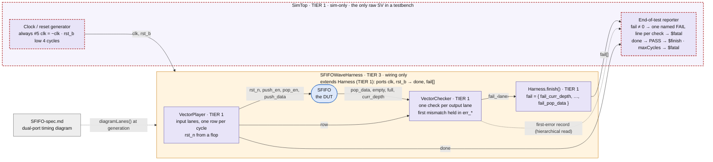
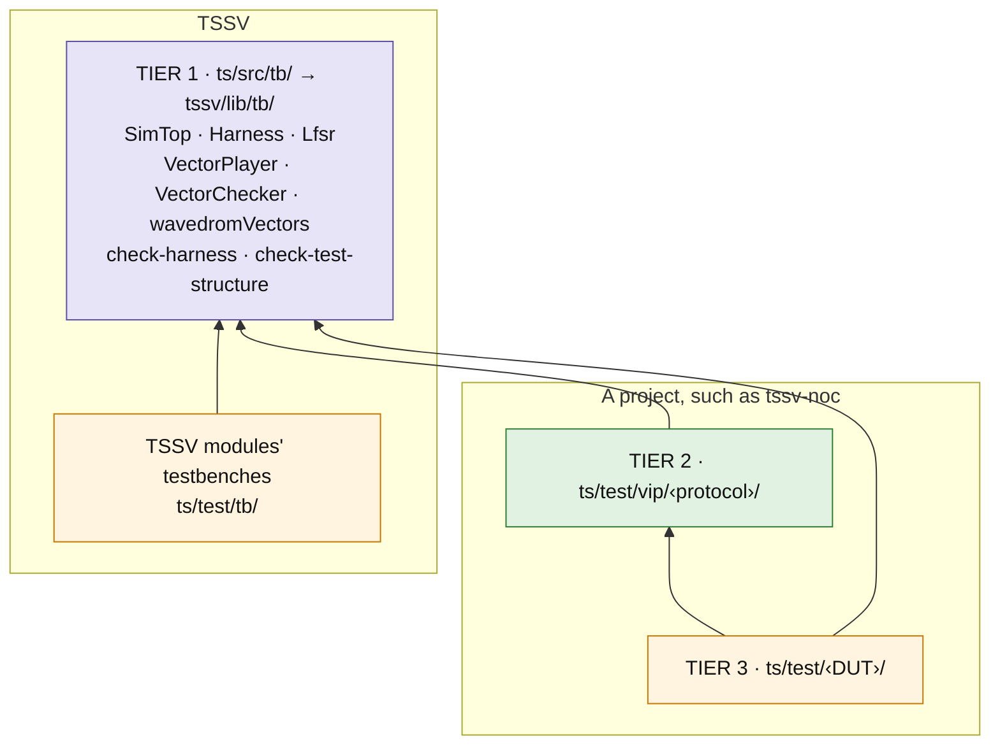
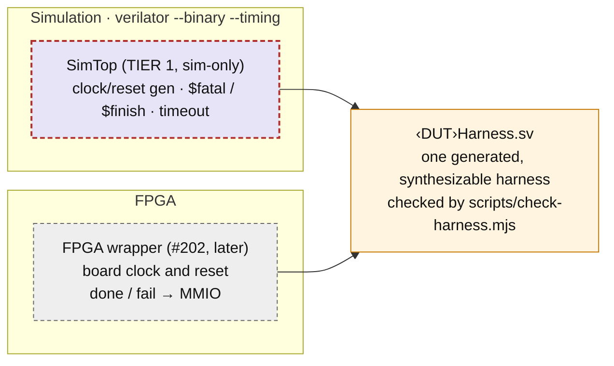

# Block testbench framework

> **Status:** tier 1 of the testbench framework (tssv-noc#207, TSSV#196). Still to come: pattern
> memories loaded from files (#197), a generic injector, checker and scoreboard (#198), clocks
> and resets for several domains (#199), the TB generator and TB spec template (#200), the
> port-contract check (#201), and an FPGA wrapper (#202).
> **Code:** `ts/src/tb/`, imported as `tssv/lib/tb/<file>`
> **Checks:** `scripts/check-harness.mjs`, `scripts/check-test-structure.mjs`
> **Examples:** `ts/test/tb/`, run by `make -C verilatorTB tb_examples_sim`

How a block testbench is put together, in TSSV or in a project built on it. The aim is a
testbench that a reviewer can read top to bottom, that an agent can follow without inventing a
new style, and whose harness could run on an FPGA unchanged.

---

## Two layers: a synthesizable harness under SimTop

Every testbench has the same two layers.

- **The harness** is synthesizable. It is built only from TSSV constructs: `addRegister`,
  `addAssign`, `addMux`, `addSubmodule`, interfaces. It instantiates the DUT, the components that
  drive it, and the checkers that watch it. Its ports are always the same:
  - `clk` and `rst_b` (active low, asynchronous) in;
  - `done` and `fail`, one bit per check, out.
- **SimTop** is the simulation-only top, and the only raw SV in a testbench. One class,
  `SimTop` (`ts/src/tb/SimTop.ts`), wraps every harness. It does three things:
  - generates the clock and reset;
  - reports the result: a named FAIL line per failed check, or one PASS line;
  - enforces a cycle timeout.

**Diagram 1: the SFIFO example testbench.** It replays a timing diagram from the SFIFO spec
against the RTL (`ts/test/tb/SFIFOWaveHarness.ts`). Fill color is the tier, and a red dashed
border marks a sim-only block; everything else is synthesizable. Solid arrows are ports; the
dotted arrow is a hierarchical read.



Lavender is tier 1 (`ts/src/tb/`), amber tier 3, and blue the DUT.

---

## Three tiers

What a piece of testbench code knows about decides where it lives. **A tier may depend only on
the tiers below it, and must not name anything above it.**

| Tier | Where | Knows about | Must not know about |
|---|---|---|---|
| 1 · Framework | TSSV's `ts/src/tb/`, imported as `tssv/lib/tb/<file>` | TSSV's core | any protocol, any DUT |
| 2 · Protocol package | a project's `ts/test/vip/<protocol>/` | tier 1, and one interface | any DUT |
| 3 · Per-DUT testbench | a project's `ts/test/<DUT>/` | tiers 1 and 2, and its one DUT | other DUTs |

- **A TSSV module's testbench uses tier 1 directly.** TSSV has no tier 2: its modules' ports
  are plain signals and AMBA interfaces. The examples are in `ts/test/tb/`.
- **Tier 3 is wiring only.** A harness instantiates, binds, and picks check parameters. If it
  needs logic of its own, that logic is something a protocol or the framework is missing: add
  it to tier 2 or 1 without naming the DUT.
- **New reusable code goes in the lowest tier that doesn't need to know more.** A random
  sequence is tier 1. A checker for one interface's protocol is tier 2. A DUT's latency is a
  tier-3 parameter.
- **`scripts/check-test-structure.mjs` enforces the rule** for tiers 1 and 2:
  - A tier-1 file may import only Node, `tssv/lib/core/`, `tssv/lib/tb/` and its own files.
  - A tier-2 file may also import `tssv/lib/interfaces/`, and the project's `ts/test/vip/`,
    `ts/src/interfaces/` and `ts/src/tools/`.
  - So neither can import a DUT: neither TSSV's (`tssv/lib/modules/`) nor the project's
    (`ts/src/modules/`).

**Diagram 2: the tiers across TSSV and a project.**



---

## Components

Tier 1, in `ts/src/tb/`:

| Component | Ports | Parameters | What it does |
|---|---|---|---|
| `SimTop` | none (top) | `name`, `harness`, `maxCycles`, `resetCycles` (4) | The sim-only top. Clock (period 10); `rst_b` low for `resetCycles` rising edges, released at a falling edge. It reads `fail`, then `done`, at every rising edge after reset |
| `Harness` | `clk`, `rst_b` → `done`, `fail[N-1:0]` | `name` | Base class of every harness. Its helpers:<br/>• `check(name, description, detail?)` adds a check and returns its fail net<br/>• `tap(path, width)` reads a DUT signal by hierarchical reference<br/>• `finish()` builds `fail` |
| `Lfsr` | `clk`, `rst_b`, `step` → `value` | `width` (32 or 64), `seed`, `outWidth` | A xorshift sequence that steps on `step`. Two Lfsrs with one seed produce the same values, which is how a source and its checker agree on what was sent |
| `VectorPlayer` | `clk`, `rst_b` → `row`, `done`, one output per lane | `name`, `rows`, `lanes` | Drives a table one row per cycle, as constants, case tables on `row`, or flops for lanes that must be registered (a reset, SV guide RST-4). `done` rises after the last row |
| `VectorChecker` | `clk`, `rst_b`, `row`, one input per lane → `fail_<lane>` | `name`, `rows`, `lanes`, `firstRow` | Compares each lane with its row of the table, with don't-cares. It latches the first mismatch per lane in `err_row_`, `err_got_` and `err_want_<lane>`; `firstError()` is the detail line that prints them |
| `wavedromVectors` | (TypeScript) | | Reads a spec's WaveDrom diagrams. `diagramLanes()` gives one diagram on one clock as values per cycle per lane, for a `VectorPlayer` and a `VectorChecker`. `diagramTasks()` gives every diagram with a prefix, on a fast and a slow clock, as SV tasks for a hand-written testbench |
| `testbench` | (TypeScript) | | `markTestbench(module)` marks a module as simulation-only, so the SYN-1 scan skips it. SimTop marks itself |

---

## Pass and fail

- **A check is one fail bit.** Each `Harness.check()` call adds one bit to `fail`. The component
  making the check sets the bit at its first violation and holds it.
- **A check has a name and a description.** SimTop prints both:
  `FAIL x64: a 64-bit Lfsr from seed 0x123456789abcdef gives xorshift64's low 64 bits`.
- **A check may have a detail line**, a `$display` format over signals inside the harness. A
  checker that latches its first error supplies one (`VectorChecker.firstError('chk', port)`):
  `first differs in cycle 1: 1e2b7e2ad5623bc2, expected 3f2800d6569e01b4`.
- **The order of the reads matters.** At every rising edge after reset, SimTop reads `fail`
  first, then `done`, then the cycle count. So a check that fails in the last cycle still fails
  the run.
- **The exit status is the result.** Failures end in `$fatal`, never `$finish(1)`, because
  Verilator discards the `$finish` argument. A testbench built with `verilator --binary` exits
  with status 1 on a failure and 0 on a pass.
- **Shared values come from shared seeds.** A source and its checker can agree on a sequence
  through a shared `Lfsr` seed rather than a channel between them. That's why the harness is the
  only thing that has to know both.

---

## The sim-only boundary

- **What is sim-only.** Clock generation, reset sequencing, `$display` and `$fatal`/`$finish`
  all live in SimTop, which is marked as a testbench (`markTestbench()`). Nothing else in a
  testbench may use `initial`, `#`, `force` or a system task.
- **`scripts/check-harness.mjs` checks the boundary.** For each testbench it finds the harness
  (the one file the SimTop includes) and runs two checks on it:
  - `verilator --lint-only -Wall --no-timing`, which reports any delay or event control. Without
    `--no-timing`, lint accepts both;
  - the SV guide's SYN-1 scan, over every file the harness reaches.

  `doc/rtl-style/sv-style/harness_waivers.vlt` waives one warning: nothing in the harness reads
  the `err_*` first-error registers, because SimTop reads them from outside (SV guide,
  section 8).
- **Ready isolation is not a simulation check.** That an output doesn't depend combinationally
  on an input is a property of the structure, so the port-contract check (#201) checks it, not
  SimTop.
- **Taps.** A spec diagram can show a DUT's internal state. `Harness.tap('dut.valid_0', 1)` reads
  it by downward hierarchical reference. This synthesizes in Vivado as long as the path names a
  signal, not a member reached through an interface port.

**Diagram 3: the same harness in simulation and on an FPGA.**



---

## Running the checks

In TSSV:

```bash
npm run check:test-structure                      # tier 1 imports nothing above it
npm run check:harness -- sv-examples/tb/<tb>/<tb>.sv ...
make -C verilatorTB tb_examples_sim               # the examples: generate, check-harness, run
```

In a project, through its link to TSSV, from the project's root:

```bash
node node_modules/tssv/scripts/check-test-structure.mjs .    # TSSV's tier 1 and the project's tier 2
node node_modules/tssv/scripts/check-harness.mjs sv-examples/<DUT>/<tb>/<tb>.sv ...
```

`check-harness` takes `--harness <harness.sv>...` to name harness files directly instead of
testbenches; given a SimTop that way, it fails, as it should. Both scripts exit 1 on a failure.

---

## Writing a block testbench

1. **The harness.** Create `<DUT>Harness.ts`, a `Harness` subclass: in a project, in
   `ts/test/<DUT>/`. Its header comment says:
   - what it verifies;
   - which spec section it verifies against;
   - a small block diagram of its wiring;
   - the list of checks.
2. **Its body is wiring.** It creates the interface instances and nets, then adds each submodule
   with explicit bindings. Pass `autoBind = false`: auto-binding would short two same-named
   `fail` outputs together. It binds each component's fail output to
   `this.check(name, description)`, and calls `this.finish()` last.
3. **The runner.** A test script wraps each harness in a `SimTop` and writes it with
   `writeSystemVerilogFiles()` to `sv-examples/<DUT>/<testbench>/`, on a path that starts at the
   repo's root (`` `${TSSV_ROOT}/sv-examples/...` `` in TSSV). Pick `maxCycles` well above the
   cycles the test needs: it is the only timeout.
4. **Build and run.** `verilator --binary --timing +define+USE_INCLUDES -I<dir> <dir>/<tb>.sv`
   builds a testbench, and its exit status is the result. Run `check-harness` on it too. In
   TSSV, add it to `TB_EXAMPLES` in `verilatorTB/Makefile`.
5. **Show that each check can fail.** Break the DUT on purpose, one way per check, and record in
   the PR which testbench and check caught each break ([Evidence](#evidence-that-a-check-works)).

Expected values come from the spec, from a TypeScript table (a `VectorPlayer`/`VectorChecker`
row), from a model of what the DUT is meant to do, or from a shared seed. Never derive them by
re-implementing the generator's expressions.

---

## What TS-side tests may check

A test that runs in Node without a simulator, for a module tested this way, uses `node:test` and
`node:assert`. It checks only what the TSSV object model or the module's TypeScript exposes:

- **Parameter validation:** `assert.throws` with the error message the spec promises.
- **Port and modport shape**, where the spec defines it (TSSV guide TEST-2).
- **Derived names and other TypeScript-visible results.**

**It never reads, regexes or string-matches the generated SV.** Behaviour is checked in
simulation, by a harness. People read the generated SV in the PR comments
(`doc/process/issue-workflow.md` §5), and no test parses it. TSSV's older tests, which read
emitted SV through `ts/test/models/emitted.ts`, predate this framework; moving them onto it is
separate work.

---

## Evidence that a check works

A testbench that passes proves nothing until each of its checks has been seen to fail. Before a
PR adds or changes a check, break the DUT once per check. For each break, record which
testbench caught it and on which check, then restore the DUT. The PR shows the table.

For the examples, each break below was made in the source and run against both testbenches.
Each was caught by exactly the check it targets, and the other testbench passed:

| Break | Caught by | On |
|---|---|---|
| SFIFO `full` one entry early (`fifo_cnt_q == depth - 1`) | `tb_SFIFOWave_dual_port` | `full`, cycle 5 |
| SFIFO `empty` never set | `tb_SFIFOWave_dual_port` | `empty`, cycle 0 |
| SFIFO `curr_depth` with bit 0 flipped | `tb_SFIFOWave_dual_port` | `curr_depth`, cycle 0 |
| SFIFO `bypass_q` never loaded | `tb_SFIFOWave_dual_port` | `pop_data`, cycle 3 |
| `Lfsr` xorshift32 triple (13, 17, 6) | `tb_Lfsr` | `x32_8`, cycle 1 |
| `Lfsr` xorshift64 triple (13, 8, 17) | `tb_Lfsr` | `x64`, cycle 1 |

A failure reads, for example:

```text
FAIL x64: a 64-bit Lfsr from seed 0x123456789abcdef gives xorshift64's low 64 bits
  first differs in cycle 1: 1e2b7e2ad5623bc2, expected 3f2800d6569e01b4
[65] %Fatal: tb_Lfsr.sv:47: Assertion failed in tb_Lfsr: tb_Lfsr failed in cycle 2
```

---

## The examples: `ts/test/tb/`

| File | What it is |
|---|---|
| `SFIFOWaveHarness.ts` | Replays the SFIFO spec's dual-port timing diagram: `diagramLanes()` reads it, a `VectorPlayer` drives the four input lanes, and a `VectorChecker` checks the four output lanes, one check each |
| `LfsrHarness.ts` | Two `Lfsr`s, 64 bits and 32 bits with an 8-bit output, each stepping every cycle from reset, checked by a `VectorChecker` against a TypeScript model of Marsaglia's xorshift for 64 cycles |
| `test_tbExamples.ts` | Wraps each harness in a `SimTop` and writes `tb_SFIFOWave_dual_port` and `tb_Lfsr` to `sv-examples/tb/` |
