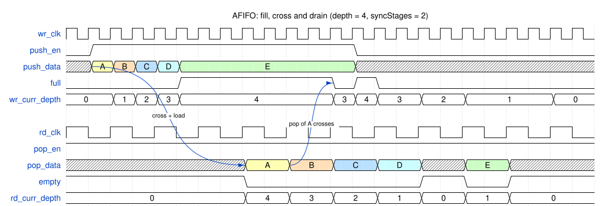
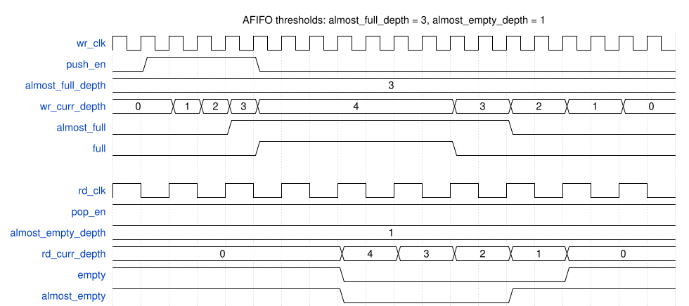

# Module Specification: `AFIFO`

> **Source:** `ts/src/modules/AFIFO/`
> **Status:** Draft

---

## Overview

Dual-clock (asynchronous) **First-In First-Out** queue. Words are pushed in the `wr_clk` domain and popped in the `rd_clk` domain, with no assumed relationship between the two clocks' frequencies or phases. It is `SFIFO` with its clock split in two. It has the same show-ahead read, the same push/pop ports and status outputs, and the same optional almost-full/almost-empty thresholds. It's the clock-domain crossing for tssv-noc's asynchronous `NoCEdge`.

The data crosses through a `TwoClockRegFile`, written on `wr_clk` and read on `rd_clk`. Only the pointers cross through synchronizers. Each pointer is Gray-coded, so one bit changes per push or pop, and a synchronizer that samples it mid-change resolves to the old value or the new one, never to a third. Each side sees the other's pointer a few cycles late, which makes the status conservative: `full` can stay asserted after a pop has freed a word, and `empty` can stay asserted after a push. Neither side ever sees more space or more data than the FIFO has.

The storage is flops, not a memory macro, so the same RTL serves ASIC flows and AMD FPGA prototyping. That limits `depth` to a power of two from 4 to 32. A design that needs more buffering puts an `SFIFO` behind the `AFIFO`.

The pointer scheme is Cummings' ("Simulation and Synthesis Techniques for Asynchronous FIFO Design", SNUG 2002), as in BaseJump STL's [bsg_async_fifo](https://github.com/bespoke-silicon-group/basejump_stl/blob/master/bsg_async/bsg_async_fifo.sv), which inspired this module.

---

## Parameters

Defined in `AFIFO_Parameters extends TSSVParameters`.

| Parameter | Type | Default | Description |
|---|---|---|---|
| `name` | `string` | auto-generated | Instance name. If omitted, TSSV derives it from the other parameters, e.g. `AFIFO_514_8_2_false_false` |
| `dataWidth` | `bigint` (≥ 1) | — | Word width in bits. There is no upper limit. |
| `depth` | `bigint` (4, 8, 16 or 32) | — | Number of words. A power of two; see [Implementation Notes](#implementation-notes) for why. [Throughput and depth](#throughput-and-depth) covers choosing it. |
| `syncStages?` | `bigint` (≥ 2) | `2n` | Flops in each pointer synchronizer. Each extra stage lowers the chance that a metastable value escapes the synchronizer, and adds a cycle of latency in each direction |
| `inclAlmostFull?` | `boolean` | `false` | Adds the `almost_full_depth` input and `almost_full` output, in the write domain |
| `inclAlmostEmpty?` | `boolean` | `false` | Adds the `almost_empty_depth` input and `almost_empty` output, in the read domain |
| `fpgaRamStyle?` | `'distributed' \| 'block'` | unset | Passed to the `TwoClockRegFile`: how Vivado implements the storage. Unset lets Vivado choose. ASIC flows ignore it. See `TwoClockRegFile`'s [Synthesis mapping](../TwoClockRegFile/TwoClockRegFile-spec.md#synthesis-mapping) |

Invalid values throw an `Error` that names the module, the parameter and the value: `dataWidth < 1`, a `depth` other than 4, 8, 16 or 32, `syncStages < 2`, or an `fpgaRamStyle` string that isn't listed above. TypeScript catches the last one at compile time, but JavaScript callers don't get that check.

`ptrWidth` below is `log2(depth) + 1`: 3 bits for depth 4, 6 bits for depth 32. It's the width of `SFIFO`'s `curr_depth` at the same depth.

---

## IO Ports

Every port belongs to one clock domain. The data and status ports have `SFIFO`'s names (with `simultPushPop = true`). Each domain has its own clock, reset and fill count, so those carry a `wr_` or `rd_` prefix.

### Write domain (`wr_clk`)

| Port | Direction | Width | Clock/Reset | Description |
|---|---|---|---|---|
| `wr_clk` | `input` | 1 | `isClock: 'posedge'` | Write clock |
| `wr_rst_n` | `input` | 1 | `isReset: 'lowasync'` | Write-domain reset, active low. See [Reset behavior](#reset-behavior) |
| `push_en` | `input` | 1 | — | Push enable: on the next `wr_clk` edge, `push_data` is pushed unless `full` is asserted |
| `push_data` | `input` | `dataWidth` | — | Push data |
| `full` | `output` | 1 | — | Asserted when `wr_curr_depth` is `depth` |
| `wr_curr_depth` | `output` | `ptrWidth` | — | Fill count as the write domain sees it, 0 to `depth`. It can over-report, never under-report |

### Read domain (`rd_clk`)

| Port | Direction | Width | Clock/Reset | Description |
|---|---|---|---|---|
| `rd_clk` | `input` | 1 | `isClock: 'posedge'` | Read clock |
| `rd_rst_n` | `input` | 1 | `isReset: 'lowasync'` | Read-domain reset, active low |
| `pop_en` | `input` | 1 | — | Pop enable: on the next `rd_clk` edge, the head is discarded unless `empty` is asserted |
| `pop_data` | `output` | `dataWidth` | — | Head of the queue, valid whenever `empty` is deasserted |
| `empty` | `output` | 1 | — | Asserted when `rd_curr_depth` is 0 |
| `rd_curr_depth` | `output` | `ptrWidth` | — | Fill count as the read domain sees it, 0 to `depth`. It can under-report, never over-report |

### `inclAlmostFull = true` (write domain)

| Port | Direction | Width | Clock/Reset | Description |
|---|---|---|---|---|
| `almost_full_depth` | `input` | `ptrWidth` | — | Fill count at which `almost_full` asserts |
| `almost_full` | `output` | 1 | — | Asserted when `wr_curr_depth >= almost_full_depth` |

### `inclAlmostEmpty = true` (read domain)

| Port | Direction | Width | Clock/Reset | Description |
|---|---|---|---|---|
| `almost_empty_depth` | `input` | `ptrWidth` | — | Fill count at or below which `almost_empty` asserts |
| `almost_empty` | `output` | 1 | — | Asserted when `rd_curr_depth <= almost_empty_depth` |

---

## Functional Description

The FIFO is **show-ahead** (first-word fall-through), like `SFIFO`. `pop_data` presents the head of the queue whenever `empty` is deasserted. No read is needed to see the head: a *pop* discards it and advances to the next entry. So the read side is a valid/ready source, with `!empty` as valid and `pop_en` as ready. The write side is a valid/ready sink, with `push_en` as valid and `!full` as ready.

Each domain has its own pointer, and its own view of the fill count:

| Domain | Its pointer | Sees the other domain's pointer | Status outputs |
|---|---|---|---|
| Write | Advanced by each push | `syncStages` `wr_clk` edges late | `full`, `wr_curr_depth`, `almost_full` |
| Read | Advanced by each pop | `syncStages` `rd_clk` edges late, plus one edge to load the head | `empty`, `rd_curr_depth`, `almost_empty` |

A crossing takes one edge longer if the synchronizer's first flop misses the change: the change can arrive too close to that edge, or the flop can go metastable and resolve to the old value. Each status output changes only on its own domain's clock edge.

### Write domain

1. **Push:** on a rising edge of `wr_clk` with `push_en` high and `full` low, `push_data` is written to the storage and the write pointer advances.
2. `wr_curr_depth` is the number of pushes minus the number of pops the write domain has seen. A pop reaches it `syncStages` `wr_clk` edges after the pop edge. So `wr_curr_depth` is never less than the true fill count.
3. `full` asserts when `wr_curr_depth` is `depth`. It asserts on the edge of the push that fills the FIFO, and deasserts on the edge where a pop reaches the write domain.
4. A push while `full` is asserted is ignored. There's no overflow protection, so the caller has to check `full`. A valid/ready producer holds its word until `full` deasserts.

### Read domain

1. **Pop:** on a rising edge of `rd_clk` with `pop_en` high and `empty` low, the head is discarded and the read pointer advances. In the following cycle `pop_data` presents the next entry, or `empty` asserts if the read domain hasn't seen another push yet.
2. **Push-to-head latency:** a word pushed into an empty FIFO appears on `pop_data` on the (`syncStages` + 1)th `rd_clk` edge after the push edge, the same edge on which `empty` deasserts. That's `syncStages` edges for the write pointer to cross and one to load the word. A `rd_clk` edge at the same instant as the push edge doesn't count.
3. **Back-to-back pops:** once the read domain has seen more than one entry, a pop presents the next one in the following cycle, so the read side can pop on every `rd_clk` edge.
4. `rd_curr_depth` is the number of pushes the read domain has seen minus the number of pops. While `empty` is asserted it's 0, even in the cycle after a push has crossed, before the head is loaded. So `rd_curr_depth` is never more than the true fill count.
5. `empty` asserts when `rd_curr_depth` is 0. `pop_data` and `empty` always update on the same edge, so `!empty` is a sufficient qualifier for `pop_data`.
6. A pop while `empty` is asserted is ignored. `pop_data` is undefined while `empty` is asserted.

See [Internal Architecture](#internal-architecture) for how show-ahead is built on `TwoClockRegFile`'s registered read.

### Throughput and depth

Each side can transfer a word on every edge of its own clock, but the FIFO can only sustain that if `depth` covers a word's round trip. A word holds its place in the storage from its push until the write domain sees its pop. With both sides always ready and both clocks at the same frequency, that's about 2 × `syncStages` + 2 cycles. When the clocks differ, the slower one sets the rate.

Fraction of the slower clock's rate that the FIFO sustains, with both sides always ready:

| `syncStages` | `depth` | Same frequency | One clock 1.3× the other | One clock 3× the other |
|---|---|---|---|---|
| 2 | 4 | 0.57 to 0.67 | 0.70 to 0.75 | 1 |
| 2 | 8 | 1 | 1 | 1 |
| 3 | 4 | 0.44 to 0.5 | 0.56 to 0.57 | 0.67 to 0.8 |
| 3 | 8 | 0.89 to 1 | 1 | 1 |

The ranges depend on the clocks' phase and on which clock is faster. These figures come from a cycle model of this design. The testbench checks the `depth = 8` row at a near-equal clock pair (see [Test Plan](#test-plan)).

Depth 4 is correct at any clock ratio. It only costs throughput.

### Almost-full / almost-empty

`almost_full` and `almost_empty` are early warnings with run-time programmable thresholds, as in `SFIFO`. They are enabled independently by `inclAlmostFull` and `inclAlmostEmpty`. Each one lives in its own domain:

| Flag | Domain | Asserted when |
|---|---|---|
| `almost_full` | write | `wr_curr_depth >= almost_full_depth` |
| `almost_empty` | read | `rd_curr_depth <= almost_empty_depth` |

1. Each flag is a combinational compare of its domain's fill count against the threshold input, so it changes on the same edge as that domain's `full` or `empty`. No extra latency is added.
2. The threshold inputs are intended to be static configuration (tied off, or driven from a register). Each belongs to its flag's domain: drive `almost_full_depth` from `wr_clk` logic and `almost_empty_depth` from `rd_clk` logic. If a threshold changes, the flag follows combinationally in the same cycle.
3. **Using `almost_full` for back-pressure:** if a producer takes *N* `wr_clk` cycles to stop pushing after it sees a flag, set `almost_full_depth = depth - N`. Then the pushes still in flight fit in the remaining space and none are dropped. This holds across the crossing because `wr_curr_depth` never under-reports.
4. **Using `almost_empty` for bursts:** a consumer that needs a burst of *M* entries can wait for `!almost_empty` with `almost_empty_depth = M - 1`. The read domain has then seen at least *M* entries, so they can be popped on *M* consecutive `rd_clk` edges.
5. **Threshold boundary values:**

   | Setting | Result |
   |---|---|
   | `almost_full_depth = depth` | `almost_full` is identical to `full` |
   | `almost_full_depth = 0` | `almost_full` is always asserted |
   | `almost_full_depth > depth` | `almost_full` never asserts |
   | `almost_empty_depth = 0` | `almost_empty` is identical to `empty` |
   | `almost_empty_depth >= depth` | `almost_empty` is always asserted |

### Reset behavior

Each domain has its own active-low asynchronous reset:

- `wr_rst_n` resets the write pointer and the synchronizer that brings the read pointer into the write domain.
- `rd_rst_n` resets the read pointer, `empty`, and the synchronizer that brings the write pointer into the read domain.

The storage and `pop_data` have no reset. After both resets, `empty` asserts, `full` deasserts and both fill counts are 0. `almost_empty` asserts and `almost_full` deasserts, unless `almost_full_depth = 0`. `pop_data` is undefined until the first push reaches the read side.

The two resets have to be used together:

1. **Assert both, overlapping.** Resetting one side while the other side's pointer is nonzero corrupts the FIFO. Each side would see a pointer value the other no longer holds, so words can be lost or repeated. An asynchronous reset also changes several bits of a Gray pointer at once, which its synchronizer can catch halfway (see [`GrayPointer`'s Reset behavior](../GrayPointer/GrayPointer-spec.md#reset-behavior)). So from the moment either reset asserts until both are released, every output on both sides is meaningless.
2. **Release each one synchronously to its own clock.** The `AFIFO` has no reset synchronizer. That's the caller's job (RST-4 in `doc/rtl-style/sv-style/sv-coding-style.md`).
3. **Don't push or pop until both resets have been released.**

### Edge cases

- **A push while `full` is asserted:** ignored, with no overflow protection. The caller has to check `full`.
- **A pop while `empty` is asserted:** ignored, with no pointer or count change. `pop_data` remains undefined.
- **A push and a pop at once:** they're in different domains, so `SFIFO`'s same-cycle cases don't arise. A push into a FIFO whose last entry is being popped reaches the read side with the push-to-head latency above.

---

## Timing

Both diagrams draw `rd_clk` at half `wr_clk`'s frequency, with every `rd_clk` edge at the same instant as a `wr_clk` edge, so that they fit on one grid. In practice the clocks are unrelated. At a shared edge, each side's synchronizer captures the other side's pointer from before the edge, as it would in a simulation with aligned clocks. `syncStages = 2` in both.

### Fill, cross and drain

`depth = 4`, consumer always ready (`pop_en` held high). The producer offers `A` to `E` back to back and holds each word until it's accepted. `A` to `D` fill the FIFO. `E` waits while `full` is asserted.

- `A` appears on `pop_data` three `rd_clk` edges after its push. Two edges are for the write pointer to cross, and one is to load `A`.
- `full` deasserts two `wr_clk` edges after the pop of `A`, when that pop reaches the write domain. `E` takes the freed word, which fills the FIFO again until the pop of `B` arrives.
- `empty` asserts for a cycle after `D` is popped, because `E`'s push hasn't reached the read side yet.

<!-- wavedrom AFIFO-timing-fill-drain.svg
{
  "signal": [
    {"name": "wr_clk",        "wave": "p......................."},
    {"name": "push_en",       "wave": "01...........0.........."},
    {"name": "push_data",     "wave": "x34567.......x..........", "data": ["A", "B", "C", "D", "E"], "node": ".A......................"},
    {"name": "full",          "wave": "0....1......010.........", "node": "............D..........."},
    {"name": "wr_curr_depth", "wave": "=.====......===.=.=...=.", "data": ["0", "1", "2", "3", "4", "3", "4", "3", "2", "1", "0"]},
    {},
    {"name": "rd_clk",        "wave": "p...........", "period": 2},
    {"name": "pop_en",        "wave": "1...........", "period": 2},
    {"name": "pop_data",      "wave": "x...3456x7x.", "period": 2, "data": ["A", "B", "C", "D", "E"], "node": "....BC......"},
    {"name": "empty",         "wave": "1...0...101.", "period": 2},
    {"name": "rd_curr_depth", "wave": "=...=======.", "period": 2, "data": ["0", "4", "3", "2", "1", "0", "1", "0"]}
  ],
  "edge": ["A~>B cross + load", "C~>D pop of A crosses"],
  "head": {"text": "AFIFO: fill, cross and drain (depth = 4, syncStages = 2)"}
}
-->


### Almost-full / almost-empty thresholds

`depth = 4`, `inclAlmostFull = true`, `inclAlmostEmpty = true`, `almost_full_depth = 3`, `almost_empty_depth = 1`. Four pushes, which the consumer pops as they appear. Each flag follows its own domain's count. `almost_full` asserts with the third push, a cycle before `full`, and stays asserted until the pop of `B` reaches the write domain. `almost_empty` deasserts when the read side sees all four entries, and asserts again when it's down to one.

<!-- wavedrom AFIFO-timing-almost-flags.svg
{
  "signal": [
    {"name": "wr_clk",             "wave": "p..................."},
    {"name": "push_en",            "wave": "01...0.............."},
    {"name": "almost_full_depth",  "wave": "=...................", "data": ["3"]},
    {"name": "wr_curr_depth",      "wave": "=.====......=.=.=.=.", "data": ["0", "1", "2", "3", "4", "3", "2", "1", "0"]},
    {"name": "almost_full",        "wave": "0...1.........0....."},
    {"name": "full",               "wave": "0....1......0......."},
    {},
    {"name": "rd_clk",             "wave": "p.........", "period": 2},
    {"name": "pop_en",             "wave": "1.........", "period": 2},
    {"name": "almost_empty_depth", "wave": "=.........", "period": 2, "data": ["1"]},
    {"name": "rd_curr_depth",      "wave": "=...=====.", "period": 2, "data": ["0", "4", "3", "2", "1", "0"]},
    {"name": "empty",              "wave": "1...0...1.", "period": 2},
    {"name": "almost_empty",       "wave": "1...0..1..", "period": 2}
  ],
  "head": {"text": "AFIFO thresholds: almost_full_depth = 3, almost_empty_depth = 1"}
}
-->


_Push-to-head latency: **`syncStages` + 1 `rd_clk` edges**. Pop-to-space latency: **`syncStages` `wr_clk` edges**. Each is one edge longer if the first synchronizer flop misses the change. Pop-to-next-head latency: **1 `rd_clk` edge**, once the next entry has crossed._

---

## Internal Architecture

The `AFIFO` has three kinds of submodule:

- **Storage:** a `TwoClockRegFile` of `depth` words.
  - Port A, the write port, is on `wr_clk`. `a_we` is `push_fire`, `a_addr` is the write pointer's low `log2(depth)` bits, and `a_data_in` is `push_data`.
  - Port B, the read port, is on `rd_clk`. `b_re` is `head_load`, `b_addr` is the low bits of `rd_ptr_nxt`, and `b_data_out` drives `pop_data` directly. So `pop_data` comes straight from a `rd_clk` flop, with no mux.
- **Pointers:** two `GrayPointer`s, one per domain, each `ptrWidth` bits wide. Each one counts its domain's pushes or pops, and gives the count in binary in both domains. Inside, it crosses in Gray code through a `CDCSynchronizer`: a chain of `syncStages` flops on the destination clock, each with `(* ASYNC_REG = "TRUE" *)`. The Gray code doesn't appear in the `AFIFO`; see [`GrayPointer`'s spec](../GrayPointer/GrayPointer-spec.md#use-in-the-afifo) for how the two instances connect.

### Write side

- `push_fire = push_en && !full`. It writes the storage and advances `wr_ptr_q`.
- `wr_curr_depth = wr_ptr_q - rd_ptr_wsync`, modulo 2^`ptrWidth`. `rd_ptr_wsync` is the read pointer as the write domain sees it.
- `full` asserts when `wr_ptr_q` equals `rd_ptr_wsync` with its top bit inverted: the pointers are exactly `depth` apart. That's the same condition as `wr_curr_depth == depth`, with no subtractor in the path to `push_fire`.
- `full` and `wr_curr_depth` are combinational functions of `wr_clk` flops, so they change only on a `wr_clk` edge.

### Read side (show-ahead)

`TwoClockRegFile`'s read is registered, so the head is loaded into `b_data_out` ahead of time, the way `SFIFO` prefetches over `SRAM`. Unlike `SFIFO`, there's no bypass: a pushed word can only reach the read side through the storage.

- `rd_ptr_q` is the head's address. `pop_fire = pop_en && !empty`, and `rd_ptr_nxt = rd_ptr_q + pop_fire`.
- `head_vld_nxt` means the word at `rd_ptr_nxt` has crossed: `rd_ptr_nxt != wr_ptr_rsync`, where `wr_ptr_rsync` is the write pointer as the read domain sees it.
- `head_load = head_vld_nxt && (pop_fire || empty)` loads a new head when the current one is popped or when there isn't one. While it's low, `b_data_out` holds the head.
- `empty` is a flop. It loads `!head_vld_nxt` on every `rd_clk` edge, and resets to 1.
- `rd_curr_depth = empty ? 0 : wr_ptr_rsync - rd_ptr_q`, modulo 2^`ptrWidth`.

A valid/ready consumer therefore sees both `empty` and `pop_data` straight from `rd_clk` flops.

### Storage access rules

The pointers keep `TwoClockRegFile`'s [Access rules](../TwoClockRegFile/TwoClockRegFile-spec.md#access-rules):

1. **Write, then read:** the read side loads word *w* only after the synchronized write pointer has passed *w*. The write pointer advanced on the edge that wrote *w*.
2. **Read, then overwrite:** the write side writes word *w* only while `full` is low, which means the synchronized read pointer has passed *w*'s previous occupant. The read pointer passes a word when it's popped, which comes after the edge that loaded the word into `pop_data`.

### Key signals

| Signal | Domain | Width | Description |
|---|---|---|---|
| `push_fire` | write | 1 | Push accepted this cycle |
| `wr_ptr_q` | write | `ptrWidth` | Write pointer: the write `GrayPointer`'s `bin_ptr`. Its low `log2(depth)` bits address the storage |
| `rd_ptr_wsync` | write | `ptrWidth` | Read pointer as the write domain sees it: the read `GrayPointer`'s `far_bin_ptr` |
| `pop_fire` | read | 1 | Pop accepted this cycle |
| `rd_ptr_q` | read | `ptrWidth` | Read pointer, the head's address: the read `GrayPointer`'s `bin_ptr` |
| `rd_ptr_nxt` | read | `ptrWidth` | `rd_ptr_q + pop_fire`: the head's address after this edge |
| `wr_ptr_rsync` | read | `ptrWidth` | Write pointer as the read domain sees it: the write `GrayPointer`'s `far_bin_ptr` |
| `head_vld_nxt` | read | 1 | The word at `rd_ptr_nxt` has crossed |
| `head_load` | read | 1 | Load the head into `pop_data`: the storage's `b_re` |

---

## Dependencies

| Import | Source | Purpose |
|---|---|---|
| `Module`, `TSSVParameters`, `Expr` | `tssv/lib/core/TSSV` | Base class, parameter type and expressions |
| `TwoClockRegFile` | `tssv/lib/modules/TwoClockRegFile` | Storage |
| `GrayPointer` | `tssv/lib/modules/GrayPointer` | One pointer per domain, with its synchronizer into the other domain |
| `CDCSynchronizer` | `tssv/lib/modules/CDCSynchronizer` | The synchronizer inside each `GrayPointer` |

---

## Test Plan

**Test script:** `ts/test/modules/test_AFIFO.ts`.
- It generates every combination of `inclAlmostFull` and `inclAlmostEmpty` (at `depth = 4`), and checks each one's ports against the IO tables above.
- It checks that AFIFOs differing in any parameter get different module names, that depths 4, 8, 16 and 32 generate, and that `dataWidth = 1026n` generates.
- It checks that every flop in each synchronizer carries `ASYNC_REG`.
- It checks that each invalid parameter in [Parameters](#parameters) throws: `depth` 2, 6 and 64, `dataWidth` 0, `syncStages` 1, and an unlisted `fpgaRamStyle`.
- It emits each submodule in its own file (#46), so every generated file lints clean under `-Wall` with no `DECLFILENAME` waiver.
- Finally, it generates the testbench configurations below. `runAllTests.sh` runs it.

**Testbench:** `verilatorTB/tb_AFIFO.sv`, built once per configuration. It takes its DUT name from the configuration list that `test_AFIFO.ts` writes, as `tb_SFIFO.sv` does, so no module name is typed by hand.
- **Reference model:** a queue checks every popped word, and every `rd_clk` cycle while not empty it checks `pop_data`.
- **Status checks**, at every edge of each domain's clock:
  - `full == (wr_curr_depth == depth)` and `empty == (rd_curr_depth == 0)`.
  - `rd_curr_depth` ≤ true fill count ≤ `wr_curr_depth`. The true fill count is the pushes minus the pops so far.
  - Each almost flag matches its own domain's count and threshold.
- **Clock pairs:** every test runs at three pairs. `wr_clk` 10 ns with `rd_clk` 31 ns is a fast writer. `wr_clk` 31 ns with `rd_clk` 10 ns is a fast reader. `wr_clk` 10 ns with `rd_clk` 11 ns is near-equal, and its phase drifts. A 0.3 ns offset keeps the two clocks' edges from ever coinciding, except in the diagram replay.

**Output:** `sv-examples/AFIFO/<module>/` and `sv-examples/AFIFO/tb/`

| Configuration | `dataWidth` | `depth` | `syncStages` | Almost flags |
|---|---|---|---|---|
| `d4_flags` | 8 | 4 | 2 | both |
| `d8` | 8 | 8 | 2 | none |
| `d16_s3_flags` | 8 | 16 | 3 | both |
| `d32` | 8 | 32 | 2 | none |
| `d4_flags_w1026` | 1026 | 4 | 2 | both |

| Test case | Configurations | Notes |
|---|---|---|
| Show-ahead | all | Push one word into an empty FIFO. It is on `pop_data` when `empty` deasserts, within `syncStages + 2` `rd_clk` edges of the push, with no pop |
| Fill to full | all | Read side idle. Push until `full`: `wr_curr_depth` is `depth`, and one more push is ignored. Once the pushes have crossed, `rd_curr_depth` is `depth` |
| Drain to empty | all | Write side idle. Pop `depth` words in order until `empty`, and one more pop is ignored. Once the pops have crossed, `wr_curr_depth` is 0 |
| Fast writer / fast reader | all | Free-running traffic at each clock pair. `full` throttles a fast writer and `empty` a fast reader. Every word arrives once, in order |
| Valid/ready | all | The producer holds each word on `push_data` with `push_en` high until it's accepted. The consumer drives `pop_en` randomly and takes `pop_data` when `!empty && pop_en`. No word is lost or repeated, at each clock pair |
| Throughput | `d8` | Both sides always ready, at the near-equal pair: once the first word arrives, the read side pops on every `rd_clk` edge (see [Throughput and depth](#throughput-and-depth)) |
| Almost-full / almost-empty thresholds | with almost flags | `almost_full_depth = depth - 2`, `almost_empty_depth = 2`, fill then drain |
| Threshold boundaries | with almost flags | `almost_full_depth = depth` tracks `full`. `almost_empty_depth = 0` tracks `empty` |
| Reset | all | Both resets are asserted together in the middle of traffic, then released one after the other. The FIFO comes back empty with both counts at 0, and traffic resumes |
| Timing diagrams | `d4_flags`, `d4_flags_w1026` | Each diagram in [Timing](#timing) replays cycle for cycle, with `rd_clk` at half `wr_clk`'s frequency and edges aligned, as drawn. `test_AFIFO.ts` builds the vectors from the diagrams' WaveDrom JSON, as `test_SFIFO.ts` does, so a diagram change is tested without editing the testbench |
| Random | all | 3000 `rd_clk` cycles of random pushes and pops at each clock pair, in fill-biased, drain-biased and balanced phases. Each threshold changes every 50 cycles of its own domain's clock |

**FPGA mapping:** a Vivado synthesis run of a generated `AFIFO` with `fpgaRamStyle: 'distributed'` maps the storage to LUTRAM, and every synchronizer flop keeps `ASYNC_REG` in the netlist. The PR records the Vivado version and target part. This is a manual check.

### Simulation

```bash
make -C verilatorTB afifo_sim    # generates the SV, then builds and runs each configuration
# waveform per configuration and clock pair: verilatorTB/obj_dir/afifo_<config>/tb_AFIFO_<config>.fst
```

The target also gets its own step in `.github/workflows/test.yml`.

---

## Implementation Notes

- **Show-ahead only.** #67 asked for a registered read as the default, with show-ahead as an option. `SFIFO` went show-ahead only in #77, and the `AFIFO` follows it. Show-ahead doesn't delay the first word. In the draft's registered mode, `rd_empty` deasserts as soon as the write pointer has crossed, but the data arrives on the edge after the read, the same edge on which show-ahead presents it. Show-ahead's cost is the `empty` flop and the `head_load` logic. A consumer that wants the data registered on a pop can register `pop_data` itself.
- **Names follow `SFIFO`, not the `add_AFIFO` draft.**
  - Ports: `push_en`, `push_data` and `full` replace `wr_en`, `wr_data_in` and `wr_full`. `pop_en`, `pop_data` and `empty` replace `rd_en`, `rd_data_out` and `rd_empty`.
  - Parameters: `depth` replaces `log2depth`. `inclAlmostFull` and `inclAlmostEmpty`, with run-time threshold inputs, replace `InclAlmostDepth` and the `almost_full_depth` / `almost_empty_depth` parameters.
  - That settles #67's items 1 and 2. The testbench takes its DUT names from the generated configurations, and no threshold parameter can be dropped on the way to `super()`.
- **Power-of-two depth.** A pointer with one more bit than the address wraps cleanly only when `depth` is a power of two: its Gray code then changes one bit at a time through the wrap, and the full test holds (pointers equal apart from the top bit are exactly `depth` apart). Depth stops at 32 because flop storage gets expensive beyond that (`TwoClockRegFile`'s limit).
- **No bypass.** `SFIFO` sends a push into an empty FIFO straight to `pop_data`. Here a word can only reach the read domain through the storage, after the write pointer has crossed.
- **Storage is `TwoClockRegFile` (#121), not `DualClockRAM`.** The `add_AFIFO` branch's `DualClockRAM` assumed a dual-clock memory macro, which ASIC libraries generally don't have, so this branch doesn't land it.
- **The helpers have their own specs** (MOD-1): [`GrayPointer`](../GrayPointer/GrayPointer-spec.md) and [`CDCSynchronizer`](../CDCSynchronizer/CDCSynchronizer-spec.md). This spec only describes how the `AFIFO` uses them.
- **SYN-3.** The data crosses through the storage without a synchronizer. That's the exception `TwoClockRegFile`'s spec describes, and the [Storage access rules](#storage-access-rules) above are what make it safe. Every control signal that crosses goes through a `CDCSynchronizer`.
- **Timing constraints.** The crossings need constraints that the RTL can't express yet. Each Gray pointer's bits must reach the synchronizer within one source-clock period of each other (Vivado's `set_bus_skew`; see [`GrayPointer`'s Implementation Notes](../GrayPointer/GrayPointer-spec.md#implementation-notes)). The path from the storage to `pop_data` must be shorter than the pointer's trip through the synchronizer (`set_max_delay -datapath_only`). The timing-intent epic (#96) is where TSSV will carry them, and #106 moves the `AFIFO` onto it. Until then, the integrator writes them.
- **Compared with `bsg_async_fifo`:**
  - The pointer scheme is the same: `log2(depth) + 1`-bit pointers that cross in Gray code. The full test is the same condition. `bsg_async_fifo` compares the Gray pointers with the top two bits inverted, and the `AFIFO` compares the binary pointers with the top bit inverted.
  - The resets differ. Each domain has an active-low asynchronous reset (MOD-4), where `bsg_async_fifo` uses a synchronous reset on each side.
  - The storage is `TwoClockRegFile` instead of `bsg_mem_1r1w`.
  - `bsg_async_fifo`'s `and_data_with_valid_p` option, which zeroes the read data while empty, isn't ported.
- **Future:** #106 moves the `AFIFO` onto the timing-intent epic's CDC primitives and annotations, and keeps the ports and behavior above.
