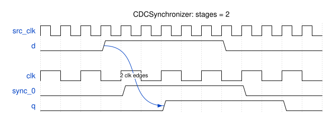

# Module Specification: `CDCSynchronizer`

> **Source:** `ts/src/modules/CDCSynchronizer/`
> **Status:** Draft

---

## Overview

A multi-flop synchronizer: a chain of flops on the destination clock that brings a signal from another clock domain into this one. When the input changes close to a clock edge, the first flop can go metastable. Each flop after it gives it another clock period to settle, so the output is stable. This is the kind of module SYN-3 in `doc/rtl-style/sv-style/sv-coding-style.md` requires for every signal that crosses a clock domain.

It's safe only for an input that changes one bit at a time: a single-bit level, or a Gray-coded counter. A multi-bit value that can change several bits at once needs a handshake or an `AFIFO` instead (see [What the input may be](#what-the-input-may-be)). `GrayPointer` uses it to carry the `AFIFO`'s pointers across.

The module knows only its destination clock: not the source clock, and not how `d` is encoded. So the module that instantiates it owns the crossing: its input rules, its timing constraints and the assertion that checks them (see [Responsibilities of the instantiating module](#responsibilities-of-the-instantiating-module)). `CDCSynchronizer` itself owns only the chain, `ASYNC_REG` on every stage, and `a_latency`.

---

## Parameters

Defined in `CDCSynchronizer_Parameters extends TSSVParameters`.

| Parameter | Type | Default | Description |
|---|---|---|---|
| `name` | `string` | auto-generated | Instance name. If omitted, TSSV derives it from the other parameters, sorted by parameter name, e.g. `CDCSynchronizer_2_3` for 2 stages of 3 bits |
| `width` | `bigint` (≥ 1) | — | Width of the synchronized signal, in bits. **For `width > 1`, `d` must change at most one bit at a time** (for example, Gray code). The instantiating module guarantees this and constrains the crossing (see [Responsibilities of the instantiating module](#responsibilities-of-the-instantiating-module)). `q` then shows only values `d` held, but it can skip values when `d` changes faster than `clk` |
| `stages?` | `bigint` (≥ 2) | `2n` | Flops in the chain. Each extra stage lowers the chance that a metastable value reaches `q`, and adds a cycle of latency |

Invalid values throw an `Error` that names the module, the parameter and the value: `width < 1` or `stages < 2`.

---

## IO Ports

Every port is in the destination domain except `d`, which comes from the source domain.

| Port | Direction | Width | Clock/Reset | Description |
|---|---|---|---|---|
| `clk` | `input` | 1 | `isClock: 'posedge'` | Destination clock |
| `rst_n` | `input` | 1 | `isReset: 'lowasync'` | Destination-domain reset, active low |
| `d` | `input` | `width` | — | The signal from the source domain. It must come straight from a source-domain flop |
| `q` | `output` | `width` | — | `d`, synchronized to `clk`, `stages` edges late |

---

## Functional Description

### Operation

1. On each rising edge of `clk`, the first flop samples `d`, and each later flop samples the one before it. `q` is the last flop.
2. **Latency:** a change on `d` reaches `q` on the `stages`th `clk` edge after the change reaches `sync_0`'s input. It's one edge later if the first flop misses the change: the change can arrive too close to the edge, or the flop can go metastable and resolve to the old value. A `clk` edge at the same instant as the change doesn't count. The delay from the source flop to `sync_0` comes before that, and the instantiating module bounds it (see [Responsibilities of the instantiating module](#responsibilities-of-the-instantiating-module)).
3. A change that the first flop catches mid-transition can leave it metastable for part of a cycle. It resolves to the old value or the new one, never to anything else, and the later flops pass on whichever it chose.

### What the input may be

The module can't check its input or constrain the path to it, so these rules belong to the instantiating module (see [Responsibilities of the instantiating module](#responsibilities-of-the-instantiating-module)):

1. **Straight from a flop.** `d` must be driven directly by a flop in the source domain, with no logic in between. Combinational logic can glitch, and the first flop can capture a glitch as if it were a real value.
2. **One bit at a time.** For `width > 1`, `d` must never change more than one bit at once, which a Gray-coded counter guarantees. Otherwise the first flop can catch some bits old and some new, and `q` can show a value `d` never held.
3. **Bounded skew.** For `width > 1`, the bits of `d` must reach the first flop within a skew budget of each other: the shortest interval between changes of `d`, minus `sync_0`'s setup and hold times and the clock jitter. Then the bits that changed at two different times are never in flight at once, so rule 2 still holds at the destination. The RTL can't enforce this; it needs a timing constraint (see [Responsibilities of the instantiating module](#responsibilities-of-the-instantiating-module)).
4. **Long enough.** A change that lands in `sync_0`'s setup/hold window can resolve to the old value, so a value can be missed altogether. To be seen for certain, a value must be held for longer than one `clk` period plus the skew, `sync_0`'s setup and hold times, and the jitter: in practice at least 1.5 `clk` periods. Only an instantiating module that needs every value to reach `q` has to meet this; a Gray-coded counter that may skip values doesn't. A single-cycle pulse from a faster domain needs a pulse or handshake synchronizer, which this module isn't.

### Responsibilities of the instantiating module

`CDCSynchronizer` knows only its destination clock. It doesn't know the source clock or how `d` is encoded, so it can't state the timing constraints on the path from the source flop to `sync_0`, and it can't check its own input rules. The module that instantiates it knows both, so it owns them. In #67 that's `GrayPointer`, whose spec states each item for its crossing ([Timing constraints](../GrayPointer/GrayPointer-spec.md#timing-constraints) and [Assertions](../GrayPointer/GrayPointer-spec.md#assertions)).

The instantiating module:

1. **Drives `d` straight from a flop in the source domain** (rule 1).
2. **Guarantees the input class:** for `width > 1`, at most one bit of `d` changes at a time (rule 2).
3. **States the static timing constraints** on the path from its source flop to `sync_0`:
   - **`set_bus_skew`:** at most the shortest interval between changes of `d`, minus `sync_0`'s setup and hold times and the clock jitter (rule 3).
   - **`set_max_delay -datapath_only`:** a bound that supports the latency the instantiating module promises. Latency here is counted from `sync_0`'s input (Operation, item 2).
   - **No `set_clock_groups -asynchronous` or `set_false_path`** may cover these paths. Vivado gives those precedence over `set_max_delay`, so they would silently drop it.
4. **Embeds the assertion that checks rule 2**, clocked on the source clock. It can't be clocked on `clk` (see [Assertions](#assertions)).
5. **Handles the reset rule** in [Reset behavior](#reset-behavior), second paragraph.

`CDCSynchronizer` itself owns only the chain's structure, `ASYNC_REG` on every stage, and `a_latency`.

### Reset behavior

`rst_n` resets every flop in the chain to 0, so `q` is 0. It's the destination domain's reset. After it's released, `q` follows `d` with the latency above.

If `d` jumps while the chain is running, for example because the source domain's asynchronous reset asserts, that jump can change several bits at once and break rule 2. A design that resets one domain has to reset the other at the same time, and ignore `q` until both resets are released. `GrayPointer` and `AFIFO` state this as a reset rule.

### Edge cases

- **`stages = 2`:** the minimum. Each extra stage adds latency and lowers the chance of a metastable output further.
- **`width = 1`:** rules 2 and 3 hold trivially.

---

## Timing

The diagram draws `clk` at half the frequency of `src_clk`, the source clock that launches `d`, so that they fit on one grid. In practice the clocks are unrelated. `d` changes only on the `src_clk` edges that fall between two `clk` edges. `width = 1`, `stages = 2`.

`d` rises between two `clk` edges. `sync_0` catches it on the next `clk` edge, and `q` follows on the one after. The fall goes through the same way.

<!-- wavedrom CDCSynchronizer-timing.svg
{
  "signal": [
    {"name": "src_clk", "wave": "p............."},
    {"name": "d",       "wave": "0..1.....0....", "node": "...A.........."},
    {},
    {"name": "clk",     "wave": "p......", "period": 2},
    {"name": "sync_0",  "wave": "0.1..0.", "period": 2},
    {"name": "q",       "wave": "0..1..0", "period": 2, "node": "...B..."}
  ],
  "edge": ["A~>B 2 clk edges"],
  "head": {"text": "CDCSynchronizer: stages = 2"}
}
-->


_Latency: **`stages` `clk` edges**, or one more if the first flop misses the change._

---

## Internal Architecture


All of the module's logic is in `ts/src/modules/CDCSynchronizer/CDCSynchronizer.ts`. It has no submodules.

- **Chain:** `stages` signals, `sync_0` to `sync_<stages-1>`, each `width` bits and each built with `addRegister` on `clk` and `rst_n` (BUILD-3). `sync_0` samples `d`, and each later stage samples the one before it.
- **Output:** `assign q = sync_<stages-1>`. Every flop in the chain is then an internal signal declared the same way, with its attribute.
- **`ASYNC_REG`:** every stage is declared with `attributes: { ASYNC_REG: 'TRUE' }`, which emits `(* ASYNC_REG = "TRUE" *)` in front of its declaration. Vivado then places the chain's flops next to each other and doesn't merge them into a shift-register LUT, which would put the first stage's metastability into the LUT. ASIC flows ignore the attribute.

### Key signals

| Signal | Width | Description |
|---|---|---|
| `sync_0` | `width` | First stage: samples `d`, and may go metastable |
| `sync_<i>` | `width` | Stage *i*: samples `sync_<i-1>` |

---

## Assertions

These checks run in `tb_CDCSynchronizer.sv` (see [Test Plan](#test-plan)). They're SVA in the subset that Verilator 5.052 is known to run correctly (#97), and each is named by its SVA label, so a failure names it. When #100 provides inline checkers, #106 decides which of them move into the generated RTL, behind `TSSV_CDC_ASSERT`.

| Label | Clock; disabled while | Property | Fails when |
|---|---|---|---|
| `a_latency` | `clk`; `rst_n` is low, and for the first `stages` edges after it rises | `q == $past(d, stages)` | The chain has the wrong length, or a stage is wired to the wrong one |

**The input rules can't be checked here.** The module has no source clock. Sampled on `clk`, a fast source can legitimately change several bits of `d` between two edges, for example when a Gray counter advances twice, so a one-bit check on `clk` would fail on correct designs. So the instantiating module embeds this check, clocked on the source clock: in #67, `GrayPointer`'s `a_gray_one_bit`. This is also why #96 has each CDC primitive own its source register and take both clocks.

**Not checkable in simulation:**
- **Metastability.** A simulated flop never goes metastable, so a change never takes the extra edge. A simulation-only option could model it: on each `clk` edge, `sync_0` loads either `d` or the value `d` had at the previous `clk` edge, chosen at random. That delays a change by at most one edge and never invents a value. Holding each changed bit at random instead can invent one: with a faster source, `d` can change two bits between edges, and mixing old and new bits gives a value `d` never held. In a cycle model of the `AFIFO`, every `AFIFO` check holds with this option, and its latency bounds are reached exactly. The option needs simulation-only code in the RTL, so it waits for #100; it isn't part of #67.
- **Rules 1 and 3** of [What the input may be](#what-the-input-may-be): driving `d` straight from a flop is structural, and the bits' skew is a timing constraint (see [Responsibilities of the instantiating module](#responsibilities-of-the-instantiating-module)).

---

## Dependencies

| Import | Source | Purpose |
|---|---|---|
| `Module`, `TSSVParameters`, `Expr` | `tssv/lib/core/TSSV` | Base class, parameter type and expressions |

---

## Test Plan

**Test script:** `ts/test/modules/test_CDCSynchronizer.ts`.
- It generates `width` 1 and 8 at `stages` 2 and 3, and checks each one's ports against the IO table above.
- It checks that every stage's declaration carries `(* ASYNC_REG = "TRUE" *)`, and that there are exactly `stages` of them.
- It checks that synchronizers differing in any parameter get different module names.
- It checks that each invalid parameter in [Parameters](#parameters) throws: `width` 0 and `stages` 1.
- Finally, it generates the testbench configurations below. `runAllTests.sh` runs it.

**Testbench:** `verilatorTB/tb_CDCSynchronizer.sv`, built once per configuration.
- `d` comes from a flop on `src_clk`, which loads a random value on random edges.
- The checks in [Assertions](#assertions) run in every test. `a_latency` checks `q` on every `clk` edge, and it's exact, since a simulated flop never goes metastable.
- The test runs at three clock pairs: `src_clk` 10 ns with `clk` 31 ns, `src_clk` 31 ns with `clk` 10 ns, and `src_clk` 10 ns with `clk` 11 ns. A 0.3 ns offset keeps the edges from ever coinciding, except in the diagram replay.

**Output:** `sv-examples/CDCSynchronizer/<module>/` and `sv-examples/CDCSynchronizer/tb/`

| Configuration | `width` | `stages` |
|---|---|---|
| `w1_s2` | 1 | 2 |
| `w8_s3` | 8 | 3 |

| Test case | Configurations | Notes |
|---|---|---|
| Latency | all | 2000 `clk` cycles of random `d` at each clock pair, checked every edge |
| Reset | all | `rst_n` asserted mid-run clears `q` to 0 at once. After release, `q` follows `d` again |
| Timing diagram | `w1_s2` | The diagram in [Timing](#timing) replays cycle for cycle, with `clk` at half `src_clk`'s frequency and edges aligned, as drawn. `test_CDCSynchronizer.ts` builds the vectors from its WaveDrom JSON, as `test_SFIFO.ts` does |

The testbench changes `d` freely, including several bits at once. In simulation every flop samples cleanly, so rule 2 of [What the input may be](#what-the-input-may-be) can't be tested here. `GrayPointer`'s testbench checks that its input changes one bit at a time.

**FPGA mapping:** the `AFIFO`'s Vivado run checks that every stage keeps `ASYNC_REG` in the netlist.

### Simulation

```bash
make -C verilatorTB cdcsynchronizer_sim    # generates the SV, then builds and runs each configuration
# waveform per configuration: verilatorTB/obj_dir/cdcsynchronizer_<config>/tb_CDCSynchronizer_<config>.fst
```

The target also gets its own step in `.github/workflows/test.yml`.

---

## Implementation Notes

- **Timing constraints.** The path from the source flop to `sync_0` needs a bus-skew bound (rule 3) and a max-delay bound (the latency), and must not be covered by an asynchronous clock group or a false path. The instantiating module's spec states them, because only it knows the source clock and the encoding (see [Responsibilities of the instantiating module](#responsibilities-of-the-instantiating-module); for #67, `GrayPointer`'s [Timing constraints](../GrayPointer/GrayPointer-spec.md#timing-constraints)). #96 is how TSSV will eventually emit them.
- **Changes from the `add_AFIFO` draft:**
  - `width` is a `bigint` with no upper limit, instead of `IntRange<1, 256>`.
  - Invalid parameters throw instead of logging.
  - Every stage carries `ASYNC_REG`, and `q` is assigned from the last stage instead of being a flop itself.
- **Future:** #96's CDC primitive catalog may replace this module, or wrap it as its generic implementation. #106 decides which for the `AFIFO`.
