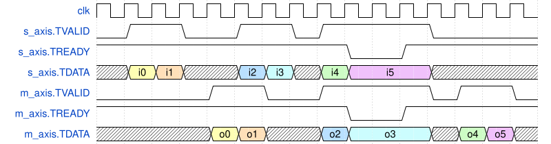

# Module Specification: `FIR`

> **Source:** `ts/src/modules/FIR/`
> **Status:** Approved

---

## Overview

Implements a parameterized **Finite Impulse Response (FIR) digital filter**. Input samples arrive on an AXI4-Stream slave interface. Each one shifts into a delay line of `numTaps` taps, each tap is multiplied by its coefficient, and the products are summed, rounded and saturated before being driven on an AXI4-Stream master interface. The coefficients are registers in a `RegisterBlock`, written and read at runtime over the `regs` Memory bus; the `coefficients` parameter sets their reset values. `numTaps` can be any positive integer, and the register block scales to match.

---

## Parameters

| Parameter | Type | Default | Description |
|---|---|---|---|
| `name` | `string` | derived | Module name. Derived from the other parameters when omitted |
| `numTaps` | `number` | — | Number of filter taps and coefficient registers; a positive integer (required) |
| `coefficients` | `bigint[]` | `0n` per tap | Reset value of each coefficient register, tap 0 first. Taps past the end of the list reset to `0n` |
| `coefficientsWidth` | `IntRange<2,32>` | `32` | Coefficient register width; coefficients are signed |
| `inWidth` | `IntRange<1,32>` | `8` | Input sample width (signed) |
| `outWidth` | `IntRange<1,32>` | `9` | Output sample width (signed) |
| `rShift` | `IntRange<0,32>` | `2` | Right shift from the accumulator to the output, rounding half up. `0` passes the accumulator through unrounded |
| `accumulatorWidth` | `IntRange<1,128>` | `inWidth + coefficientsWidth + ⌊log2(numTaps)⌋` | Accumulator width (signed). The default holds the sum for any coefficients. A narrower accumulator wraps when a sum doesn't fit (see Functional Description) |

The default `accumulatorWidth` is the narrowest that never wraps. The largest sum in magnitude is `numTaps` products of the two most negative values, `numTaps × 2^(inWidth + coefficientsWidth − 2)`, which needs `inWidth + coefficientsWidth + ⌊log2(numTaps)⌋` bits, signed.

The constructor throws, naming the parameter and the value, when:

- `numTaps` isn't a positive integer;
- a width or `rShift` isn't an integer in its range: the table's, and for `accumulatorWidth`, from `rShift + 1` to its default;
- `coefficients` has more values than `numTaps`;
- a coefficient doesn't fit in `coefficientsWidth` bits, signed: −2<sup>w−1</sup> to 2<sup>w−1</sup> − 1.

---

## IO Ports

| Port | Direction | Width | Notes |
|---|---|---|---|
| `clk` | input | 1 | `posedge` clock |
| `rst_b` | input | 1 | Active-low async reset |

### Interfaces

| Interface | Type | Role | Description |
|---|---|---|---|
| `s_axis` | `AXI4Stream_32_4_0_4` | inward (slave) | Input samples: `TDATA[inWidth-1:0]`, signed |
| `m_axis` | `AXI4Stream_32_4_0_4` | outward (master) | Filtered output: `TDATA` sign-extended to 32 bits |
| `regs` | `memory_bidi_32_32` | inward (slave) | The coefficient registers (Register Map below) |

**`s_axis`:** FIR reads `TVALID` and `TDATA[inWidth-1:0]`, and drives `TREADY`. It ignores the bits of `TDATA` above `inWidth`, `TSTRB`, `TKEEP`, `TLAST`, `TID`, `TDEST` and `TWAKEUP`.

**`m_axis`:** FIR drives `TVALID` and `TDATA`, and reads `TREADY`. Every beat is a whole packet with every byte valid: `TLAST` is `1`, `TSTRB` and `TKEEP` are all ones, and `TID`, `TDEST` and `TWAKEUP` are `0`.

**Clock and reset:** FIR runs on `clk` and `rst_b`. It ignores each stream's `ACLK`, `ARESETn` and `ACLKEN`, so both streams must be synchronous to `clk`, and FIR has no clock enable: tie `ACLKEN` high.

**Backpressure:** `s_axis.TREADY` deasserts when `m_axis.TREADY` is low and the output stage holds valid data, stalling the entire pipeline. FIR takes a sample in every cycle that nothing stalls.

---

## Register Map

**YAML source:** `ts/src/modules/FIR/fir_coeffs.yaml`
**Regenerate:** `./scripts/gen_regblock.sh ts/src/modules/FIR/fir_coeffs.yaml`

The YAML uses `repeatedRegister` to define a template; the generated factory function `createFirCoeffsDef(numTaps, coefficientsWidth, resetValues?)` produces the actual `RegisterBlockDef` at construction time.

| Register | Address | Type | Width | Reset | Description |
|---|---|---|---|---|---|
| `COEFF_0` | `0x000` | RW (signed) | `coefficientsWidth` | `coefficients[0]` or `0n` | Tap 0 coefficient |
| `COEFF_1` | `0x004` | RW (signed) | `coefficientsWidth` | `coefficients[1]` or `0n` | Tap 1 coefficient |
| `COEFF_N` | `0x000 + N×4` | RW (signed) | `coefficientsWidth` | `coefficients[N]` or `0n` | Tap N coefficient |

Total registers = `numTaps`. Accesses follow the `Memory` interface's handshake, with `READY` always high. Every bit of `ADDR` is decoded, so only these addresses match.

- **Write:** a cycle with `WE` high writes `DATA_WR[coefficientsWidth-1:0]` to the register, a byte lane at a time under `WSTRB`. The bits above `coefficientsWidth`, and their strobe lanes, are ignored. The new coefficient is in effect from the next cycle.
- **Read:** a cycle with `RE` high puts the register on `DATA_RD` in the next cycle, in the low `coefficientsWidth` bits. The bits above them read as `0`: a negative coefficient is not sign-extended.

A sum uses the coefficients in effect in the cycle it's computed, the cycle after its sample's transfer unless the pipeline stalls. To change the filter between two samples, write the coefficients while no sample is in the pipeline, with `m_axis.TVALID` low and no transfer in the last two cycles.

---

## Functional Description

Each output is

    y[n] = saturate( round( wrap( Σ coeff[i] × x[n−i] ) ) ),  i = 0 … numTaps−1

where `x[n]` is the n-th sample transferred on `s_axis`, and a sample from before reset counts as `0`.

1. **Handshake.** The pipeline advances (`en`) when `m_axis.TREADY` is high or the output stage holds no valid data. `s_axis.TREADY` is `en`, and a transfer (`s_xfer`) is a cycle with `s_axis.TVALID` and `en` both high.
2. **Tap line.** On each transfer, the sample `$signed(s_axis.TDATA[inWidth-1:0])` shifts into `tap_0_q`, and each `tap_i_q` into `tap_{i+1}_q`. Without a transfer the taps hold.
3. **Products.** Each `tap_i_q` is multiplied by `coeff_i`, the output of `COEFF_i`, at full precision: `inWidth + coefficientsWidth` bits.
4. **Accumulator.** The products are summed at `accumulatorWidth` bits into `sum_nxt`, and registered into `sum_q` when `en` is high. With the default width the sum never wraps. A narrower accumulator keeps the low `accumulatorWidth` bits of the sum, as a signed value.
5. **Round.** With `rShift > 0`, `sum_q` is shifted right by `rShift`, rounding half up (`addRound`'s `rp` mode): `(sum_q + 2^(rShift−1)) >>> rShift`, into `rounded`, which has one more bit than the shift leaves to hold the rounding carry. With `rShift = 0`, `sum_q` passes through.
6. **Saturate.** The rounded value is clamped to `[−2^(outWidth−1), 2^(outWidth−1) − 1]` into `saturated`, then registered into `data_out_q` when `en` is high. An output at least as wide as the rounded value is sign-extended instead.
7. **Output.** `m_axis.TDATA` is `data_out_q` sign-extended to 32 bits.
8. **Valid chain.** One valid bit per stage, each advancing when `en` is high: `valid_tap_q` (the tap line holds a new sample) takes `s_xfer`, `valid_sum_q` (`sum_q` holds its sum) takes `valid_tap_q`, and `valid_out_q` (`data_out_q` holds its output) takes `valid_sum_q`. `m_axis.TVALID` is `valid_out_q`.

### Reset behavior

`rst_b` clears the valid bits, so `m_axis.TVALID` is low and `s_axis.TREADY` high, and clears the taps to `0`, so the first `numTaps − 1` outputs see a history of zeros. The coefficient registers reset to `coefficients`, or `0n` for taps past its end.

`sum_q` and `data_out_q` have no reset (SV guide RST-3). They are datapath registers, and nothing reads them while their valid bit is low. `m_axis.TDATA` is undefined until the first output.

---

## Timing

`myFIR3` from reset, with bubbles on `s_axis` and a two-cycle stall on `m_axis`. Output `oN` is the filter's output for input `iN`. A sample transferred in cycle c comes out in cycle c + 3: `i0` in cycle 1, `o0` in cycle 4. While `m_axis.TVALID` is high and `m_axis.TREADY` low (cycles 9 and 10), the whole pipeline holds, so `s_axis.TREADY` is low and `o3` stays on `m_axis.TDATA`. `i4`, in the tap line during the stall, comes out two cycles late. `make -C verilatorTB fir_sim` replays this diagram cycle for cycle.

<!-- wavedrom FIR-timing-stream.svg
{
  "signal": [
    {"name": "clk",           "wave": "p..............."},
    {"name": "s_axis.TVALID", "wave": "01.0.1.01...0..."},
    {"name": "s_axis.TREADY", "wave": "1........0.1...."},
    {"name": "s_axis.TDATA",  "wave": "x34x.56x78..x...", "data": ["i0", "i1", "i2", "i3", "i4", "i5"]},
    {"name": "m_axis.TVALID", "wave": "0...1.0.1...01.0"},
    {"name": "m_axis.TREADY", "wave": "1........0.1...."},
    {"name": "m_axis.TDATA",  "wave": "x...34x.56..x78x", "data": ["o0", "o1", "o2", "o3", "o4", "o5"]}
  ]
}
-->



---

## Internal Architecture

- **Handshake** — `en`, `s_xfer` and the valid chain `valid_tap_q` → `valid_sum_q` → `valid_out_q`; `addAssign` and `addRegister` calls.
- **Tap line** — `numTaps` `addRegister` calls chaining `data_in → tap_0_q → … → tap_{N-1}_q`, enabled by `s_xfer`. `data_in` is `$signed(s_axis.TDATA[inWidth-1:0])`.
- **`u_coeff_regs` (`<name>_coeffRegs`)** — `RegisterBlock` submodule with `numTaps` RW registers built from `createFirCoeffsDef(numTaps, coefficientsWidth, coefficients)`. Its `regs` bus is bound to FIR's `regs` port, and each `COEFF_i` to `coeff_i`.
- **Multipliers** — `numTaps` `addMultiplier` calls, `prod_i = tap_i_q * coeff_i`.
- **Accumulator** — one `addAssign`, `sum_nxt = prod_0 + … + prod_{N-1}`, with one outer cast when `accumulatorWidth` is narrower than its default (SV guide WIDTH-2), then `addRegister` into `sum_q`.
- **Round/saturate** — `addRound` (when `rShift > 0`) then `addSaturate`, then `addRegister` into `data_out_q`.
- **Output stream** — `addAssign` calls driving `m_axis`.
- **Ignored inputs** — the inputs FIR ignores on purpose are read into local signals under a waiver for that signal only, with the reason (SV guide LINT-3): `axis_unused_clk` for both streams' `ACLK`, `ACLKEN` and `ARESETn`, and, when `coefficientsWidth < 32`, `regs_unused_bits` for the `DATA_WR` bits and `WSTRB` lanes above `coefficientsWidth`.

---

## Dependencies

| Import | Source |
|---|---|
| `TSSV` (default) | `tssv/lib/core/TSSV` |
| `RegisterBlock` | `tssv/lib/core/Registers` |
| `Memory` | `tssv/lib/interfaces/Memory` |
| `AXI4Stream` | `tssv/lib/interfaces/AMBA/AMBA4/AXI4Stream/r0p0_1/AXI4Stream` |
| `createFirCoeffsDef` | `./regs-fir_coeffs.js` (generated from `fir_coeffs.yaml`) |

---

## Test Plan

**Test script:** `ts/test/test_FIR.ts`
**Testbench:** `verilatorTB/tb_FIR.sv`, run by `make -C verilatorTB fir_sim` (and in CI)
**Output:** `sv-examples/FIR/<name>/`, and the testbench inputs in `sv-examples/FIR/tb/`

`test_FIR.ts` writes each configuration below one definition per file, with a lint wrapper and filelist (`<name>_lint_top.f`). It checks each one's ports against the IO tables above and its accumulator width against the `accumulatorWidth` default (TSSV guide TEST-2). It also checks that each bad value under Parameters throws, and that parameters that make the same module give it the same name: a short `coefficients` list and its zero-padded form, the parameters in any order, and `accumulatorWidth` left out or passed at its default.

| Configuration | `numTaps` | `coefficients` | Widths: coefficients, in, out, accumulator | `rShift` | Covers |
|---|---|---|---|---|---|
| `lowpass13` (`myFIR3`) | 13 | `[-1,0,5,-6,-10,38,77,38,-10,-6,5,0,-1]` | 8, 8, 8, 19 | 7 | The tutorial's low-pass filter; replays the Timing diagram |
| `defaults` | 4 | omitted (`0n`) | 32, 8, 9, 42 | 2 | Every default; only a write over `regs` gives a nonzero output |
| `no_round` | 3 | `[-2,1,3]` | 4, 4, 12, 9 | 0 | No rounding; an output wider than the accumulator never saturates |
| `narrow_acc` | 5 | `[3,-7,12,-7,3]` | 6, 6, 6, 10 | 3 | An accumulator 4 bits narrower than its default, which wraps |
| `wide` | 1 | `[-2^31]` | 32, 32, 32, 64 | 31 | Every width at its maximum |
| `narrowest` | 2 | `[-2,1]` | 2, 1, 2, 4 | 1 | Every width at its minimum |

`make fir_sim` lints each configuration with `verilator --lint-only -Wall` and the common waivers, through its filelist, then builds and runs `tb_FIR.sv` on it. The testbench checks every output on `m_axis` against a reference model of the Functional Description, and that a valid output holds, unchanged, until `m_axis.TREADY` takes it. Its phases:

1. After reset, `m_axis.TVALID` is low and `s_axis.TREADY` high.
2. `lowpass13` only: the Timing diagram, cycle for cycle, from the spec's own WaveDrom JSON.
3. Latency: one sample, with `m_axis` always ready, comes out 3 cycles after its transfer.
4. Random traffic with the reset coefficients: bubbles on `s_axis`, stalls on `m_axis`, samples biased to the extremes, and random bits in `TDATA` above `inWidth`.
5. Three rounds of new coefficients written over `regs`, with random bits above `coefficientsWidth`, each read back and followed by random traffic. The first round sets every coefficient to its most negative value. At least one output must differ from what the reset coefficients give.

Where the widths allow it, some outputs must saturate and some not.

`tb_lpFIR`, the testbench in `doc/tutorials/fir.md`, drives `myFIR3` with a chirp for viewing in GTKWave. It checks nothing.

```bash
npx tsc && node out/test/test_FIR.js
make -C verilatorTB fir_sim
cd verilatorTB && make clean && make
./rungtkwave.sh Vtb_lpFIR.vcd
# In GTKWave: look for s_axis.TDATA (chirp input) and m_axis.TDATA (filtered output)
```

---

## Implementation Notes

- **Style-guide deviations.** The module follows the [TSSV guide](../../rtl-style/tssv-style/tssv-coding-style.md) and the [SV guide](../../rtl-style/sv-style/sv-coding-style.md), except:
  - **MOD-4** (TSSV guide, SHOULD): the reset is `rst_b`, not `rst_n`. Renaming reset ports is out of scope for [#59](https://github.com/TypeScriptSystemVerilog/TSSV/issues/59).
  - **MOD-2** (TSSV guide, SHOULD): `params` is declared with the normalized type, every default applied, rather than `FIR_Parameters`, so its fields aren't optional.
  - **RST-3** (SV guide, SHOULD): the taps are datapath registers but keep their reset. They are filter state: the first `numTaps − 1` outputs read taps that no sample has written yet.
- **Notes on the guides.**
  - **WIDTH-4 / WIDTH-9:** `data_in` is `$signed(s_axis.TDATA[inWidth-1:0])`. WIDTH-4 rules out `$signed(x)` to convert an unsigned value. Here the bits already hold a two's-complement sample, so `$signed` reinterprets them, the explicit change of signedness WIDTH-9 asks for.
  - **PARAM-1:** `numTaps` is a `number`, checked in the constructor, not an `IntRange`, which can't express a bound past 999.
  - **BUILD-1:** the accumulator is one `addAssign`, not a chain of `addAdder` calls, which would add `numTaps − 1` named intermediates.
- **Changed in #152.** Before #152 (and [#83](https://github.com/TypeScriptSystemVerilog/TSSV/issues/83)):
  - `regs` wasn't a port. `addSubmodule`'s `createMissing` made it a local bundle inside FIR, so the coefficients kept their reset values.
  - The tap line shifted whenever the pipeline advanced, with or without `s_axis.TVALID`. `m_axis.TVALID` rose one cycle before its output reached `TDATA`: the valid chain had two stages and the data three. This spec gave the latency as 2, counting to the early `TVALID`. A sample's output has always reached `TDATA` 3 cycles after its transfer.
  - The accumulator was `inWidth + bitWidth(Σ|coefficients|)` bits: sized for the reset coefficients, it wrapped once others were written, and was `inWidth` bits for the default coefficients. `myFIR3`'s accumulator goes from 16 to 19 bits; its outputs for its reset coefficients don't change.
  - `rShift: 0` rounded away one bit anyway; it now passes the sum through.
  - The coefficient check accepted 2<sup>w−1</sup>, which doesn't fit `w` bits signed. `numTaps` and the length of `coefficients` weren't checked.
  - Derived names didn't include `accumulatorWidth`, depended on the order the parameters were passed in, and changed with a short `coefficients` list's zero padding. Every unnamed FIR's coefficient block was named `fir_coeffRegs`, so two of them in one design shared one definition. It is now `<FIR name>_coeffRegs`.
  - `sum_q` and `data_out_q` were reset.
  - Signal and instance names: `valid_pipe_0`/`valid_pipe_1` are now `valid_tap_q`/`valid_sum_q`/`valid_out_q`, `tap_i` is `tap_i_q`, `sum` is `sum_q`, `data_out` is `data_out_q`, `prod_tap_ixcoeff_i` is `prod_i`, and `coeff_block` is `u_coeff_regs`.
