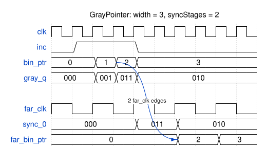

# Module Specification: `GrayPointer`

> **Source:** `ts/src/modules/GrayPointer/`
> **Status:** Draft

---

## Overview

A counter in one clock domain that another clock domain can read. The counter advances by one when `inc` is high, and its value is available in binary in both domains: as `bin_ptr` in its own domain, and as `far_bin_ptr` in the far domain, a few far-domain cycles late.

It crosses in Gray code, where consecutive values differ in one bit. It goes through a `CDCSynchronizer`, so a sample taken mid-change resolves to the old value or the new one, never to a third. The Gray code stays inside the module: both outputs are binary.

The `AFIFO` uses one `GrayPointer` per domain: the write pointer counts pushes, and the read pointer counts pops. Each side compares its own pointer with the other side's, as the other side's `far_bin_ptr`.

---

## Parameters

Defined in `GrayPointer_Parameters extends TSSVParameters`.

| Parameter | Type | Default | Description |
|---|---|---|---|
| `name` | `string` | auto-generated | Instance name. If omitted, TSSV derives it from the other parameters, sorted by parameter name, e.g. `GrayPointer_2_3` for 2 sync stages of 3 bits |
| `width` | `bigint` (≥ 1) | — | Pointer width in bits. The pointer counts from 0 to 2^`width` − 1, then wraps to 0 |
| `syncStages?` | `bigint` (≥ 2) | `2n` | Flops in the `CDCSynchronizer` that carries the pointer into the far domain |

Invalid values throw an `Error` that names the module, the parameter and the value: `width < 1` or `syncStages < 2`.

---

## IO Ports

### Own domain (`clk`)

| Port | Direction | Width | Clock/Reset | Description |
|---|---|---|---|---|
| `clk` | `input` | 1 | `isClock: 'posedge'` | The pointer's clock |
| `rst_n` | `input` | 1 | `isReset: 'lowasync'` | Own-domain reset, active low. See [Reset behavior](#reset-behavior) |
| `inc` | `input` | 1 | — | Advance the pointer by one on the next `clk` edge |
| `bin_ptr` | `output` | `width` | — | The pointer, in binary |

### Far domain (`far_clk`)

| Port | Direction | Width | Clock/Reset | Description |
|---|---|---|---|---|
| `far_clk` | `input` | 1 | `isClock: 'posedge'` | The reading domain's clock |
| `far_rst_n` | `input` | 1 | `isReset: 'lowasync'` | Far-domain reset, active low |
| `far_bin_ptr` | `output` | `width` | — | The pointer as the far domain sees it, in binary, `syncStages` `far_clk` edges late |

---

## Functional Description

### Own domain

1. On each rising edge of `clk`, `bin_ptr` advances by one if `inc` is high, wrapping from 2^`width` − 1 to 0. It's a flop.
2. A Gray-coded copy of the pointer, `gray_q`, is registered on the same edge. It changes in exactly one bit whenever `bin_ptr` advances, including across the wrap, and doesn't change otherwise. It's the only signal that crosses.

### Far domain

1. **Latency:** a value that `bin_ptr` takes at a `clk` edge reaches `far_bin_ptr` on the `syncStages`th `far_clk` edge after it. This assumes `gray_q` reaches the synchronizer within one `far_clk` period ([Timing constraints](#timing-constraints), item 2). It's one edge later if the synchronizer's first flop misses the change: the change can arrive too close to the edge, or the flop can go metastable and resolve to the old value. A `far_clk` edge at the same instant as the `clk` edge doesn't count.
2. **Only real values, in order:** every value `far_bin_ptr` shows is a value `bin_ptr` held, and the values appear in the order `bin_ptr` took them. So `far_bin_ptr` never moves backwards.
3. **Values can be skipped:** if `bin_ptr` advances more than once between two samples, `far_bin_ptr` jumps straight to the later value. That happens whenever `clk` is faster than `far_clk` and `inc` is high on consecutive edges.
4. **Wraps aren't counted:** `far_bin_ptr` is exact modulo 2^`width`. A caller that measures the distance between two pointers has to keep it below 2^`width`. The `AFIFO` keeps it at or below `depth`, which is 2^(`width` − 1).
5. `far_bin_ptr` is combinational from the synchronizer's last flop, so it changes only on a `far_clk` edge.

### Use in the AFIFO

The `AFIFO` instantiates two, each with `width` = `log2(depth) + 1` and the `AFIFO`'s `syncStages`:

| Instance | `clk` / `rst_n` | `inc` | `bin_ptr` | `far_clk` / `far_rst_n` | `far_bin_ptr` |
|---|---|---|---|---|---|
| Write pointer | `wr_clk` / `wr_rst_n` | `push_fire` | `wr_ptr_q` | `rd_clk` / `rd_rst_n` | `wr_ptr_rsync` |
| Read pointer | `rd_clk` / `rd_rst_n` | `pop_fire` | `rd_ptr_q` | `wr_clk` / `wr_rst_n` | `rd_ptr_wsync` |

Every output is used in both instances, so neither leaves a port unconnected (MOD-6) or a signal unread (LINT-1).

### Reset behavior

`rst_n` resets `bin_ptr` and `gray_q` to 0. `far_rst_n` resets the synchronizer, so `far_bin_ptr` is 0. After both are released, `far_bin_ptr` follows `bin_ptr` with the latency above.

The two resets have to be used together:

1. **Assert both together.** When either reset asserts, the other has to assert by the next edge of its own clock. Releasing them one after the other is fine. When `rst_n` asserts, `gray_q` jumps to 0 at once, which can change several bits together. A synchronizer that samples that jump can show a value `bin_ptr` never held. So from the moment either reset asserts until both are released, the far side must ignore `far_bin_ptr`. `a_rst_together_own` and `a_rst_together_far` check this rule ([Assertions](#assertions)).
2. **Release each one synchronously to its own clock.** The module has no reset synchronizer. That's the caller's job (RST-4).

The `AFIFO` follows both rules: its own reset rules cover them.

### Edge cases

- **`width = 1`:** the pointer toggles. Gray code and binary are the same.
- **`inc` high on every edge:** the pointer counts every cycle. Its Gray code still changes one bit per edge, so the crossing stays safe at any clock ratio, given the bus-skew bound in [Timing constraints](#timing-constraints).

---

## Timing

The diagram draws `far_clk` at half `clk`'s frequency, with every `far_clk` edge at the same instant as a `clk` edge, so that they fit on one grid. In practice the clocks are unrelated. At a shared edge, the synchronizer samples `gray_q` from before the edge, as it would in a simulation with aligned clocks. `width = 3`, `syncStages = 2`. `gray_q` and `sync_0` are internal: `sync_0` is the first flop of the `CDCSynchronizer`.

`inc` is high for three `clk` cycles, so `bin_ptr` counts 0, 1, 2, 3, and `gray_q` changes one bit at a time. `far_clk` is slower, so `sync_0` never samples the Gray value of 1, and `far_bin_ptr` goes straight from 0 to 2, then to 3. 2 and 3 each reach `far_bin_ptr` two `far_clk` edges after the `clk` edge that set them. For 3, the `far_clk` edge at the same instant doesn't count.

<!-- wavedrom GrayPointer-timing.svg
{
  "signal": [
    {"name": "clk",         "wave": "p........."},
    {"name": "inc",         "wave": "01..0....."},
    {"name": "bin_ptr",     "wave": "=.===.....", "data": ["0", "1", "2", "3"], "node": "...A......"},
    {"name": "gray_q",      "wave": "=.===.....", "data": ["000", "001", "011", "010"]},
    {},
    {"name": "far_clk",     "wave": "p....", "period": 2},
    {"name": "sync_0",      "wave": "=.==.", "period": 2, "data": ["000", "011", "010"]},
    {"name": "far_bin_ptr", "wave": "=..==", "period": 2, "data": ["0", "2", "3"], "node": "...B."}
  ],
  "edge": ["A~>B 2 far_clk edges"],
  "head": {"text": "GrayPointer: width = 3, syncStages = 2"}
}
-->


_Latency: **`syncStages` `far_clk` edges** from the `clk` edge that changes `bin_ptr`, or one more if the first synchronizer flop misses the change, given the max-delay bound in [Timing constraints](#timing-constraints)._

---

## Internal Architecture


All of the module's logic is in `ts/src/modules/GrayPointer/GrayPointer.ts`, plus one `CDCSynchronizer` submodule.

- **Counter:** `bin_ptr_nxt = bin_ptr + inc`, `width` bits, so it wraps. `bin_ptr` is a flop that loads `bin_ptr_nxt` on every `clk` edge, built with `addRegister` (BUILD-3).
- **Gray copy:** `gray_q` is a flop that loads `bin_ptr_nxt ^ (bin_ptr_nxt >> 1)` on the same edge. So `gray_q` is always the Gray code of `bin_ptr`, and it's a flop, not logic. The synchronizer's input has to come straight from a flop (`CDCSynchronizer`'s rule 1).
- **Crossing:** `u_sync`, a `CDCSynchronizer` with `width` bits and `stages = syncStages`. It's clocked by `far_clk` and reset by `far_rst_n`. `d` is `gray_q`, and `q` is `gray_far`.
- **Back to binary:** `far_bin_ptr` bit *i* is the XOR of `gray_far` bits *i* and up: `far_bin_ptr[i] = ^gray_far[width-1:i]`. TypeScript generates the bits as one concatenation (BUILD-6). A 1-bit pointer is its own Gray code, so then `far_bin_ptr` is `gray_far`.
- **Module names:** neither `GrayPointer` nor its `CDCSynchronizer` is given an explicit name, so TSSV derives one from the parameters. The `AFIFO`'s two pointers have the same parameters, so they share one `GrayPointer` module, and one `CDCSynchronizer`.

### Key signals

| Signal | Domain | Width | Description |
|---|---|---|---|
| `bin_ptr_nxt` | own | `width` | `bin_ptr + inc`: the pointer after this edge |
| `gray_q` | own | `width` | Registered Gray code of `bin_ptr`: the only signal that crosses |
| `gray_far` | far | `width` | `gray_q` after `syncStages` `far_clk` flops |

---

## Timing constraints

`GrayPointer` knows both clocks and the encoding, so it owns the constraints on its crossing. That crossing is the path from each flop that drives `u_sync`'s input (`gray_q`) to its `u_sync/sync_0` flop (`CDCSynchronizer`'s [Responsibilities of the instantiating module](../CDCSynchronizer/CDCSynchronizer-spec.md#responsibilities-of-the-instantiating-module)). The RTL can't carry the constraints yet. #96 is how TSSV will emit them, and until then the integrator applies them, with the paths and values below.

1. **`set_bus_skew` ≤ T<sub>clk</sub> − (t<sub>setup</sub> + t<sub>hold</sub> + t<sub>jitter</sub>)**, with the setup and hold times of the `sync_0` flops and the jitter of the two clocks.
   - The budget is the `clk` period because `inc` can be high on every edge, so `gray_q` can change once per `clk` period: that's the shortest interval between changes.
   - The skew includes differences in when `far_clk` reaches the `sync_0` flops, not only the data paths.
   - This is the only constraint the one-value-at-a-time argument needs ([Implementation Notes](#implementation-notes)), and it holds at any clock ratio.
2. **`set_max_delay -datapath_only` ≤ T<sub>far_clk</sub>.**
   - The latency in [Far domain](#far-domain), item 1, and in [Timing](#timing) (`syncStages` `far_clk` edges, or one more) holds only if `gray_q` reaches `sync_0` within one `far_clk` period. A longer route adds edges.
   - The `AFIFO`'s `a_rd_latency` and `a_wr_latency` depend on this bound. Simulation can't catch a violation, because its path delays are zero.
3. **No `set_clock_groups -asynchronous` or `set_false_path` between `clk` and `far_clk` on these paths.** Vivado gives those precedence over `set_max_delay`, so it would silently drop item 2.
4. **`syncStages` and MTBF.**
   - `gray_q` can change at up to f<sub>clk</sub>, and a synchronizer's MTBF falls in proportion to the rate its input changes, as well as to f<sub>far_clk</sub>. So choose `syncStages` for the MTBF the design needs at the real f<sub>clk</sub> and f<sub>far_clk</sub>, not at the average rate of `inc`.
   - On UltraScale+ parts, Vivado's `report_synchronizer_mtbf` reports it for chains marked `ASYNC_REG`.

**Selecting the paths:** the end points are the `sync_0` flops of `u_sync`. Select their start points through the fan-in of those flops' inputs, not by name. Synthesis can merge `gray_q`'s top bit with `bin_ptr`'s, since the two are always equal, and #67's Vivado run did.

**No clock-ratio assertion is needed.** Given item 1, every value `far_bin_ptr` shows is one `bin_ptr` held, at any clock ratio. Items 1 and 2 are checked by static timing against the real clocks, not in simulation.

---

## Assertions

`GrayPointer` owns its crossing, so it embeds the crossing's checks in its generated RTL, behind `TSSV_CDC_ASSERT`. They are `a_gray_one_bit`, `a_gray_match`, `a_rst_together_own` and `a_rst_together_far`.
- `a_gray_one_bit` checks `CDCSynchronizer`'s input rule 2 on the source clock. The crossing's correctness depends on it.
- #106 builds the embedding mechanism, on #100's inline checkers. It decides how they're embedded, not whether.
- Until then, these checks run in `tb_GrayPointer.sv`, together with `a_hold` and `a_step`. Those two stay in the testbench, because they check the counter's arithmetic, not the crossing.
- `tb_AFIFO.sv` runs every check here on both of the `AFIFO`'s instances, `u_wr_ptr` and `u_rd_ptr`, through hierarchical references. The shared module `verilatorTB/GrayPointer_checks.sv` holds them.

All of them are SVA in the subset that Verilator 5.052 is known to run correctly (#97). Each is named by its SVA label, so a failure names it.

### Own domain

Each is clocked on `clk` and disabled while `rst_n` is low.

| Label | Embedded | Property | Fails when |
|---|---|---|---|
| `a_gray_one_bit` | yes | `$countones(gray_q ^ $past(gray_q)) <= 1` | `gray_q` changes more than one bit in a cycle, so a synchronizer could catch a value that never existed. This is the check #96's acceptance criteria break with a skipped Gray code |
| `a_gray_match` | yes | `gray_q == (bin_ptr ^ (bin_ptr >> 1))` | The Gray copy is out of step with the pointer |
| `a_hold` | no | `!inc \|=> $stable(bin_ptr)` | The pointer moves without `inc` |
| `a_step` | no | `inc \|=> bin_ptr == $past(bin_ptr) + 1'b1` | The pointer doesn't advance by exactly one, modulo 2^`width` |

A reset that asserts mid-run changes `gray_q` by several bits at once: the one case where that's correct. `a_gray_one_bit` is disabled while `rst_n` is low, so it doesn't fire on that, and after the release `$past(gray_q)` is the reset value, 0. The reset rule that makes the jump safe is checked by `a_rst_together_own` and `a_rst_together_far` (below).

### Both resets

These read both domains' resets, so they're simulation-only, as everything behind `TSSV_CDC_ASSERT` is. Neither is disabled by a reset. When either reset asserts, the other has to be asserted by the next edge of its own clock. Releasing them one after the other is fine.

| Label | Embedded | Clock | Property | Fails when |
|---|---|---|---|---|
| `a_rst_together_far` | yes | `far_clk` | `$fell(rst_n) \|-> !far_rst_n` | `rst_n` asserts and `far_rst_n` isn't asserted by the next `far_clk` edge |
| `a_rst_together_own` | yes | `clk` | `$fell(far_rst_n) \|-> !rst_n` | `far_rst_n` asserts and `rst_n` isn't asserted by the next `clk` edge |

### Far domain

Nothing is embedded in the far domain. This is a decision, not a gap. The exact check of `far_bin_ptr` stays in the testbench (see [Test Plan](#test-plan)), because it needs `bin_ptr`'s history in both domains. What makes every far value correct is checked elsewhere: `a_gray_one_bit` on the source clock, and the bus-skew bound in [Timing constraints](#timing-constraints) by static timing.

### Coverage

Each cover counts its hits in its action block. At the end of a configuration's run, the testbench fails if any cover listed for that configuration has no hits. Verilator evaluates covers only in a build with `--coverage-user`, and without it they compile and silently never run (#97).

| Label | Clock | Property | Configurations | Shows the test reached |
|---|---|---|---|---|
| `c_wrap` | `clk` | `inc && bin_ptr == '1` | all | A wrap from 2^`width` − 1 to 0 |
| `c_far_skip` | `far_clk` | (`far_bin_ptr` − `$past(far_bin_ptr)`) mod 2^`width` > 1 | `width` ≥ 2 | `far_bin_ptr` skipping values, as it does when `clk` is faster |

---

## Dependencies

| Import | Source | Purpose |
|---|---|---|
| `Module`, `TSSVParameters`, `Expr` | `tssv/lib/core/TSSV` | Base class, parameter type and expressions |
| `CDCSynchronizer` | `tssv/lib/modules/CDCSynchronizer` | Carries `gray_q` into the far domain |

---

## Test Plan

**Test script:** `ts/test/modules/test_GrayPointer.ts`.
- It generates the testbench configurations below, and checks each one's ports against the IO tables above.
- It checks that pointers differing in any parameter get different module names.
- It checks that each invalid parameter in [Parameters](#parameters) throws: `width` 0 and `syncStages` 1.
- It emits the `CDCSynchronizer` in its own file (#46), so every generated file lints clean under `-Wall` with no `DECLFILENAME` waiver.
- `runAllTests.sh` runs it.

**Testbench:** `verilatorTB/tb_GrayPointer.sv`, built once per configuration.
- **Own domain:** the checks in [Assertions](#assertions) run in every test, and every cover must be hit in each configuration it applies to.
- **Far domain**, after every `far_clk` edge: `far_bin_ptr` equals `bin_ptr` as it was just before the `far_clk` edge `syncStages − 1` edges earlier. A simulated flop never goes metastable, so this is exact.
- **Clock pairs:** every test runs at three pairs. `clk` 10 ns with `far_clk` 31 ns, `clk` 31 ns with `far_clk` 10 ns, and `clk` 10 ns with `far_clk` 11 ns. A 0.3 ns offset keeps the edges from ever coinciding, except in the diagram replay.

**Output:** `sv-examples/GrayPointer/<module>/` and `sv-examples/GrayPointer/tb/`

| Configuration | `width` | `syncStages` | Notes |
|---|---|---|---|
| `w1_s2` | 1 | 2 | The smallest pointer |
| `w3_s2` | 3 | 2 | The `AFIFO` at `depth = 4` |
| `w4_s3` | 4 | 3 | The `AFIFO` at `depth = 8` with three stages |
| `w6_s2` | 6 | 2 | The `AFIFO` at `depth = 32` |

| Test case | Configurations | Notes |
|---|---|---|
| Count and wrap | all | `inc` high on every edge until the pointer has wrapped at least four times |
| Random | all | 2000 `clk` cycles of random `inc` at each clock pair |
| Reset | all | Both resets asserted together mid-run, then released one after the other: both pointers return to 0, and counting resumes |
| Timing diagram | `w3_s2` | The diagram in [Timing](#timing) replays cycle for cycle, with `far_clk` at half `clk`'s frequency and edges aligned, as drawn. Its internal lanes, `gray_q` and `sync_0`, are checked through hierarchical references. `test_GrayPointer.ts` builds the vectors from the diagram's WaveDrom JSON, as `test_SFIFO.ts` does |

### Simulation

```bash
make -C verilatorTB graypointer_sim    # generates the SV, then builds and runs each configuration
# waveform per configuration: verilatorTB/obj_dir/graypointer_<config>/tb_GrayPointer_<config>.fst
```

The target builds with `--coverage-user`, so the covers run. It also gets its own step in `.github/workflows/test.yml`.

---

## Implementation Notes

- **Binary outputs only.** The `add_AFIFO` draft also put out the Gray pointer, in both domains. The `AFIFO` compares pointers in binary instead, so the Gray code stays inside this module. Each output is then used by both of the `AFIFO`'s instances, and the comparisons need no Gray code. Converting back costs an XOR tree of at most `width` − 1 levels in the far domain, which is small at the `AFIFO`'s widths (6 bits at most).
- **Why Gray code is enough.** One bit changes per `clk` edge, and the bus-skew bound in [Timing constraints](#timing-constraints) keeps the bits' arrival times at the synchronizer within a `clk` period, less setup, hold and jitter. So at any instant at most one bit is in flight at the synchronizer, and a sample is either the old value or the new one.
- **Timing constraints.** This spec states them ([Timing constraints](#timing-constraints)), because `GrayPointer` is the module that knows both clocks and the encoding. #96 is how TSSV will emit them; until then the integrator applies them.
- **Changes from the `add_AFIFO` draft:**
  - `width` replaces `log2depth`, so the module isn't tied to a FIFO's depth. The `AFIFO` passes `log2(depth) + 1`.
  - `bin_ptr` and `far_bin_ptr` replace `bin_ptr`, `gray_ptr` and `gray_ptr_far`.
  - The synchronizer gets a derived name instead of `<name>_sync`.
  - Invalid parameters throw instead of logging.
- **Future:** #106 replaces this module's synchronizer with #96's `gray` primitive, or folds the module into it.
