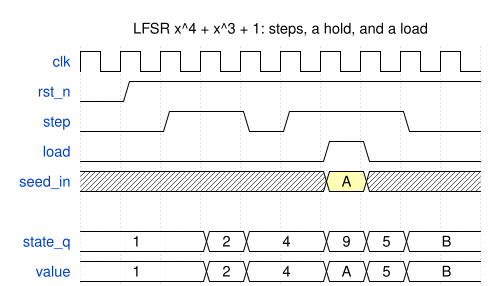

# Module Specification: `LFSR`

> **Source:** `ts/src/modules/LFSR/`
> **Status:** Review

---

## Overview

**Linear-feedback shift register**: a pseudo-random sequence generator of any width. At each
step, the state shifts up one or more stages, and each new bit is the XOR of the stages that the
**feedback polynomial** taps. With a maximal-length polynomial, an LFSR of `width` bits visits
every non-zero state, 2<sup>`width`</sup> − 1 of them, before it repeats. Two LFSRs built with the
same parameters and seed produce the same values, and `LFSRModel` predicts them in TypeScript. That
is how a testbench's source and checker agree on what was sent without a channel between them.

The module is the Fibonacci form: the state is a shift register, and the feedback goes into its
first stage. An advance of several shifts per step costs no more clocks, only a wider XOR network
per bit. The module checks its polynomial: it refuses one that isn't maximal-length unless told
otherwise. It ships a library of maximal-length polynomials, `MAXIMAL_LENGTH_POLY` and the PRBS
polynomials ([The library](#the-library)), so most users never write one.

Polynomials are written in several conventions, and they differ in ways that matter. This spec
defines LFSR's convention exactly ([The polynomial](#the-polynomial)), and shows how to convert
from each of the others ([Converting from other notations](#converting-from-other-notations)).

---

## Parameters

Defined in `LFSR_Parameters extends TSSVParameters`.

| Parameter | Type | Default | Description |
|---|---|---|---|
| `width` | `bigint` | — | The state's width in bits, 2 or more. The polynomial can be checked for maximal length up to 168 bits ([The maximal-length check](#the-maximal-length-check)). |
| `polynomial` | `string \| number[]` | `MAXIMAL_LENGTH_POLY[width]` | The feedback polynomial, of degree `width`: a string such as `'x^16 + x^14 + x^13 + x^11 + 1'`, or its exponents such as `[16, 14, 13, 11, 0]` ([The polynomial](#the-polynomial)). The default, `MAXIMAL_LENGTH_POLY[width]`, is the library's maximal-length polynomial for the width ([The library](#the-library)). |
| `seed` | `bigint` | — | The state after reset: a `width`-bit value other than 0. All-zeros is the lock-up state: its feedback is 0, so the LFSR would stay there ([Reset, the seed and the lock-up state](#reset-the-seed-and-the-lock-up-state)). |
| `advance` | `bigint` | `1n` | How many shifts the state makes per step, 1 or more. Each step still takes one clock ([The advance](#the-advance)). |
| `outWidth` | `bigint` | `width` | How many bits of the state `value` shows, 1 to `width`: `state_q[outWidth-1:0]`, the low-order bits. Bit 0 is stage 1, where the feedback enters, so these are the newest bits ([What it means](#what-it-means)). |
| `loadable` | `boolean` | `false` | Adds `load` and `seed_in`, to restart the sequence at a seed chosen at run time ([Loading a seed](#loading-a-seed)). |
| `disablePolyChecks` | `boolean` | `false` | Skips the checks that the period is 2<sup>`width`</sup> − 1: that the polynomial is maximal-length, and that the advance shares no factor with 2<sup>`width`</sup> − 1 ([The maximal-length check](#the-maximal-length-check)). Needed above 168 bits, where a polynomial can't be checked even when it is maximal-length, and to build one that isn't, such as a CRC's. It doesn't change the SV, so it isn't part of the module's name. |

The module's name isn't an LFSR parameter. TSSV derives it, as for every module, from the
parameters above ([concepts.md §2](../../framework/concepts.md#2-parameters-and-the-module-name)).
Every parameter but `disablePolyChecks` is part of it, with its default applied: an
LFSR that leaves `advance` out and one that passes `1n` are the same module. The polynomial is
part of the name in its canonical form, so its two forms, and any spacing or order of its terms,
give the same module. Each parameter, the canonical polynomial included, is listed in the comment
block at the top of the emitted module.

---

## IO Ports

| Port | Direction | Width | Clock/Reset | Description |
|---|---|---|---|---|
| `clk` | `input` | 1 | `isClock: 'posedge'` | Clock |
| `rst_n` | `input` | 1 | `isReset: 'lowasync'` | Active-low asynchronous reset: the state becomes `seed` |
| `step` | `input` | 1 | — | Moves the state on, by `advance` shifts, at the rising edge |
| `load` | `input` | 1 | — | `loadable` only. Restarts the sequence at `seed_in` |
| `seed_in` | `input` | `width` | — | `loadable` only. The seed `load` restarts at |
| `value` | `output` | `outWidth` | — | The low `outWidth` bits of the current state, `state_q[outWidth-1:0]`, or of `seed_in` while `load` is high |

---

## The polynomial

### What it means

LFSR's state is `state_q[width-1:0]`. Number its bits as stages, from the input: **stage k is
state bit k − 1**, so stage 1 is bit 0 and stage `width` is the top bit. At each shift, every bit
moves up one stage, and bit 0 takes the **feedback**: the XOR of the stages the polynomial taps.

**The term x<sup>k</sup>, for k from 1 to `width`, taps stage k.** The `1` term, x<sup>0</sup>,
stands for the input itself, where the feedback enters. A polynomial for a `width`-bit LFSR
therefore always has x<sup>`width`</sup> (the last stage always feeds back) and always has `1`.

For x<sup>16</sup> + x<sup>14</sup> + x<sup>13</sup> + x<sup>11</sup> + 1, the taps are stages
16, 14, 13 and 11, which are bits 15, 13, 12 and 10:

```text
  stage    1    2   ...   11   12   13   14   15   16
  bit      0    1   ...   10   11   12   13   14   15
  tapped                   *         *    *         *

  each shift: every bit moves up one stage, and bit 0 takes bit 15 ^ bit 13 ^ bit 12 ^ bit 10
```

One shift, in SV, is:

```systemverilog
state_nxt = {state_q[14:0], state_q[15] ^ state_q[13] ^ state_q[12] ^ state_q[10]};
```

As a recurrence on the bits that enter the register, if b(t) is the bit shifted in at shift t:

  b(t) = b(t − 16) ⊕ b(t − 14) ⊕ b(t − 13) ⊕ b(t − 11)

Each tapped stage k contributes the bit that entered k shifts ago. In the mathematical
literature, this polynomial is the **connection polynomial** of the sequence b. The
**characteristic polynomial** of the same sequence is its reciprocal,
x<sup>16</sup> + x<sup>5</sup> + x<sup>3</sup> + x<sup>2</sup> + 1
([The reciprocal](#the-reciprocal-convention)). LFSR always means the connection polynomial,
the form that hardware references print.

This is the convention of Xilinx [XAPP052](https://docs.amd.com/v/u/en-US/xapp052)'s tables, of
[Wikipedia's Fibonacci example](https://en.wikipedia.org/wiki/Linear-feedback_shift_register#Fibonacci_LFSRs), of the ITU-T PRBS definitions, and of
hand-written SV such as `{l[14:0], l[15] ^ l[13] ^ l[12] ^ l[10]}`. Each of those is checked against
LFSR in `test_LFSR.ts` ([Converting from other notations](#converting-from-other-notations)).

### A worked example: x<sup>4</sup> + x<sup>3</sup> + 1

`polynomial: 'x^4 + x^3 + 1'` taps stages 4 and 3, bits 3 and 2:

![The x^4 + x^3 + 1 LFSR: four flops, stage 1 to stage 4 (state_q[0] to state_q[3]), each moving its
bit to the next at every step. Stages 4 and 3 feed an XOR, the x^4 and x^3 terms, and its output
goes back into stage 1, the 1 term. value is all four bits.](LFSR-circuit-x4.drawio.svg)

LFSR emits:

```systemverilog
assign state_nxt = {state_q[2:0], state_q[3] ^ state_q[2]};
```

From seed `0001`, it visits all 15 non-zero states, then returns to `0001`:

| Step | State | Step | State | Step | State |
|---|---|---|---|---|---|
| 0 | `0001` | 5 | `0110` | 10 | `0111` |
| 1 | `0010` | 6 | `1101` | 11 | `1111` |
| 2 | `0100` | 7 | `1010` | 12 | `1110` |
| 3 | `1001` | 8 | `0101` | 13 | `1100` |
| 4 | `0011` | 9 | `1011` | 14 | `1000` |

So it is maximal-length, and it is `MAXIMAL_LENGTH_POLY[4]`. To check that an LFSR built from a
datasheet's polynomial is the one the datasheet means, compare its first few states with the
datasheet's, using `new LFSRModel({ width: 4n, polynomial: 'x^4 + x^3 + 1' }).values(1n, 8)`.

### A poor polynomial: x<sup>4</sup> + x<sup>2</sup> + 1

x<sup>4</sup> + x<sup>2</sup> + 1 is also a degree-4 polynomial with a `1`, but it isn't
maximal-length. From `0001`, it visits `0001`, `0010`, `0101`, `1010`, `0100`, `1000`, then
returns to `0001`: 6 states of 15. Other seeds give other short cycles. It factors as
(x<sup>2</sup> + x + 1)<sup>2</sup>, so it isn't **primitive**, and only a primitive polynomial
gives the full period. LFSR refuses it:

```text
LFSR: polynomial x^4 + x^2 + 1 isn't maximal-length (it isn't primitive), so its sequence repeats
before visiting all 15 non-zero states. Use MAXIMAL_LENGTH_POLY[4], or pass disablePolyChecks: true
to build it anyway
```

Most polynomials of a given degree are poor: of the 8 with x<sup>4</sup> and 1, two are primitive.
A polynomial with an even number of terms is never primitive, since x + 1 divides it.

### Writing a polynomial

Both forms mean the same polynomial, and give the same module:

| Form | Example | Rules |
|---|---|---|
| String, as sources print it | `'x^16 + x^14 + x^13 + x^11 + 1'` | Each term is `x^k`, `x` (x<sup>1</sup>) or `1` (x<sup>0</sup>), joined by `+`. The terms may come in any order, with any spacing, and `x ^ 3` is `x^3`. |
| Exponents | `[16, 14, 13, 11, 0]` | Each term's exponent, `width` and 0 included, in any order. |

Both forms must have x<sup>`width`</sup>, the `1`, and no term twice. LFSR refuses anything
else, and says what is wrong:

| Polynomial (`width: 4n`) | Message |
|---|---|
| `'x^4 + 2x^3 + 1'` | `polynomial 'x^4 + 2x^3 + 1' has a term "2x^3" that isn't x^k, x or 1` |
| `'y^4 + y^3 + 1'` | `has a term "y^4" that isn't x^k, x or 1` |
| `'x^4 + x^3 + x^3 + 1'` | `has the term x^3 twice` |
| `'x^5 + x^3 + 1'` | `has degree 5, but the width is 4: its highest term must be x^4` |
| `'x^4 + x^3'` | `has no 1 (x^0) term; add the 1: 'x^4 + x^3 + 1'` |
| `[4, 3]` | `has no 1 (x^0) term; a tap list, such as XAPP052's, leaves the 0 out: write [4, 3, 0]` |

There is no hex form. A hex number names a polynomial only together with a convention, and
there are at least three in use (below), so LFSR takes the polynomial written out.

The canonical form, which the module's name and its SV header carry, lists the terms highest
first: `x^16 + x^14 + x^13 + x^11 + 1`.

### Converting from other notations

Each conversion below is checked by a test in `ts/test/modules/test_LFSR.ts` that runs the other
notation as its source writes it, and compares it with LFSR.

| Source gives | Example | LFSR's `polynomial` | Same states? |
|---|---|---|---|
| A polynomial, as printed by XAPP052, Wikipedia or ITU-T O.150 | x<sup>16</sup> + x<sup>14</sup> + x<sup>13</sup> + x<sup>11</sup> + 1 | The same: `'x^16 + x^14 + x^13 + x^11 + 1'` | Yes, if the source numbers stages from the input |
| A tap list, as in XAPP052's Table 3 | `16,15,13,4` | The taps, then 0: `[16, 15, 13, 4, 0]` | With XOR feedback, yes; with XNOR, see below |
| Hand-written SV | `{l[14:0], l[15] ^ l[13] ^ l[12] ^ l[10]}` | Each tapped bit index + 1: `[16, 14, 13, 11, 0]` | Yes, bit for bit |
| An LFSR that shifts right, new bit at the top | [Wikipedia's Fibonacci example](#wikipedias-fibonacci-example) | The same polynomial | Yes, with the state bit-reversed |
| A Galois toggle mask, or Koopman's hex | `0xB400` | Mask bit i is x<sup>i+1</sup>, plus the 1: `'x^16 + x^14 + x^13 + x^11 + 1'` | No: the same bit sequence, but other states |
| A characteristic polynomial | x<sup>16</sup> + x<sup>5</sup> + x<sup>3</sup> + x<sup>2</sup> + 1 | Its reciprocal: `'x^16 + x^14 + x^13 + x^11 + 1'` | Yes |
| A CRC polynomial | CRC-16-CCITT, x<sup>16</sup> + x<sup>12</sup> + x<sup>5</sup> + 1 | The same, with `disablePolyChecks: true`: most aren't primitive, so LFSR refuses them by default | Not a CRC: [no data input](#crc-polynomials) |

#### Hand-written SV

In `lfsr <= {lfsr[n-2:0], <XOR of bits>}`, each bit index in the XOR is a
stage minus 1. So `{lfsr[14:0], lfsr[15] ^ lfsr[13] ^ lfsr[12] ^ lfsr[10]}` taps stages 16, 14, 13
and 11, and is x<sup>16</sup> + x<sup>14</sup> + x<sup>13</sup> + x<sup>11</sup> + 1. LFSR with that
polynomial and the same seed steps through the same states.

#### XAPP052 and XNOR feedback

[XAPP052](https://docs.amd.com/v/u/en-US/xapp052) labels its stages Q1 to Qn, "with 1 being the first stage
of the shift register", and feeds the XNOR of the listed outputs into D1. So its taps are the
polynomial's exponents. Its circuits use XNOR rather than XOR, which moves the lock-up state from
all-zeros to all-ones (XAPP052: "by default the flip-flops wake up in the all-zeros state"). For
a primitive polynomial, the XNOR LFSR from seed s is the bitwise complement of the XOR LFSR from
seed ~s. So to match an XNOR circuit bit for bit, give LFSR the seed `~s` and use `~value`. LFSR
has no XNOR option ([Reset, the seed and the lock-up state](#reset-the-seed-and-the-lock-up-state)).

#### Wikipedia's Fibonacci example

[Wikipedia's Fibonacci example](https://en.wikipedia.org/wiki/Linear-feedback_shift_register#Fibonacci_LFSRs), for
x<sup>16</sup> + x<sup>14</sup> + x<sup>13</sup> + x<sup>11</sup> + 1, shifts right, with the new
bit at the top:

```c
bit = ((lfsr >> 0) ^ (lfsr >> 2) ^ (lfsr >> 3) ^ (lfsr >> 5)) & 1u;
lfsr = (lfsr >> 1) | (bit << 15);
```

Its bit 15 is stage 1 and its bit 0 is stage 16. So it is LFSR with the same polynomial, with the
state bit-reversed: its start state `0xACE1` is LFSR's `0x8735`, and both have period 65535.

#### Galois toggle masks and Koopman's tables

A Galois LFSR XORs a mask into the state when the bit it shifts out is 1, as in
[Wikipedia's Galois example](https://en.wikipedia.org/wiki/Linear-feedback_shift_register#Galois_LFSRs) and [Koopman's tables](https://users.ece.cmu.edu/~koopman/lfsr/), whose page gives
the loop `if (i & 1) i = (i >> 1) ^ feed;`:

```c
unsigned lsb = lfsr & 1u;
lfsr >>= 1;
if (lsb) lfsr ^= 0xB400u;
```

Set bit i of the mask is the term x<sup>i+1</sup>, and the 1 is implied: `0xB400` has bits 15, 13,
12 and 10, which give x<sup>16</sup> + x<sup>14</sup> + x<sup>13</sup> + x<sup>11</sup> + 1. The
bits a Galois LFSR shifts out follow the same recurrence as the bits LFSR shifts in. So it is the
same sequence of bits, at another phase, and the same polynomial is maximal-length in both forms.
The states aren't the same. To match a Galois design state for state, compare its output bits,
not its states.

#### The reciprocal convention

Some sources describe an LFSR by the characteristic polynomial of
its sequence, or number its stages from the output end. Either way they print the
**reciprocal**: x<sup>n</sup>·p(1/x), the exponents k replaced by n − k. For example,
x<sup>16</sup> + x<sup>5</sup> + x<sup>3</sup> + x<sup>2</sup> + 1 is the reciprocal of
x<sup>16</sup> + x<sup>14</sup> + x<sup>13</sup> + x<sup>11</sup> + 1. A polynomial is primitive
exactly when its reciprocal is, so the maximal-length check can't tell which one was meant. The
reciprocal gives a different maximal-length LFSR, whose bits are the same sequence backwards. If
a source's first few states don't match LFSR's (`LFSRModel.values()`), try the reciprocal.

#### A hex number

Besides toggle masks, a polynomial may be written as a hex number with every
term (bit k is x<sup>k</sup>: `0x16801` for x<sup>16</sup> + x<sup>14</sup> + x<sup>13</sup> +
x<sup>11</sup> + 1), or, for a CRC, without the top term (`0x1021` for CRC-16-CCITT's
x<sup>16</sup> + x<sup>12</sup> + x<sup>5</sup> + 1). Find out which before converting.

#### CRC polynomials

CRC polynomials are chosen for error detection, not for period, and most aren't primitive.
CRC-16-CCITT's x<sup>16</sup> + x<sup>12</sup> + x<sup>5</sup> + 1 has four terms, so x + 1
divides it, and LFSR refuses it by default. With `disablePolyChecks: true`, LFSR builds it: a
sequence generator whose period is shorter than 2<sup>16</sup> − 1 and depends on the seed. That
still isn't a CRC. A CRC register XORs each message bit into its feedback, and LFSR has no data
input, so it can't compute a CRC over a message.

### The library

`polynomials.ts` exports two sets of polynomials, all in LFSR's convention and all checked by
`test_LFSR.ts`:

- **`MAXIMAL_LENGTH_POLY[width]`**, one maximal-length polynomial for each width from 2 to 168,
  and the default when `polynomial` is left out. Widths 3 to 168 are [XAPP052](https://docs.amd.com/v/u/en-US/xapp052)'s Table 3
  (P. Alfke, *Efficient Shift Registers, LFSR Counters, and Long Pseudo-Random Sequence
  Generators*, v1.1, 1996), which
  gives a trinomial where it found one, otherwise a pentanomial, and for width 37 six taps.
  Width 2 is x<sup>2</sup> + x + 1, the only primitive polynomial of degree 2. Width 102 isn't
  XAPP052's: its taps `102,101,36,35` give a polynomial that isn't primitive (it factors into
  polynomials of degree 3, 34 and 65). The library has
  x<sup>102</sup> + x<sup>101</sup> + x<sup>26</sup> + x<sup>25</sup> + 1 instead, the only
  primitive polynomial of the same shape. There is no primitive trinomial of degree 102.
- **The PRBS polynomials** of test equipment: `PRBS9_POLY` (x<sup>9</sup> + x<sup>5</sup> + 1),
  `PRBS11_POLY` (x<sup>11</sup> + x<sup>9</sup> + 1),
  `PRBS15_POLY` (x<sup>15</sup> + x<sup>14</sup> + 1),
  `PRBS20_POLY` (x<sup>20</sup> + x<sup>3</sup> + 1),
  `PRBS23_POLY` (x<sup>23</sup> + x<sup>18</sup> + 1)
  and `PRBS31_POLY` (x<sup>31</sup> + x<sup>28</sup> + 1), from ITU-T O.150, and `PRBS7_POLY`
  (x<sup>7</sup> + x<sup>6</sup> + 1), which isn't in O.150 but is as widely used. These are the
  polynomials only. O.150 also says how each pattern is sent, for example inverted; take `~value`
  for that, and check the bit order a piece of equipment expects.

Where `MAXIMAL_LENGTH_POLY[w]` and a PRBS constant have the same width, they may differ
(`MAXIMAL_LENGTH_POLY[20]` is x<sup>20</sup> + x<sup>17</sup> + 1, the reciprocal of
`PRBS20_POLY`). Use the PRBS constant to match test equipment.

### The maximal-length check

A polynomial p of degree n is primitive, and its LFSR visits all 2<sup>n</sup> − 1 non-zero
states, exactly when the order of x modulo p is 2<sup>n</sup> − 1. That is, when
x<sup>2<sup>n</sup> − 1</sup> ≡ 1 (mod p), and x<sup>(2<sup>n</sup> − 1)/q</sup> ≢ 1 for each
prime q that divides 2<sup>n</sup> − 1. `isPrimitive()` computes this over GF(2), from the prime
factors of 2<sup>n</sup> − 1 in `mersenneFactors.ts`, for n from 2 to 168. The table was generated
with sympy, and the test checks it rather than trusts it: each list of factors multiplies to
2<sup>n</sup> − 1, and each factor is prime. The test also checks `isPrimitive()` against a brute
force: for every polynomial of degree 2 to 10, it is true exactly when the LFSR's period is
2<sup>n</sup> − 1.

Above 168 bits, the table has no factors, so the check can't be made, even for a polynomial that
is maximal-length: LFSR refuses the polynomial unless `disablePolyChecks` is set, and
`MAXIMAL_LENGTH_POLY` has no default.

---

## Functional Description

### Normal operation

1. At each rising edge of `clk` with `step` high, the state moves on by `advance` shifts. In each
   shift, every bit moves up a stage, and bit 0 takes the XOR of the tapped stages.
2. `value` is the low `outWidth` bits of the current state: the stages nearest the input, which
   hold the newest bits.
3. With `step` low, the state holds.

### The advance

An advance of N makes N shifts per step, in one clock: each bit of the next state is the XOR of
some bits of the current one, worked out in TypeScript. The bits above N only move: for N less than
`width`, the next state is `{cur[width-1-N:0], <N new bits>}`.

With `advance` at least `outWidth`, every bit of `value` is new at each step, so consecutive
values are disjoint windows of one sequence. A testbench drawing `k` bits a step uses an advance of
at least `k`, so that two draws share no bits.

The period, in steps, is (2<sup>`width`</sup> − 1) / gcd(`advance`, 2<sup>`width`</sup> − 1): an
advance that shares a factor with 2<sup>`width`</sup> − 1 visits only some of the states. For
example, 2<sup>16</sup> − 1 = 65535 = 3 · 5 · 17 · 257, so an advance of 3 repeats after 21845
steps. LFSR refuses such an advance unless `disablePolyChecks` is set:

```text
LFSR: an advance of 3 shares the factor 3 with 2^16 − 1 = 65535, so the sequence repeats after
21845 steps instead of 65535. Pick an advance with no factor in common with 65535 (any power of 2
has none), or pass disablePolyChecks: true to build it anyway
```

2<sup>n</sup> − 1 is odd, so a power of 2 is always safe.

### Loading a seed

A loadable LFSR has `load` and `seed_in`. While `load` is high, the current state is `seed_in`,
not `state_q`: `value` shows `seed_in`'s low bits in the same cycle, and a step moves the state on
from `seed_in`. With `load` and `step` both high, the state after the edge is the one after
`seed_in`. With `load` high and `step` low, `state_q` doesn't change, and `value` shows `seed_in`.

So `load` takes effect in the cycle it is high, and a step at the next rising edge. They do
different things: `value` always shows the current state, and `load` *selects* the current state,
through a mux, while a step *writes* `state_q`, a flop. The record streams need the load this
way. An injector's record and its seed come out of its pattern memory in the same cycle, and the
payload the LFSR fills in from that seed must go out with that record. A load that went through
`state_q` would put the payload one cycle behind its record.

A `seed_in` of 0 would hold the state at 0, so whoever drives `load` leaves it low for a seed of 0.
The record streams do this ([testbench.md](../../framework/testbench.md), "Record streams"): a
record whose seed is 0 continues the sequence.

### Reset, the seed and the lock-up state

`rst_n` low sets the state to `seed`. With XOR feedback, the all-zero state is the **lock-up
state**: it moves to itself, so an LFSR there never leaves. LFSR therefore refuses a seed of 0. The
other 2<sup>`width`</sup> − 1 states form one cycle, with a maximal-length polynomial.

LFSR has no XNOR option. XNOR feedback moves the lock-up state to all-ones, which makes all-zeros
legal. That matters where flops come up at 0 without a reset, as in XAPP052's FPGAs. LFSR always
resets to its seed, so it doesn't need that, and an XNOR LFSR adds no sequence that XOR can't
give: it is the complement of the XOR LFSR from the complemented seed. Inverted output, as some
PRBS patterns are sent, is `~value` outside the module too.

---

## Timing

A loadable LFSR with x<sup>4</sup> + x<sup>3</sup> + 1, seed 1 and an advance of 1. It steps in
cycles 2, 3, 5, 6 and 7, and holds in cycle 4. In cycle 6, `load` restarts it at `A`: `value` shows
`A` while `state_q` is still `9`, and the step moves it on from `A` to `5`. `test_LFSR.ts` checks
these values against the model.

<!-- wavedrom LFSR-timing.svg
{
  "signal": [
    {"name": "clk",     "wave": "p........."},
    {"name": "rst_n",   "wave": "01........"},
    {"name": "step",    "wave": "0.1.01..0."},
    {"name": "load",    "wave": "0.....10.."},
    {"name": "seed_in", "wave": "x.....3x..", "data": ["A"]},
    {},
    {"name": "state_q", "wave": "=..==.===.", "data": ["1", "2", "4", "9", "5", "B"]},
    {"name": "value",   "wave": "=..==.===.", "data": ["1", "2", "4", "A", "5", "B"]}
  ],
  "head": {"text": "LFSR x^4 + x^3 + 1: steps, a hold, and a load"}
}
-->


_Latency from `load` to `value`: **0 clock cycles**, since `load` selects the current state.
From `step` to `value`: **1 clock cycle**, since a step writes `state_q`
([Loading a seed](#loading-a-seed))._

---

## Internal Architecture

All of it is in `ts/src/modules/LFSR/`:

- **`LFSR.ts`**, the module. It works out the next state symbolically: it starts with each bit of
  the state standing for itself, and applies `advance` shifts to those sets of bits. Each bit of
  the next state is then an XOR of bits of the current state, emitted as one `assign` with a slice
  for the bits that only move. A register holds the state, enabled by `step`.
- **`polynomial.ts`**: the two forms of a polynomial, `normalizePolynomial()` and
  `resolvePolynomial()`, and the maximal-length check, `isPrimitive()`.
- **`polynomials.ts`**: the library, `MAXIMAL_LENGTH_POLY` and the PRBS constants.
- **`mersenneFactors.ts`**: the prime factors of 2<sup>n</sup> − 1 for n from 2 to 168.
- **`model.ts`**: `LFSRModel`, the sequence in TypeScript. It shifts a concrete state one place at
  a time, apart from the module's symbolic construction, so a test of the RTL against it checks
  that construction.

For x<sup>4</sup> + x<sup>3</sup> + 1 with an advance of 2, the two new bits come from both
shifts:

```systemverilog
assign state_nxt = {state_q[1:0], state_q[3] ^ state_q[2], state_q[2] ^ state_q[1]};
```

### Key signals

| Signal | Width | Description |
|---|---|---|
| `state_q` | `width` | The state register |
| `cur` | `width` | `loadable` only: `load ? seed_in : state_q`, the state the sequence is at this cycle |
| `state_nxt` | `width` | The state `advance` shifts on from `cur` (or `state_q`) |

---

## Dependencies

| Import | Source | Purpose |
|---|---|---|
| `Module`, `Expr` | `tssv/lib/core/TSSV` | Base class, expressions |

`LFSR` is a **building block**: the testbench framework's tier 1 uses it (`Throttle`,
`RecordInjector`, `RecordChecker`), and `scripts/check-test-structure.mjs` lets tiers 1 and 2
import it ([testbench.md](../../framework/testbench.md#three-tiers)). So it imports nothing but
TSSV's core.

---

## Test Plan

**Test script:** `ts/test/modules/test_LFSR.ts`
**Output:** `sv-examples/LFSR/<name>/`

| Test case | Inputs | Expected output | Notes |
|---|---|---|---|
| Both forms | The same polynomial as a string, a list, and reordered | The same canonical polynomial and module name | |
| Malformed polynomials | Each row of the table in [Writing a polynomial](#writing-a-polynomial) | Refused with its message | |
| Factor table | n = 2 to 168 | Each list multiplies to 2<sup>n</sup> − 1, each factor prime | |
| Maximal-length check | Every polynomial of degree 2 to 10 | `isPrimitive()` exactly when the brute-force period is 2<sup>n</sup> − 1 | |
| The library | `MAXIMAL_LENGTH_POLY[2..168]`, `PRBS7_POLY` to `PRBS31_POLY` | Each primitive; brute-force period for widths up to 20 | XAPP052's width 102 is shown not primitive |
| The model | x<sup>4</sup> + x<sup>3</sup> + 1 and x<sup>4</sup> + x<sup>2</sup> + 1 from 0001 | The tables above | Also: period 65535 at 16 bits, advance N = N shifts, short periods with a shared factor |
| Conversions | Each row of [Converting from other notations](#converting-from-other-notations), as its source writes it | The same states, or the same bits | |
| Configurations | Widths 2 to 168, both forms, advances 1, 8, `width` and more, `outWidth`, `loadable` | The ports above, and SV written | |
| Refused parameters | A non-primitive polynomial, an advance with a shared factor, width 200, seed 0, a seed or `outWidth` too wide, `advance` 0 | Refused with its message | `disablePolyChecks` builds them |

### Simulation

`tb_LFSR` (`ts/test/tb/LFSRHarness.ts`, written by `ts/test/tb/test_tbExamples.ts`) checks the
RTL against `LFSRModel`, cycle by cycle, for 160 cycles:

- PRBS7 with an advance of 1, past its period of 127;
- the 16-bit default with an advance of 8 and 8 bits out;
- x<sup>33</sup> + x<sup>20</sup> + 1, as a list, with an advance of 40 (more than the width);
- the 64-bit default with an advance of 64;
- a loadable 32-bit LFSR with an advance of 32, loading seeds back to back and twice in a row.

```bash
make -C verilatorTB tb_examples_sim
```

With one tap dropped from the RTL's XOR network, four of its five checks fail at cycle 1.

---

## Implementation Notes

- **Fibonacci, not Galois.** In the Fibonacci form each state bit is one bit of a single sequence,
  so with `advance ≥ outWidth` the values are disjoint windows of it, which is easy to state and to
  model. A Galois form would cost the same with an advance, since either way each next-state bit
  is one XOR of current bits, but its states mix several phases of the sequence.
- **`width`, `advance` and `outWidth` are bigints** (TSSV guide PARAM-1): each can exceed 999.
- **The reset is `rst_n`** (TSSV guide MOD-4). Tier-1 components, whose resets are `rst_b`, bind
  it as `rst_n: 'rst_b'`.
- **Future:** factors for widths above 168, if an LFSR that wide is needed. The data exists
  (the Cunningham tables), and the test would check it as it checks the rest.

---

## References

- P. Alfke, [*Efficient Shift Registers, LFSR Counters, and Long Pseudo-Random Sequence
  Generators*](https://docs.amd.com/v/u/en-US/xapp052), Xilinx XAPP052, v1.1, 1996. Table 3, the source of `MAXIMAL_LENGTH_POLY`.
- [Linear-feedback shift register](https://en.wikipedia.org/wiki/Linear-feedback_shift_register), Wikipedia: the
  [Fibonacci](https://en.wikipedia.org/wiki/Linear-feedback_shift_register#Fibonacci_LFSRs) and [Galois](https://en.wikipedia.org/wiki/Linear-feedback_shift_register#Galois_LFSRs) examples.
- P. Koopman, [Maximal Length LFSR Feedback Terms](https://users.ece.cmu.edu/~koopman/lfsr/).
- ITU-T O.150 (05/96), [General requirements for instrumentation for performance measurements on
  digital transmission equipment](https://www.itu.int/rec/T-REC-O.150/en): PRBS9 to PRBS31, in its
  §5, digital test sequences.
