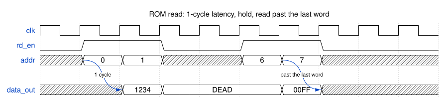

# Module Specification: `ROM`

> **Source:** `ts/src/modules/ROM/`
> **Status:** Approved

---

## Overview

Synchronous **Read-Only Memory** with flexible initialization. Its contents are a parameter, `ROMContents`: a file path, an array of the same entries a file holds, a plain number array, or a `Uint8Array`. Supports binary, hexadecimal, and decimal literals, and packs bytes into wider words in either byte order. Optionally outputs an RCF file, one binary word per line. Depth is inferred from the number of words the contents make.

`ROM` is one memory. Splitting a ROM across several physical macros is the job of the ASIC macro wrapper that replaces it, not of this module.

---

## Parameters

Defined in `ROM_Parameters extends TSSVParameters`.

| Parameter | Type | Default | Description |
|---|---|---|---|
| `name` | `string` | auto | Module name. If omitted, TSSV derives it from the other parameters, with a hash of the contents ([Module name](#module-name)) |
| `dataWidth` | `IntRange<1,256>` | — | Bit width of each ROM word |
| `endianness` | `'big' \| 'little'` | `'big'` | Byte order of a word packed from bytes ([Contents](#contents)). No effect when the contents aren't packed |
| `ROMContents` | `ROM_Contents`: `string \| string[] \| number[] \| Uint8Array` | — | The contents: the path of a file with one entry per line, an array of entries in the same syntax, an array of decimal numbers, or bytes ([Contents](#contents)) |
| `macroConfig` | `string` | `'default'` | Free-form technology macro selector (high-speed, high-density, mux, leakage, etc.), as on `SRAM`. No effect on the behavioral model's SV, but part of the module name, so ROMs built for different macro settings are different modules |

**Constructor extra argument:**

| Argument | Type | Description |
|---|---|---|
| `rcf_path` | `string` (optional) | Directory to write an `.rcf` output file to. Not a parameter: it doesn't change the SV |

---

## IO Ports

| Port | Direction | Width | Description |
|---|---|---|---|
| `clk` | input | 1 | `posedge` clock |
| `rd_en` | input | 1 | Read enable: `data_out` loads the addressed word on the next clock edge while high, and holds while low |
| `addr` | input | `max(1, ceil(log2(depth)))` | Read address |
| `data_out` | output | `dataWidth` | Registered read data (1-cycle latency) |

---

## Functional Description

### Contents

`ROMContents` is parsed at TypeScript elaboration time.

1. **Entries.** A file holds one entry per line, and a string array one entry per element. `_` and whitespace are removed from each entry, and blank entries are skipped, so a file's final newline adds nothing. Each entry is one of:
   - binary: `'b0101`, with an optional size such as `8'b0101`;
   - hexadecimal: `'hBEEF`, `32'hBEEF` or `0xBEEF`;
   - decimal: `'d255`, `16'd255` or `255`.

   A leading `-` negates the value. The size is ignored, and base letters and hex digits can be either case. An entry of a number array is an integer, and an entry of a `Uint8Array` is a byte.
2. **Fit.** Each entry must be a value of `n` bits, signed or unsigned: from -2<sup>n-1</sup> to 2<sup>n</sup>-1. `n` is `dataWidth`, or 8 when the entries are bytes packed into words. A negative entry is stored in two's complement.
3. **Packing.** When `dataWidth` is a multiple of 8 above 8, bytes are packed into words, `dataWidth / 8` to a word. A `Uint8Array` is always packed, and a file or string array is packed when its first entry is 8-digit binary, such as `8'b0000_0001`. A number array is never packed. With `endianness: 'big'` the first byte of each word is its top byte, with `'little'` its bottom byte. If the bytes don't fill the last word, the missing bytes are zero: they are the high bytes of that word with `'little'` and the low bytes with `'big'`. Contents that aren't packed give one word per entry.
4. **Depth** is the number of words.

### Module name

5. The constructor replaces `ROMContents` with its words, one `'h` entry each, such as `'h0A0B0C0D`, before passing it on with the other parameters. So `this.params.ROMContents` holds the words, never a file path, and `new ROM({ ...rom.params, name: undefined })` builds the same ROM again.
6. Without a `name`, TSSV derives one from the parameter values: `ROM_<dataWidth>_<endianness>_<hash>_<macroConfig>`. `<hash>` is the 7-character, base-36 hash of a 32-bit value that `Module` gives any array parameter, here the words. For example, `ts/test/test_rom_init_file.txt` at 32 bits gives `ROM_32_big_1prb6tp_default`. ROMs with different words get different names. The same words give the same name, whether they come from a file at any path, a string array, a number array or bytes. [#123](https://github.com/TypeScriptSystemVerilog/TSSV/issues/123) will change how every module's derived name is built, including this hash.
7. The parameter comment at the top of the emitted module gives the contents as their word count and hash, the same hash as in a derived name, such as `// ROMContents = 10 words, hash 1prb6tp, in rom_read`, since the case table lists the words.

### Example contents

**A file of mixed formats.** Formats can be mixed freely, one entry per line. With `dataWidth: 16` and `ROMContents` set to the file's path:

```text
0x1234
0XDE AD
16'hBEEF
'b1010_0101
'd100
-1
255
```

| Line | Format | Word |
|---|---|---|
| `0x1234` | hexadecimal | `16'h1234` |
| `0XDE AD` | hexadecimal; the space is removed | `16'hDEAD` |
| `16'hBEEF` | hexadecimal with a size, which is ignored | `16'hBEEF` |
| `'b1010_0101` | binary; the `_` is removed | `16'h00A5` |
| `'d100` | decimal | `16'h0064` |
| `-1` | negative decimal, stored in two's complement | `16'hFFFF` |
| `255` | decimal without a prefix | `16'h00FF` |

That's 7 words, so `addr` is 3 bits wide and address 7 reads `'x`. A newline after the last line adds nothing. The same lines as a string array give the same words, and the same module name:

```ts
new ROM({ dataWidth: 16, ROMContents: ['0x1234', '0XDE AD', "16'hBEEF", "'b1010_0101", "'d100", '-1', '255'] })
```

**A file of bytes.** The first entry is 8-digit binary, so when `dataWidth` is a multiple of 8 above 8, the bytes are packed into words:

```text
8'b0000_0001
8'b0000_0010
8'b0000_0011
8'b0000_0100
8'b0000_0101
```

| `dataWidth` | `endianness` | Words |
|---|---|---|
| 32 | `'big'` | `32'h01020304`, `32'h05000000` |
| 32 | `'little'` | `32'h04030201`, `32'h00000005` |
| 8 | either | `8'h01` to `8'h05`: not packed, one word per byte |

The fifth byte starts a second word, and the missing bytes of that word are zero.

**A number array.** Each number is one word, never packed:

```ts
new ROM({ dataWidth: 16, ROMContents: [-5, 0, 255, 32767, -32768] })
// 16'hFFFB, 16'h0000, 16'h00FF, 16'h7FFF, 16'h8000
```

**A `Uint8Array`.** Packed whenever `dataWidth` is a multiple of 8 above 8:

```ts
new ROM({ dataWidth: 32, ROMContents: new Uint8Array([0xDE, 0xAD, 0xBE, 0xEF, 0x01]) })
```

| `dataWidth` | `endianness` | Words |
|---|---|---|
| 32 | `'big'` | `32'hDEADBEEF`, `32'h01000000` |
| 32 | `'little'` | `32'hEFBEADDE`, `32'h00000001` |
| 12 | either | `12'h0DE`, `12'h0AD`, `12'h0BE`, `12'h0EF`, `12'h001`: not packed, since 12 isn't a multiple of 8 |

**Rejected.** These throw ([Rejected contents](#rejected-contents)):

- `0xZZ` in a file: not a literal;
- `'h1FF` in a file with `dataWidth: 8`: 9 bits;
- `65536` in a number array with `dataWidth: 16`: 17 bits;
- `1.5` in a number array: not an integer.

### Reads

8. The words form a `case (addr)` table in an `always_ff @(posedge clk)` block named `rom_read`. On a clock edge with `rd_en` high, `data_out` loads word `addr`. While `rd_en` is low, `data_out` holds.
9. A read past the last word, `addr >= depth`, which a depth that isn't a power of 2 allows, loads `'x`.

### RCF output

10. If `rcf_path` is given, `<rcf_path>/<name>.rcf` is written at elaboration time: one word per line, in binary with `dataWidth` digits, and no newline after the last.

### Reset behavior

`ROM` has no reset port, and `data_out` isn't reset. This is a design decision under the SV guide's RST-3: `data_out` is a datapath register, undefined until the first read, as an `SRAM`'s read data is. A consumer reads it only after issuing a read, so a reset would add a port and reset fan-out for nothing.

### Rejected contents

Before building anything, the constructor throws an error that starts with `ROM <name>:`, or `ROM:` without a `name` (TSSV guide PARAM-5), for:

- a `ROMContents` file path it can't read;
- contents with no entries, or only blank ones;
- a file line or string array entry that isn't one of the forms in [Contents](#contents), or a number array entry that isn't an integer;
- an entry that doesn't fit its width.

### Edge cases

- One word: `addr` is still 1 bit wide, and address 1 reads `'x`.
- Non-power-of-2 depths: the address width is `ceil(log2(depth))`, and addresses past the last word read `'x`.
- Words wider than 53 bits: entries are parsed as `bigint`, so every bit is exact, up to 256-bit words.
- A partly filled last word (packed bytes only) is zero-padded; e.g. 17 bytes into 32-bit words give 5 words, the last `32'h00000020` (little) or `32'h20000000` (big) for a final byte of `0x20`.

---

## Timing

Reads from the 16-bit, 7-word ROM of the [mixed-format example](#example-contents). Each read's word appears on `data_out` one clock edge after `rd_en` and `addr` are sampled: `16'h1234` for address 0, then `16'hDEAD` for address 1. While `rd_en` is low, `data_out` holds `16'hDEAD`, whatever `addr` is. Address 6 reads `16'h00FF`. Address 7 is past the last word, so `data_out` becomes `'x` until the next read.

<!-- wavedrom ROM-timing-read.svg
{
  "signal": [
    {"name": "clk",      "wave": "p........."},
    {"name": "rd_en",    "wave": "01.0.1.0.."},
    {"name": "addr",     "wave": "x==x.==x..", "data": ["0", "1", "6", "7"], "node": ".A....C..."},
    {},
    {"name": "data_out", "wave": "x.==..=x..", "data": ["1234", "DEAD", "00FF"], "node": "..B....D.."}
  ],
  "edge": ["A~>B 1 cycle", "C~>D past the last word"],
  "head": {"text": "ROM read: 1-cycle latency, hold, read past the last word"},
  "config": {"hscale": 2}
}
-->


_Latency from `rd_en` and `addr` to `data_out`: **1 clock cycle**._

---

## Dependencies

| Import | Source |
|---|---|
| `Module`, `TSSVParameters`, `IntRange` | `tssv/lib/core/TSSV` |
| `fs` | Node.js standard library |

---

## Test Plan

**Test script:** `ts/test/modules/test_ROM.ts`
**Output:** `sv-examples/ROM/<name>/<name>.sv`; the init files the script writes for its own cases, in `sv-examples/ROM/init/`

The script checks every configuration's ports against [IO Ports](#io-ports), that each expected word is in the case table, and that the SV has no `undefined` (#127). It exits nonzero on any failure.

| Test case | Init source | `dataWidth` | Notes |
|---|---|---|---|
| Hex file | `ts/test/test_rom_init_file.txt`: binary, hex and decimal entries | 32 | Writes and checks an RCF; derived name with the contents hash |
| Packed binary file | 8-digit binary entries, `'little'` and `'big'` | 32 | Packing in each byte order |
| Decimal array | `[-5, -255, 0, 255, 32767, -32767]` | 16 | Signed negative values |
| Uint8Array, partial last word | 17 bytes, `'little'` and `'big'` | 32 | Last word zero-padded |
| Not packed | 17 bytes; the packed binary file | 31; 25 | One word per byte |
| Fit limits | `[-5, -256, 0, 255, 511]` | 9 | -256 signed and 511 unsigned both fit |
| Power-of-2 depth | 8 numbers | 40 | No address past the last word |
| Uint8Array, wide words | 70 bytes, `'big'`, with an RCF | 64 | 9 words, the last partly filled; RCF holds words |
| One word | `[0x5A]` | 8 | 1-bit `addr` |
| 1-bit words | `[1, 0, -1, 0]` | 1 | |
| Wide words | A file with entries above 2<sup>53</sup> and blank lines | 256 | Exact `bigint` parsing |
| String array | The [mixed-format example](#example-contents) | 16 | Every entry format |
| Module names | Small arrays and files | 8 | Different words give different names. The same words from a file and an array, or from files at two paths, give the same name. `macroConfig` changes the name. Names are legal SV identifiers. A ROM rebuilt from its `params` matches. The parameter comment |
| Rejected contents | See [Rejected contents](#rejected-contents) | — | Each throws its error |

### Simulation

`make -C verilatorTB rom_sim` runs the test script, lints every configuration above with `-Wall`, and runs the self-checking `verilatorTB/tb_ROM.sv` once per configuration. The testbench reads random addresses on random cycles and checks `data_out` against the words the test script expects. It checks the 1-cycle latency and that `data_out` holds while `rd_en` is low. After a read past the last word it checks nothing until the next read, since Verilator is two-state and can't show the `'x`. A configuration also fails if some word is never read, if no held word is checked, or if a depth that isn't a power of 2 never gets a read past its last word. CI runs it.

---

## Implementation Notes

- **Style-guide deviations.** The module follows the [TSSV guide](../../rtl-style/tssv-style/tssv-coding-style.md) and the [SV guide](../../rtl-style/sv-style/sv-coding-style.md), except for these SHOULD rules:
  - **SEQ-2** (SV guide): the case table is inside the `always_ff`. This is the synchronous-ROM form synthesis tools document for a block ROM. An `always_comb` decode feeding a register describes the same logic as a combinational ROM ahead of a flop.
  - **IDENT-2** (TSSV guide): `ROMContents` keeps the acronym in capitals, as the review asked, and `rcf_path` isn't camelCase. Renaming `rcf_path` would break callers.
  - **MOD-5** (TSSV guide): the ports are plain signals, not an `Interface`. They mirror a ROM macro's pins, as `SRAM`'s do.
- **Changed in #151.** Before #151:
  - The contents were the second constructor argument, `MemInitFile`, and weren't in the derived name, so ROMs that differed only in contents got the same name, and emission kept only one of them (TSSV guide PARAM-2). They are now the `ROMContents` parameter, and `rcf_path` is the second argument. `macroConfig` is new.
  - The `split_setting: 'split2two'` parameter built the ROM from two sub-ROMs. It is removed: splitting into macros belongs in the ASIC macro wrapper.
  - Derived names changed with these: `ROM_32_big_interal` is now `ROM_32_big_1prb6tp_default` for the same file.
  - Bad contents printed `Error:` and generated anyway, or crashed with a `TypeError` (no entries, a missing file). They now throw. The range check accepted only the signed range, and wrongly flagged -2<sup>n-1</sup>. Now any `n`-bit value, signed or unsigned, fits.
  - Entries were parsed with JavaScript numbers, so bits past the 53rd of a decimal or binary entry were wrong. A `-` before a hex or binary entry was ignored, and a file's final newline added a zero word.
  - The RCF of a packed ROM held one byte per line, and every RCF line was rounded up to a multiple of 4 bits. Lines are now words of `dataWidth` bits.
