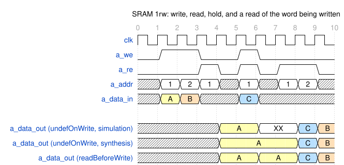
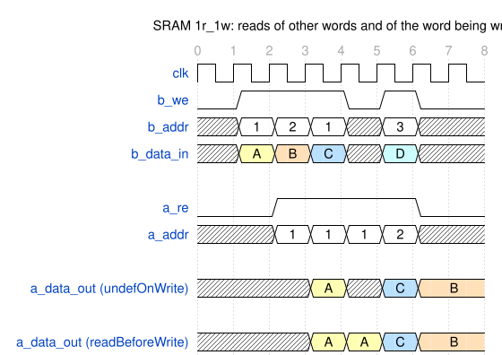
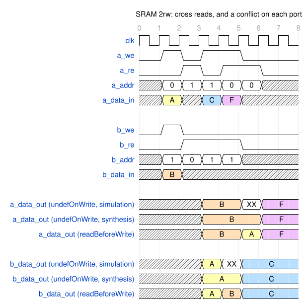

# Module Specification: `SRAM`

> **Source:** `ts/src/modules/SRAM/`
> **Status:** Approved

---

## Overview

Synchronous **Static RAM** with configurable port topology (`1rw`, `1r_1w`, `2rw`), optional write-enable masking (bit-level or byte-level), and configurable read behavior on simultaneous read/write. Intended as a behavioral model that maps to physical SRAM macros; `macroConfig` passes technology-specific parameters through to downstream tools.

---

## Parameters

| Parameter | Type | Default | Description |
|---|---|---|---|
| `name` | `string` | auto | Module name |
| `dataWidth` | `bigint` (≥ 1) | — | Word width in bits |
| `depth` | `bigint` (≥ 2) | — | Number of words |
| `ports` | `'1rw' \| '1r_1w' \| '2rw'` | — | Port configuration |
| `writeEnableMask` | `'none' \| 'bit' \| 'byte'` | `'none'` | Granularity of write mask. `'byte'` requires `dataWidth` divisible by 8 |
| `readBehavior` | `'undefOnWrite' \| 'readBeforeWrite'` | `'undefOnWrite'` | Read data when the same word is read and written in the same cycle |
| `minMacroBits` | `bigint` (≥ 32) | `1024` | The fewest bits (`depth * dataWidth`) an SRAM needs to be implemented as a macro. A smaller one is built from flip-flops: `mem` gets `(* ram_style = "registers" *)` (see [Synthesis mapping](#synthesis-mapping)) |
| `macroConfig` | `string` | `'default'` | Free-form technology macro selector (high-speed, density, mux, etc.). It doesn't change the behavioral model |

The constructor throws on a `dataWidth` below 1, a `depth` below 2 (one word would need a 0-bit address), and a byte mask on a `dataWidth` that isn't a multiple of 8.

---

## IO Ports

Each SRAM port reads, writes, or both, and its signals share a prefix:

| `ports` | Port `a_` | Port `b_` |
|---|---|---|
| `1rw` | reads and writes | — |
| `1r_1w` | reads | writes |
| `2rw` | reads and writes | reads and writes |

Every configuration has `clk` (input, 1 bit), the `posedge` clock of every port.

A port `<p>_` that reads has:

| Port | Direction | Width | Description |
|---|---|---|---|
| `<p>_re` | input | 1 | Read enable |
| `<p>_addr` | input | `ceil(log2(depth))` | Address |
| `<p>_data_out` | output | `dataWidth` | Read data (1-cycle latency) |

A port `<p>_` that writes has:

| Port | Direction | Width | Description |
|---|---|---|---|
| `<p>_we` | input | 1 | Write enable |
| `<p>_addr` | input | `ceil(log2(depth))` | Address. A port that reads and writes has one address for both |
| `<p>_data_in` | input | `dataWidth` | Write data |
| `<p>_wmask` | input | `dataWidth` (`'bit'`) or `dataWidth/8` (`'byte'`) | Write mask, one bit per lane. Absent when `writeEnableMask = 'none'` |

---

## Functional Description

- **Write:** on a rising `clk` edge with `<p>_we` high, `<p>_data_in` is written to word `<p>_addr`. A write mask splits the word into lanes, 1 bit wide for `'bit'` and 8 bits for `'byte'`, and only the lanes whose `<p>_wmask` bit is set are written. Lane *i* is bits `[i*w +: w]`.
- **Read:** on a rising `clk` edge with `<p>_re` high, word `<p>_addr` is loaded into `<p>_data_out`. While `<p>_re` is low, `<p>_data_out` holds.
- **Read/write conflict:** a read *conflicts* with a write when, in the same cycle, a port reads an address that a port writes. That is:
  - `1rw`: `a_re && a_we`.
  - `1r_1w`: `a_re && b_we && (b_addr == a_addr)`.
  - `2rw`: port a: `a_re && (a_we || (b_we && (b_addr == a_addr)))`, port b: `b_re && (b_we || (a_we && (a_addr == b_addr)))`

  Only the write enable and the addresses decide a conflict, not the write mask. A read conflicts even when the write's mask leaves every bit of the word unchanged.
  - **`readBehavior`** sets what a conflicting read returns. A read that doesn't conflict always returns the stored word.
    - `'readBeforeWrite'`: the word as it was before that cycle's writes. **WARNING:** because most macros do not behave this way, it is only implementable via flip-flops. As a result, the value of the `minMacroBits` parameter must be set accordingly (i.e. `depth * dataWidth < minMacroBits`) or elaboration will fail.
    - `'undefOnWrite'` (default): an undefined value. In simulation it is X and `<p>_data_out` stays undefined until the port's next read that doesn't conflict. In synthesis, the write occurs, but not the read and  `<p>_data_out` keeps its previous value.
- **`2rw` write collision:** when both ports write the same word in one cycle, the word becomes an X. In synthesis neither write occurs. NOTE: it is a collision when both ports write the same word, whatever the masks.
- An address at or above `depth` (possible when `depth` isn't a power of 2) is outside the array. Don't use one.


---

## Timing

There is one diagram per `ports` value, each with `depth = 4`, `dataWidth = 8` and no write mask. Each diagram covers both `readBehavior` values. The inputs are the same for both, and each value's read data has its own lanes, named `<p>_data_out (<readBehavior>)`. The numbers along the top are cycles. The inputs in a cycle are sampled on the rising edge that ends it, so read data appears in the next cycle. Hatched read data is undefined: before the first read, and after a conflicting read under `undefOnWrite`, where simulation shows X and synthesis holds the previous value. `make sram_sim` replays each diagram cycle for cycle against both of its configurations, `<ports>_none_undef` and `<ports>_none_rbw` (see [Test Plan](#test-plan)). The diagrams show conflicts and a collision on purpose, so the replays turn off the assertions those break.

### `1rw`

Cycles 1 and 2 write `A` to word 1 and `B` to word 2. Cycle 3 reads word 1: `A` appears in cycle 4, and holds in cycle 5 because `a_re` is low in cycle 4. Cycle 5 reads word 1 while writing `C` to it, which is a conflict. Under `undefOnWrite` the read data is undefined until the next read, in cycle 7. Under `readBeforeWrite` it is `A`, the word before the write. Cycles 7 and 8 read `C` and `B`.

<!-- wavedrom SRAM-timing-1rw.svg
{
  "signal": [
    {"name": "clk",       "wave": "p........."},
    {"name": "a_we",      "wave": "01.0.10..."},
    {"name": "a_re",      "wave": "0..10101.0"},
    {"name": "a_addr",    "wave": "x===x=x==x", "data": ["1", "2", "1", "1", "1", "2"]},
    {"name": "a_data_in", "wave": "x34x.5x...", "data": ["A", "B", "C"]},
    {},
    {"name": "a_data_out (undefOnWrite)",    "wave": "x...3.x.54", "data": ["A", "C", "B"]},
    {},
    {"name": "a_data_out (readBeforeWrite)", "wave": "x...3.3.54", "data": ["A", "A", "C", "B"]}
  ],
  "head": {"text": "SRAM 1rw: write, read, hold, and a read of the word being written", "tick": 0}
}
-->


### `1r_1w`

Port `b` writes and port `a` reads. Cycle 1 writes `A` to word 1. Cycle 2 writes `B` to word 2 while reading word 1. The words differ, so there is no conflict, and `A` appears in cycle 3. Cycle 3 writes `C` to word 1 while reading it, which is a conflict. In cycle 4 the read data is undefined under `undefOnWrite` and `A` under `readBeforeWrite`. Cycle 4 reads `C`. Cycle 5 writes `D` to word 3 while reading `B` from word 2, and `B` holds once `a_re` is low.

<!-- wavedrom SRAM-timing-1r_1w.svg
{
  "signal": [
    {"name": "clk",       "wave": "p......."},
    {"name": "b_we",      "wave": "01..010."},
    {"name": "b_addr",    "wave": "x===x=x.", "data": ["1", "2", "1", "3"]},
    {"name": "b_data_in", "wave": "x345x6x.", "data": ["A", "B", "C", "D"]},
    {},
    {"name": "a_re",      "wave": "0.1...0."},
    {"name": "a_addr",    "wave": "x.====x.", "data": ["1", "1", "1", "2"]},
    {},
    {"name": "a_data_out (undefOnWrite)",    "wave": "x..3x54.", "data": ["A", "C", "B"]},
    {},
    {"name": "a_data_out (readBeforeWrite)", "wave": "x..3354.", "data": ["A", "A", "C", "B"]}
  ],
  "head": {"text": "SRAM 1r_1w: reads of other words and of the word being written", "tick": 0}
}
-->


### `2rw`

- Cycle 1: port `a` writes `A` to word 0, and port `b` writes `B` to word 1.
- Cycle 2: each port reads the word the other wrote. `B` appears on `a_data_out` and `A` on `b_data_out` in cycle 3.
- Cycle 3: port `a` writes `C` to word 1 while port `b` reads it. That is a conflict on port `b` only, since port `a` doesn't read.
- Cycle 4: port `a` reads word 0 while writing `F` to it, a conflict on port `a`. Port `b` reads word 1, which nothing writes, so it gets `C`.
- Cycle 5: both ports write word 2, a write collision. Word 2 becomes undefined under either `readBehavior`.
- Cycle 6: port `a` reads `F` from word 0, and port `b` reads word 2, which is undefined.
- Cycle 7: port `b` reads `C` from word 1 again.

<!-- wavedrom SRAM-timing-2rw.svg
{
  "signal": [
    {"name": "clk",       "wave": "p........"},
    {"name": "a_we",      "wave": "0101..0.."},
    {"name": "a_re",      "wave": "0.101010."},
    {"name": "a_addr",    "wave": "x======x.", "data": ["0", "1", "1", "0", "2", "0"]},
    {"name": "a_data_in", "wave": "x3x586x..", "data": ["A", "C", "F", "D"]},
    {},
    {"name": "b_we",      "wave": "010..10.."},
    {"name": "b_re",      "wave": "0.1..01.0"},
    {"name": "b_addr",    "wave": "x=======x", "data": ["1", "0", "1", "1", "2", "2", "1"]},
    {"name": "b_data_in", "wave": "x4x..7x..", "data": ["B", "E"]},
    {},
    {"name": "a_data_out (undefOnWrite)",    "wave": "x..4.x.8.", "data": ["B", "F"]},
    {"name": "b_data_out (undefOnWrite)",    "wave": "x..3x5.x5", "data": ["A", "C", "C"]},
    {},
    {"name": "a_data_out (readBeforeWrite)", "wave": "x..4.3.8.", "data": ["B", "A", "F"]},
    {"name": "b_data_out (readBeforeWrite)", "wave": "x..345.x5", "data": ["A", "B", "C", "C"]}
  ],
  "head": {"text": "SRAM 2rw: cross reads, a conflict on each port, and a write collision", "tick": 0}
}
-->


---

## Internal Architecture

All of the module's logic is in `ts/src/modules/SRAM/SRAM.ts`. It has no submodules.

- **Storage:** one array, `mem`, of `depth` words. It has no reset. Below `minMacroBits` bits it carries `(* ram_style = "registers" *)` (see [Synthesis mapping](#synthesis-mapping)).
- **`mem_write`:** one `always_ff` writes `mem` from every write port. With more than one lane, a `for` loop over the lanes writes each lane its mask selects. With `2rw`, `w_collision` blocks every lane write of both ports, and outside synthesis sets the word to X.
- **`<p>_read`:** one `always_ff` per reading port loads `mem[<p>_addr]` into `<p>_data_out` while `<p>_re` is high. With `undefOnWrite`, it loads only while `<p>_rw_conflict` is low, and sets `<p>_data_out` to X outside synthesis while it's high.
- Any X assignments, and the assertions, are inside `` `ifndef SYNTHESIS ``, so synthesis sees only the loads and writes.
- **Assertions:** on by default. Each is a concurrent `assert property` on `posedge clk`, with no action block, because the SV guide's SYN-1 bans system tasks in RTL. A simulator reports a failure with the assertion's label.
  - read/write conflict: If a read/write conflict occurs, the assertion will fail. Protected by `` `ifndef NOASSERT_SRAM_RW_CONFLICT ``. Only with `undefOnWrite`, since a `readBeforeWrite` read may conflict. One per reading port, labelled `<p>_no_rw_conflict`: `!(<p>_re && <p>_rw_conflict)`.
  - write collision: If a write collision occurs, the assertion will fail. Protected by `` `ifndef NOASSERT_SRAM_W_COLLISION ``. `2rw` only, labelled `no_w_collision`: `!w_collision`.

### Synthesis mapping

`minMacroBits` decides how `mem` is implemented, through Vivado's `ram_style` attribute, the same mechanism `TwoClockRegFile`'s `fpgaRamStyle` uses. The attribute is set through the `attributes` field of `mem`'s signal declaration, not written into the body by hand.

| `depth * dataWidth` | Attribute on `mem` | Vivado maps `mem` to | ASIC flow |
|---|---|---|---|
| below `minMacroBits` | `(* ram_style = "registers" *)` | Flip-flops | Flip-flops. The SRAM isn't replaced by a macro, and the attribute is what marks it |
| `minMacroBits` or more | none | Block RAM or LUTRAM, by Vivado's choice | Replaced by a macro |

A `readBeforeWrite` SRAM is always below `minMacroBits`, so it is always flip-flops. The RTL's behavior is the same either way: the attribute changes only how synthesis builds `mem`.

### Key signals

| Signal | Width | Present | Description |
|---|---|---|---|
| `mem` | `dataWidth` × `depth` | always | The storage |
| `addr_a_equal_b` | 1 | `2rw`; `1r_1w` with `undefOnWrite` | `a_addr == b_addr` |
| `<p>_rw_conflict` | 1 | `undefOnWrite`, per reading port | A write enable is high, on either port, for the address port `<p>_` reads ([Read/write conflict](#functional-description)) |
| `w_collision` | 1 | `2rw` | `a_we & b_we & addr_a_equal_b`: both ports write one word, whatever their masks |

---

## Dependencies

| Import | Source |
|---|---|
| `Module`, `TSSVParameters`, `Expr` | `tssv/lib/core/TSSV` |

---

## Test Plan

**Test script:** `ts/test/modules/test_SRAM.ts` generates every combination of `ports`, `writeEnableMask` and `readBehavior`, checks each one's ports against the [IO tables](#io-ports), and generates the testbench configurations below. It also generates a 1026-bit `1rw` and `1r_1w` SRAM, and checks that the constructor rejects each bad parameter value in [Parameters](#parameters).
**Testbench:** `verilatorTB/tb_SRAM.sv`, built once per configuration.
**Output:** `sv-examples/SRAM/<module>/` and `sv-examples/SRAM/tb/`

Each configuration is named `<ports>_<mask>_<undef|rbw>`, for every `ports` and `readBehavior`, with `depth = 4` and one of four masks:

| `<mask>` | `writeEnableMask` | `dataWidth` | Lanes |
|---|---|---|---|
| `none` | `'none'` | 8 | 1 (no mask) |
| `bit` | `'bit'` | 8 | 8 |
| `byte` | `'byte'` | 32 | 4 |
| `byte1` | `'byte'` | 8 | 1 (a 1-bit `<p>_wmask`) |

Every cycle, the testbench drives random reads and writes on each port over the 4 words, so the ports often meet on one address. A reference model of the storage gives the expected read data, following [Functional Description](#functional-description). The model tracks which bits are defined, and a check compares only those bits: Verilator is two-state, so it can't show the X the RTL assigns in simulation.

| Test case | Configurations | Notes |
|---|---|---|
| Masked writes | `bit`, `byte`, `byte1` | Random masks, including all lanes and none. The run fails if no write selects some lanes but not all (`bit`, `byte`) |
| Read before write | `readBeforeWrite` | A read of a word written in the same cycle returns the old word. The run fails if none happens |
| Read/write conflict | `undefOnWrite` | Such a read is undefined until the port's next read. The run fails if none happens |
| Write collision | `2rw` | Both ports writing the same word make it undefined, whatever their masks. The run fails if none happens |
| Hold | all | While `<p>_re` is low, `<p>_data_out` keeps its value |
| Timing diagrams | `<ports>_none_undef`, `<ports>_none_rbw` | Each diagram in [Timing](#timing) replays cycle for cycle against the read data lanes for the configuration's `readBehavior`, before the random phase. `test_SRAM.ts` builds the vectors from the diagrams' WaveDrom JSON, so a diagram change is tested without editing the testbench, and it fails if a `ports` value or `readBehavior` has no diagram |
| Random | all | 4000 cycles |
| Assertions | all | The random and diagram runs keep the assertions on, except those their traffic breaks on purpose: `NOASSERT_SRAM_RW_CONFLICT` for `undefOnWrite`, `NOASSERT_SRAM_W_COLLISION` for `2rw`. Then five more runs each break one assertion, with every write mask bit low, and pass only if the run stops on that assertion: `a_no_rw_conflict` for `1rw`, for `1r_1w`, and for port `b` writing in `2rw`; `b_no_rw_conflict` for port `b`'s own write in `2rw`; and `no_w_collision` in a `readBeforeWrite` `2rw` (`assert_checks.txt`) |
| `minMacroBits` | — | `test_SRAM.ts` checks `ram_style = "registers"` on `mem` at 32 bits with `minMacroBits` 33 and the default 1024, and no attribute at 32 bits with `minMacroBits` 32 or at 1024 bits, and that the module name includes `minMacroBits`. It also checks the constructor rejects `minMacroBits` 31 and a `readBeforeWrite` SRAM of 1024 bits, and accepts one of 32 bits with `minMacroBits` 33 |

### Simulation

```bash
make -C verilatorTB sram_sim    # generates the SV, lints each variant with -Wall, then builds and runs each configuration
# waveform per configuration: verilatorTB/obj_dir/sram_<config>/tb_SRAM_<config>.fst
```

`make sfifo_sim` also exercises the `1rw` and `1r_1w` configurations without a mask, inside `SFIFO`, with every assertion on.

---

## Implementation Notes

- **Style-guide deviations.** The module follows the [TSSV guide](../../rtl-style/tssv-style/tssv-coding-style.md) and the [SV guide](../../rtl-style/sv-style/sv-coding-style.md), except for these SHOULD rules:
  - **SEQ-2** (SV guide): `mem_write` and `<p>_read` compute their enables and addresses inside the `always_ff`, which is the form synthesis tools map to a RAM. An `always_comb` computing the next state would make the array read combinational.
  - **BUILD-6** (TSSV guide): the lanes of a write mask are an SV `for` loop inside `mem_write`, the byte-enable RAM template that synthesis tools recognize, rather than one `if` per lane from a TypeScript loop. A `'bit'` mask on a wide word would otherwise emit one `if` per bit.
  - **MOD-5** (TSSV guide): each port is a set of plain signals, not an `Interface`. They mirror an SRAM macro's pins, which the ASIC macro that replaces this model must match, and `SFIFO` and `cpu_convert` bind them by name.
- **One block writes `mem`.** IEEE 1800 doesn't allow two `always_ff` blocks to write one variable, and the SV guide's COMB-5 asks for one driver per signal. So `2rw` writes both ports from `mem_write`, unlike the Verilog-2001 true-dual-port templates that use one `always` per port. Whether an FPGA tool infers a true-dual-port block RAM from this form hasn't been checked.
- **Changed in #150.** Before #150, a masked SRAM with more than one lane returned wrong read data: each lane was zero-extended into the whole of `<p>_data_out`, and the last lane read won. Against that code, `tb_SRAM.sv` fails every configuration with more than one lane. With `undefOnWrite`, a conflicting read also returned the lanes the write didn't select, from the wrong word on port `b` of a `2rw` SRAM with a 1-lane mask. It now treats the whole word as undefined, as this spec says. A `2rw` write collision was per lane; it is now the whole word, whatever the masks. The `minMacroBits` parameter and the assertions are new, and `minMacroBits` adds `_<minMacroBits>` to every derived module name.
