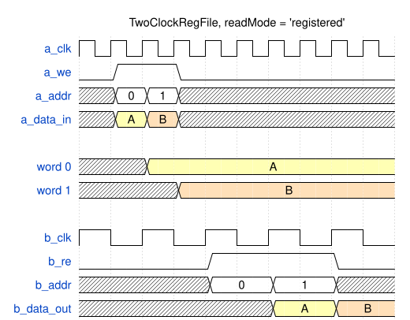
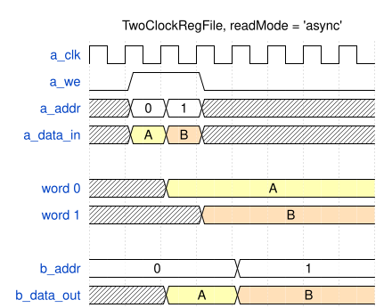

# Module Specification: `TwoClockRegFile`

> **Source:** `ts/src/modules/TwoClockRegFile/`
> **Status:** Draft

---

## Overview

Flop-based register file with a write port on one clock and a read port on another. It is the storage array of the asynchronous FIFO (`AFIFO`), and fits anywhere a small memory has to be written in one clock domain and read in another.

It's built from plain flops instead of a memory macro because ASIC libraries generally don't offer a dual-clock RAM, and the same RTL has to serve both AMD FPGA prototyping and generic ASIC flows. On an FPGA the storage maps to distributed RAM (LUTRAM); in an ASIC flow it's a flop array. Flop storage is expensive at larger sizes, so depth is limited to 32 words.

The register file doesn't synchronize anything. Data crosses from the write domain to the read domain through the storage, and the caller makes that safe by never reading a word while it's being written (see [Access rules](#access-rules)). The `AFIFO`'s Gray-coded pointers are that guarantee.

---

## Parameters

Defined in `TwoClockRegFile_Parameters extends TSSVParameters`.

| Parameter | Type | Default | Description |
|---|---|---|---|
| `name` | `string` | auto-generated | Instance name. If omitted, TSSV derives it from the other parameters, in the order below: `TwoClockRegFile_<dataWidth>_<depth>_<readMode>`, for example `TwoClockRegFile_1026_32_async` |
| `dataWidth` | `bigint` (≥ 1) | — | Word width in bits. There is no upper limit, so NoC flits of 514 or 1026 bits fit |
| `depth` | `bigint` (2 to 32) | — | Number of words. Doesn't have to be a power of two |
| `readMode?` | `'registered' \| 'async'` | `'registered'` | How the read port returns data; see [Reads](#reads) |

Invalid values throw an `Error` that names the module, the parameter and the value: `dataWidth < 1`, `depth` outside 2 to 32, or a `readMode` string that isn't listed above. TypeScript catches the last one at compile time, but JavaScript callers don't get that check.

`addrWidth` below is `ceil(log2(depth))`: 1 bit for depth 2, 5 bits for depth 17 to 32.

---

## IO Ports

Port names follow `SRAM`'s `1r_1w` convention: port A writes and port B reads.

| Port | Direction | Width | Clock/Reset | Description |
|---|---|---|---|---|
| `a_clk` | `input` | 1 | `isClock: 'posedge'` | Write clock |
| `a_we` | `input` | 1 | — | Write enable: on the next `a_clk` edge, `a_data_in` is written to word `a_addr` |
| `a_addr` | `input` | `addrWidth` | — | Write address |
| `a_data_in` | `input` | `dataWidth` | — | Write data |
| `b_clk` | `input` | 1 | `isClock: 'posedge'` | Read clock. `readMode = 'registered'` only |
| `b_re` | `input` | 1 | — | Read enable: on the next `b_clk` edge, word `b_addr` is loaded into `b_data_out`. `readMode = 'registered'` only |
| `b_addr` | `input` | `addrWidth` | — | Read address |
| `b_data_out` | `output` | `dataWidth` | — | Read data |

With `readMode = 'async'` the read port has no clock, so the module's only clock is `a_clk`. There is no reset (see [Reset behavior](#reset-behavior)).

---

## Functional Description

### Writes

A write takes effect on the rising edge of `a_clk` when `a_we` is high, and changes only word `a_addr`. Writes behave the same in both read modes.

### Reads

`readMode` sets how the read port returns data:

| `readMode` | `b_data_out` | Latency | Read enable |
|---|---|---|---|
| `'registered'` | Registered on `b_clk`. It holds its value while `b_re` is low | One `b_clk` | `b_re` |
| `'async'` | A combinational read of word `b_addr`. It follows `b_addr` and the stored word with no clock edge | None | None |

`'async'` is what the `AFIFO`'s show-ahead read needs: the head word is on `b_data_out` as soon as the read pointer points at it. `'registered'` breaks the timing path from the storage to the reader's logic. That path crosses clock domains, so a registered read is the easier one to close timing on.

### Access rules

The register file has no collision detection. The caller has to keep the two ports from using the same word at the same time, and has to synchronize every handoff of a word between them:

1. **Write, then read:** after port A writes word *w*, port B must not read *w* until it has learned of the write through a synchronizer from the `a_clk` domain, with at least two flops.
2. **Read, then overwrite:** after port B reads word *w*, port A must not write *w* again until it has learned through a synchronizer that B is finished with it. For a registered read, B is finished at the `b_re` edge. For an async read, B is finished once its own logic has captured `b_data_out`.

If the caller breaks a rule, reads of the affected word are undefined until it's written again under the rules, and a registered read that breaks rule 1 can go metastable. Other words keep their values.

### Use in the AFIFO

The `AFIFO` uses a power-of-two `depth` from 4 to 32. Port A is the write side: `a_clk` is `wr_clk`, `a_addr` is the binary write pointer, and `a_we` is a push the FIFO accepts. Port B is the read side, addressed by the binary read pointer. The AFIFO's show-ahead read mode uses `readMode = 'async'`, and its registered read mode uses `'registered'` with `b_re` as the accepted pop. The Gray-coded pointers, synchronized into the other domain, satisfy the [Access rules](#access-rules): the reader reads a word only after the synchronized write pointer has passed it, and the writer reuses a word only after the synchronized read pointer has passed it.

### Reset behavior

There is no reset. The storage and, with `readMode = 'registered'`, `b_data_out` are undefined until written. This follows RST-3 in `doc/rtl-style/sv-style/sv-coding-style.md`: no word is read before it's written, so a reset would only add area. It also lets the storage map to LUTRAM, which can't be reset.

### Edge cases

- **Address at or above `depth`** (only possible when `depth` isn't a power of two): a write changes nothing, and a read returns undefined data.
- **A word that has never been written:** reads return undefined data.
- **`readMode = 'registered'` with `b_re` low:** `b_data_out` holds the last value read.
- **`a_we` low:** nothing is written.

---

## Timing

The diagrams draw `b_clk` at half of `a_clk`'s frequency so that they fit on one grid. In practice the clocks are unrelated. Each diagram assumes the caller follows the [Access rules](#access-rules): the synchronizers it uses for that are outside the register file and not shown.

### Registered read

Port A writes `A` to word 0 and `B` to word 1. Port B reads both words, and each value appears on `b_data_out` one `b_clk` edge after it's read.

<!-- wavedrom TwoClockRegFile-timing-registered.svg
{
  "signal": [
    {"name": "a_clk",      "wave": "p........."},
    {"name": "a_we",       "wave": "01.0......"},
    {"name": "a_addr",     "wave": "x==x......", "data": ["0", "1"]},
    {"name": "a_data_in",  "wave": "x34x......", "data": ["A", "B"]},
    {},
    {"name": "word 0",     "wave": "x.3.......", "data": ["A"]},
    {"name": "word 1",     "wave": "x..4......", "data": ["B"]},
    {},
    {"name": "b_clk",      "wave": "p....", "period": 2},
    {"name": "b_re",       "wave": "0.1.0", "period": 2},
    {"name": "b_addr",     "wave": "x.==x", "period": 2, "data": ["0", "1"]},
    {"name": "b_data_out", "wave": "x..34", "period": 2, "data": ["A", "B"]}
  ],
  "head": {"text": "TwoClockRegFile, readMode = 'registered'"}
}
-->


### Async read

The same writes, with no read clock. While `b_addr` is 0, `b_data_out` changes to `A` right after the `a_clk` edge that writes word 0. When `b_addr` changes to 1, `b_data_out` follows at once. `b_addr` is drawn on `a_clk`'s grid, but it doesn't have to be synchronous to `a_clk`.

<!-- wavedrom TwoClockRegFile-timing-async.svg
{
  "signal": [
    {"name": "a_clk",      "wave": "p......."},
    {"name": "a_we",       "wave": "01.0...."},
    {"name": "a_addr",     "wave": "x==x....", "data": ["0", "1"]},
    {"name": "a_data_in",  "wave": "x34x....", "data": ["A", "B"]},
    {},
    {"name": "word 0",     "wave": "x.3.....", "data": ["A"]},
    {"name": "word 1",     "wave": "x..4....", "data": ["B"]},
    {},
    {"name": "b_addr",     "wave": "=...=...", "data": ["0", "1"]},
    {"name": "b_data_out", "wave": "x.3.4...", "data": ["A", "B"]}
  ],
  "head": {"text": "TwoClockRegFile, readMode = 'async'"}
}
-->


_Read latency: **one `b_clk`** with `readMode = 'registered'`, and **none** with `'async'`. Write latency: the word changes on the `a_clk` edge._

---

## Internal Architecture

All of the module's logic is in `ts/src/modules/TwoClockRegFile/TwoClockRegFile.ts`. It has no submodules.

- **Storage:** one array, `mem`, of `depth` words. It's written in an `always_ff` on `a_clk` when `a_we` is high, and has no reset.
- **Read:** `assign b_data_out = mem[b_addr]` with `readMode = 'async'`. With `'registered'`, an `always_ff` on `b_clk` loads `mem[b_addr]` into `b_data_out` when `b_re` is high.

### Synthesis mapping

- `mem` carries `(* ram_style = "distributed" *)`, so Vivado maps it to LUTRAM in both read modes. Without the attribute, Vivado can pick block RAM for a registered read. ASIC synthesis ignores the attribute and builds flops.
- Every storage flop is clocked by `a_clk` alone. The only `b_clk` flops are the `b_data_out` register.

### Key signals

| Signal | Width | Description |
|---|---|---|
| `mem` | `dataWidth` × `depth` | Storage, written on `a_clk` |

---

## Dependencies

| Import | Source | Purpose |
|---|---|---|
| `Module`, `TSSVParameters` | `tssv/lib/core/TSSV` | Base class and parameter type |

---

## Test Plan

**Test script:** `ts/test/modules/test_TwoClockRegFile.ts`. It generates both read modes and checks each one's ports against the IO table above. It checks that register files differing in any parameter get different module names, and that `dataWidth = 1026n` with `depth = 32n` generates. It checks that each invalid parameter in [Parameters](#parameters) throws: `depth` 1 and 33, `dataWidth` 0, and an unlisted `readMode`. Finally, it generates the testbench configurations below. `runAllTests.sh` runs it.
**Testbench:** `verilatorTB/tb_TwoClockRegFile.sv`, built once per configuration. A reference model of the storage checks every read. The testbench drives `a_clk` and `b_clk` at unrelated periods (10 ns and 13 ns), and runs every test twice: once with the read clock slower, and once with it faster (7 ns). With `readMode = 'async'`, the testbench still runs a 13 ns or 7 ns reader clock to sample `b_data_out`. It enforces the [Access rules](#access-rules) with a model of the handoff: port B may read a word only after two `b_clk` edges have passed since it was written, and port A may rewrite a word only after two `a_clk` edges have passed since it was read.
**Output:** `sv-examples/TwoClockRegFile/<module>/` and `sv-examples/TwoClockRegFile/tb/`

| Configuration | `dataWidth` | `depth` | `readMode` |
|---|---|---|---|
| `w8_d4_reg` | 8 | 4 | `'registered'` |
| `w8_d4_async` | 8 | 4 | `'async'` |
| `w8_d5_reg` | 8 | 5 | `'registered'` |
| `w8_d5_async` | 8 | 5 | `'async'` |
| `w1026_d32_reg` | 1026 | 32 | `'registered'` |
| `w1026_d32_async` | 1026 | 32 | `'async'` |

| Test case | Configurations | Notes |
|---|---|---|
| Write then read every word | all | Port A writes every word, then port B reads each one back |
| Registered read hold | `readMode = 'registered'` | `b_data_out` holds while `b_re` is low, through writes to the word last read |
| Async read | `readMode = 'async'` | `b_data_out` follows `b_addr` with no read clock edge, and shows a write to the addressed word right after the `a_clk` edge |
| Out-of-range address | `depth = 5` | Writes to addresses 5 to 7 leave words 0 to 4 unchanged |
| Random | all | 5000 random reads and writes, obeying the access rules, checked against the reference model |
| Timing diagrams | `w8_d4_reg`, `w8_d4_async` | Each diagram in [Timing](#timing) replays cycle for cycle, with vectors built from its WaveDrom JSON as `test_SFIFO.ts` does |

**FPGA mapping:** a Vivado synthesis run of `TwoClockRegFile_1026_32_registered` and `TwoClockRegFile_1026_32_async` maps `mem` to distributed RAM (LUTRAM) and uses no block RAM. This is a manual check, recorded on the PR with the Vivado version.

### Simulation

```bash
make -C verilatorTB twoclockregfile_sim    # generates the SV, then builds and runs each configuration
# waveform per configuration: verilatorTB/obj_dir/twoclockregfile_<config>/tb_TwoClockRegFile_<config>.fst
```

The target also gets its own step in `.github/workflows/test.yml`.

---

## Implementation Notes

- **Emitting `ram_style`.** `mem` gets its attribute through the `attributes` field that #131 adds to `Signal` in `ts/src/core/Base.ts`, so this module is built after #131 merges. It isn't declared by hand in the body.
- **SYN-3.** The style guide requires every crossing signal to go through a synchronizer. This module is the exception that rule depends on: data crosses through the storage without one, and the caller synchronizes the control that guards it ([Access rules](#access-rules)). The PR records this as a SYN-3 waiver. SYN-4's list of memory modules should then include `TwoClockRegFile`.
- **No collision checking.** Detecting a broken access rule would need logic that crosses domains, so the module doesn't try. A testbench that wants checking keeps its own model, as `tb_TwoClockRegFile.sv` does.
- **One write port and one read port only.** A two-clock register file in which both ports read and write needs a bank per port and a table of which bank holds each word, because a flop has only one clock. That isn't worth its cost for the `AFIFO`, so it's out of scope.
- **Replaces `DualClockRAM`.** The `add_AFIFO` branch's `DualClockRAM` assumed a dual-clock memory macro and had only a registered read. #67 builds the `AFIFO` on this module instead and doesn't land `DualClockRAM`.
- **Future:** write-enable masks, as `SRAM` has.
