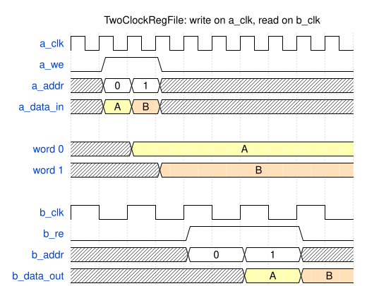

# Module Specification: `TwoClockRegFile`

> **Source:** `ts/src/modules/TwoClockRegFile/`
> **Status:** Draft

---

## Overview

Flop-based register file with a write port on one clock and a synchronous read port on another. It is the storage array of the asynchronous FIFO (`AFIFO`), and fits anywhere a small memory has to be written in one clock domain and read in another.

It's built from plain flops instead of a memory macro because ASIC libraries generally don't offer a dual-clock RAM, and the same RTL has to serve both AMD FPGA prototyping and generic ASIC flows. In an ASIC flow it's a flop array. On an FPGA, Vivado maps it to distributed RAM (LUTRAM) or block RAM: by default Vivado chooses, and `fpgaRamStyle` can force either. Flop storage is expensive at larger sizes, so depth is limited to 32 words.

The register file doesn't synchronize anything. Data crosses from the write domain to the read domain through the storage, and the caller makes that safe by never reading a word while it's being written (see [Access rules](#access-rules)). The `AFIFO`'s Gray-coded pointers are that guarantee.

---

## Parameters

Defined in `TwoClockRegFile_Parameters extends TSSVParameters`.

| Parameter | Type | Default | Description |
|---|---|---|---|
| `name` | `string` | auto-generated | Instance name. If omitted, TSSV derives it from the other parameters, in the order below: `TwoClockRegFile_<dataWidth>_<depth>`, plus `_<fpgaRamStyle>` when it's set. For example `TwoClockRegFile_1026_32`, or `TwoClockRegFile_1026_32_block` |
| `dataWidth` | `bigint` (≥ 1) | — | Word width in bits. There is no upper limit, so NoC flits of 514 or 1026 bits fit |
| `depth` | `bigint` (2 to 32) | — | Number of words. Doesn't have to be a power of two |
| `fpgaRamStyle?` | `'distributed' \| 'block'` | unset | How Vivado implements the storage; see [Synthesis mapping](#synthesis-mapping). Unset emits no attribute, so Vivado chooses. It changes only an attribute: the RTL's behavior is the same for every value, and ASIC flows ignore it |

Invalid values throw an `Error` that names the module, the parameter and the value: `dataWidth < 1`, `depth` outside 2 to 32, or an `fpgaRamStyle` string that isn't listed above. TypeScript catches the last one at compile time, but JavaScript callers don't get that check.

`addrWidth` below is `ceil(log2(depth))`: 1 bit for depth 2, 5 bits for depth 17 to 32.

---

## IO Ports

Port names follow `SRAM`'s `1r_1w` convention: port A writes and port B reads.

| Port | Direction | Width | Clock/Reset | Description |
|---|---|---|---|---|
| `a_clk` | `input` | 1 | `isClock: 'posedge'` | Write clock |
| `a_we` | `input` | 1 | — | Write enable: on the next `a_clk` edge, `a_data_in` is written to word `a_addr` |
| `a_addr` | `input` | `addrWidth` | — | Write address |
| `a_data_in` | `input` | `dataWidth` | — | Write data |
| `b_clk` | `input` | 1 | `isClock: 'posedge'` | Read clock |
| `b_re` | `input` | 1 | — | Read enable: on the next `b_clk` edge, word `b_addr` is loaded into `b_data_out` |
| `b_addr` | `input` | `addrWidth` | — | Read address |
| `b_data_out` | `output` | `dataWidth` | — | Read data, registered on `b_clk` |

There is no reset (see [Reset behavior](#reset-behavior)).

---

## Functional Description

### Writes

A write takes effect on the rising edge of `a_clk` when `a_we` is high, and changes only word `a_addr`.

### Reads

Reads are synchronous to `b_clk`. On a rising edge of `b_clk` with `b_re` high, word `b_addr` is loaded into `b_data_out`, so the data is valid one `b_clk` after the address. While `b_re` is low, `b_data_out` holds its value.

The register on `b_data_out` breaks the timing path from the storage to the reader's logic. That path crosses clock domains, and ending it at a flop on `b_clk` keeps the reader's own logic out of it.

### Access rules

The register file has no collision detection. The caller has to keep the two ports from using the same word at the same time, and has to synchronize every handoff of a word between them:

1. **Write, then read:** after port A writes word *w*, port B must not read *w* until it has learned of the write through a synchronizer from the `a_clk` domain, with at least two flops.
2. **Read, then overwrite:** after port B reads word *w*, port A must not write *w* again until it has learned through a synchronizer that B is finished with it. B is finished at the `b_clk` edge that loads *w* into `b_data_out`.

If the caller breaks a rule, reads of the affected word are undefined until it's written again under the rules, and a read that breaks rule 1 can go metastable. Other words keep their values.

### Use in the AFIFO

The `AFIFO` uses a power-of-two `depth` from 4 to 32. Port A is the write side: `a_clk` is `wr_clk`, `a_addr` is the binary write pointer, and `a_we` is a push the FIFO accepts. Port B is the read side: `b_clk` is `rd_clk`, and `b_addr` is the binary read pointer. The Gray-coded pointers, synchronized into the other domain, satisfy the [Access rules](#access-rules): the reader reads a word only after the synchronized write pointer has passed it, and the writer reuses a word only after the synchronized read pointer has passed it.

Because the read is registered, an `AFIFO` that presents its head word without a pop (show-ahead) has to read the head into `b_data_out` ahead of time, the way `SFIFO` prefetches over `SRAM`'s registered read. That logic belongs to the `AFIFO` (#67).

### Reset behavior

There is no reset. The storage and `b_data_out` are undefined until written. This follows RST-3 in `doc/rtl-style/sv-style/sv-coding-style.md`: no word is read before it's written, so a reset would only add area. It also lets the storage map to FPGA RAM, whose contents can't be reset.

### Edge cases

- **Address at or above `depth`** (only possible when `depth` isn't a power of two): a write changes nothing, and a read returns undefined data.
- **A word that has never been written:** reads return undefined data.
- **`b_re` low:** `b_data_out` holds the last value read.
- **`a_we` low:** nothing is written.

---

## Timing

The diagram draws `b_clk` at half of `a_clk`'s frequency so that it fits on one grid. In practice the clocks are unrelated. It assumes the caller follows the [Access rules](#access-rules): the synchronizers it uses for that are outside the register file and not shown.

Port A writes `A` to word 0 and `B` to word 1. Port B reads both words, and each value appears on `b_data_out` one `b_clk` edge after it's read.

<!-- wavedrom TwoClockRegFile-timing.svg
{
  "signal": [
    {"name": "a_clk",      "wave": "p........."},
    {"name": "a_we",       "wave": "01.0......"},
    {"name": "a_addr",     "wave": "x==x......", "data": ["0", "1"]},
    {"name": "a_data_in",  "wave": "x34x......", "data": ["A", "B"]},
    {},
    {"name": "word 0",     "wave": "x.3.......", "data": ["A"]},
    {"name": "word 1",     "wave": "x..4......", "data": ["B"]},
    {},
    {"name": "b_clk",      "wave": "p....", "period": 2},
    {"name": "b_re",       "wave": "0.1.0", "period": 2},
    {"name": "b_addr",     "wave": "x.==x", "period": 2, "data": ["0", "1"]},
    {"name": "b_data_out", "wave": "x..34", "period": 2, "data": ["A", "B"]}
  ],
  "head": {"text": "TwoClockRegFile: write on a_clk, read on b_clk"}
}
-->


_Read latency: **one `b_clk`**. Write latency: the word changes on the `a_clk` edge._

---

## Internal Architecture

All of the module's logic is in `ts/src/modules/TwoClockRegFile/TwoClockRegFile.ts`. It has no submodules.

- **Storage:** one array, `mem`, of `depth` words. It's written in an `always_ff` on `a_clk` when `a_we` is high, and has no reset.
- **Read:** an `always_ff` on `b_clk` loads `mem[b_addr]` into `b_data_out` when `b_re` is high. It has no reset.

### Synthesis mapping

The RTL (a write on `a_clk` and a read registered on `b_clk`, enabled by `b_re`) is Vivado's dual-clock RAM template, so it can map to either kind of FPGA RAM with the same one-`b_clk` read latency. `fpgaRamStyle` sets the `ram_style` attribute on `mem`:

| `fpgaRamStyle` | Attribute on `mem` | Vivado maps `mem` to |
|---|---|---|
| unset | none | Its own choice, by size and shape |
| `'distributed'` | `(* ram_style = "distributed" *)` | LUTRAM, with `b_data_out` as the output flops |
| `'block'` | `(* ram_style = "block" *)` | Block RAM in simple dual-port mode, with a separate clock on each port. `b_re` is the read port's enable, and `b_data_out` is the BRAM's output latch, not its optional output register |

The choice is a trade-off for a wide, shallow memory. At 1026 × 32 on UltraScale+, LUTRAM takes about 74 `RAM32M16` (roughly 590 LUTs in SLICEMs) at full depth utilization. Block RAM takes about 15 RAMB36 used 72 bits wide, with only 32 of their 512 entries used. The two also differ in where they're placed: LUTRAM sits in slices near the surrounding logic, while block RAM sits in sparse columns that both 1026-bit buses have to route to. In LUTRAM the read address fans out to every LUTRAM macro on its way to `b_data_out`. In block RAM, the read enable and address fan out to every block RAM instead, and the output latch replaces the `b_data_out` flops. Which is better depends on the design, so the [Test Plan](#test-plan)'s Vivado check measures both.

- UltraRAM can't be used: both of its ports share one clock.
- ASIC synthesis ignores `ram_style` and builds flops.
- In the RTL, every storage flop is clocked by `a_clk` alone. The only `b_clk` flops are the `b_data_out` register.

### Key signals

| Signal | Width | Description |
|---|---|---|
| `mem` | `dataWidth` × `depth` | Storage, written on `a_clk` |

---

## Dependencies

| Import | Source | Purpose |
|---|---|---|
| `Module`, `TSSVParameters` | `tssv/lib/core/TSSV` | Base class and parameter type |

---

## Test Plan

**Test script:** `ts/test/modules/test_TwoClockRegFile.ts`. It checks the generated ports against the IO table above, that register files differing in any parameter get different module names, and that `dataWidth = 1026n` with `depth = 32n` generates. It checks that `mem` carries no `ram_style` attribute when `fpgaRamStyle` is unset and the matching one for each value, and that apart from the attribute, the module name and the parameter comment, the SV is the same for all three. It checks that each invalid parameter in [Parameters](#parameters) throws: `depth` 1 and 33, `dataWidth` 0, and an unlisted `fpgaRamStyle`. Finally, it generates the testbench configurations below. `runAllTests.sh` runs it.
**Testbench:** `verilatorTB/tb_TwoClockRegFile.sv`, built once per configuration. A reference model of the storage checks every read. The testbench drives `a_clk` and `b_clk` at unrelated periods (10 ns and 13 ns), and runs every test twice: once with the read clock slower, and once with it faster (7 ns). It enforces the [Access rules](#access-rules) with an ownership model: each word belongs to one port at a time, a port hands a word over at one of its clock edges, and the other port may use it from its own third clock edge after that (two edges pass, as through a two-flop synchronizer). The timing diagram replays first, with `b_clk` at 20 ns and its rising edges aligned with `a_clk`'s, as drawn. For the other tests a 0.3 ns phase shift keeps the two clocks' edges from ever coinciding.
**Output:** `sv-examples/TwoClockRegFile/<module>/` and `sv-examples/TwoClockRegFile/tb/`

| Configuration | `dataWidth` | `depth` |
|---|---|---|
| `w8_d4` | 8 | 4 |
| `w8_d5` | 8 | 5 |
| `w1026_d32` | 1026 | 32 |

| Test case | Configurations | Notes |
|---|---|---|
| Write then read every word | all | Port A writes every word, then port B reads each one back |
| Read hold | all | `b_data_out` holds while `b_re` is low, through writes to the word last read |
| Out-of-range address | `w8_d5` | Writes to addresses 5 to 7 leave words 0 to 4 unchanged |
| Random | all | 5000 random reads and writes, obeying the access rules, checked against the reference model |
| Timing diagram | `w8_d4` | The diagram in [Timing](#timing) replays cycle for cycle, with vectors built from its WaveDrom JSON as `test_SFIFO.ts` does |

The testbench doesn't vary `fpgaRamStyle`, because the attribute doesn't change the simulated behavior.

**FPGA mapping:** Vivado synthesis and implementation runs of `TwoClockRegFile_1026_32` with each `fpgaRamStyle` setting. `'distributed'` maps `mem` to LUTRAM and uses no block RAM. `'block'` maps it to block RAM and uses no LUTRAM. For the unset run, the PR records what Vivado chose. For each run the PR records the RAM, LUT and register utilization and the worst slack on the read path, with the Vivado version and target part. This is a manual check.

### Simulation

```bash
make -C verilatorTB twoclockregfile_sim    # generates the SV, then builds and runs each configuration
# waveform per configuration: verilatorTB/obj_dir/twoclockregfile_<config>/tb_TwoClockRegFile_<config>.fst
```

The target also gets its own step in `.github/workflows/test.yml`.

---

## Implementation Notes

- **Emitting `ram_style`.** When `fpgaRamStyle` is set, `mem` gets its attribute through the `attributes` field that #131 added to `Signal` in `ts/src/core/Base.ts`. It isn't declared by hand in the body.
- **Block RAM collisions.** UG573 gives block RAM its own rules for collisions between ports on asynchronous clocks, including how the write mode behaves. The [Access rules](#access-rules) keep the ports off the same word, which should satisfy them. The `'block'` Vivado run confirms the inferred write mode, and the PR checks it against UG573.
- **SYN-3.** The style guide requires every crossing signal to go through a synchronizer. This module is the exception that rule depends on: data crosses through the storage without one, and the caller synchronizes the control that guards it ([Access rules](#access-rules)). The PR records this as a SYN-3 waiver. SYN-4's list of memory modules should then include `TwoClockRegFile`.
- **No collision checking.** Detecting a broken access rule would need logic that crosses domains, so the module doesn't try. A testbench that wants checking keeps its own model, as `tb_TwoClockRegFile.sv` does.
- **One write port and one synchronous read port only.** A port that both reads and writes on each clock needs a bank per port and a table of which bank holds each word, because a flop has only one clock. The `AFIFO` doesn't need that. An asynchronous (combinational) read mode was also considered and dropped: a show-ahead `AFIFO` prefetches instead (see [Use in the AFIFO](#use-in-the-afifo)).
- **Replaces `DualClockRAM`.** The `add_AFIFO` branch's `DualClockRAM` assumed a dual-clock memory macro. #67 builds the `AFIFO` on this module instead and doesn't land `DualClockRAM`.
- **Future:** write-enable masks, as `SRAM` has.
