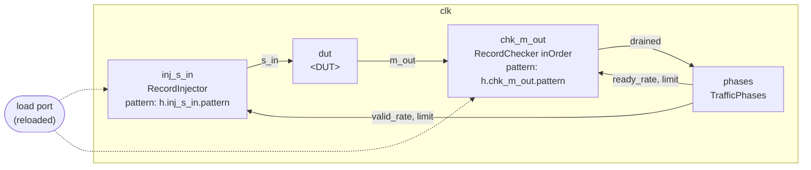

# TB Specification: `<DUT>`

_Save this as `doc/modules/<DUT>/<DUT>-tb-spec.md`, beside the DUT's module spec. A DUT that is test code, with no module spec, puts it in `doc/framework/examples/<DUT>-tb-spec.md`. Point each harness's header comment at it: `TB spec: doc/modules/<DUT>/<DUT>-tb-spec.md`. Delete this line._

_One TB spec covers every testbench of one DUT: a stream testbench and a waveform testbench of a FlitStreamPipe share one. Give each testbench its own subsection where they differ. The module spec's Test Plan says **what** is tested; this spec says **how**. The framework it builds on is [testbench.md](../framework/testbench.md); the generator, configurations and testcases are in its section "Configurations, testcases and the generator"._

> **DUT:** `<DUT>`, [module spec](<path>)
> **Testbenches:** `<testbench>` (harness `<Harness class>`, `<file>`), ...
> **Runner:** `ts/test/<path>/test_<testbench>TB.ts`, writing `sv-examples/tb/<DUT>/<testbench>/`
> **Status:** Draft / Review / Approved

---

## Overview

_One paragraph: what the testbenches verify, and against which sections of the module spec. Then a table that maps each row of the module spec's Test Plan to the testcases and checks that cover it, so a reader can see that every row is covered and how._

| Test Plan row | Testbench | Testcases | Checks |
|---|---|---|---|
| _Ordering under backpressure_ | `<testbench>` | `<testcase>`, ... | `order`, `progress` |

---

## Block diagram

_Every component of each harness, and how they connect: the pattern memories, injectors and players that drive the DUT, the DUT, the checkers that check it, the traffic phases and throttles, the clocks and resets, and in reloaded mode the load port. Use the instance names, which the testbench's FAIL lines and detail lines also use (`inj_<port>`, `chk_<port>`; [testbench.md](../framework/testbench.md), "Names"). A `mermaid` flowchart renders on GitHub; an ASCII diagram, as in a harness's header comment, is fine too._



---

## Clocks and resets

_The clock domains, each with its period, phase and reset order (`releaseAfter`), and the report domain, in whose cycles `maxCycles` counts. Say which domain each component runs in, and so which clock loads its memories in reloaded mode. One line is enough for a harness with one clock._

| Domain | Period | Phase | Released after | Components |
|---|---|---|---|---|
| `clk` | 10 | 0 | — | _all_ |

---

## Configurations

_Each configuration file (`configurations/<configuration>.json`): its DUT parameters and its pattern memories' depths. A configuration holds only what varies between builds. Below the table, list the structure that every configuration shares and that isn't configured: record fields, LFSR payloads, the traffic phases, throttle seeds and rates._

| Configuration | `parameters` | `depths` | `maxCycles` |
|---|---|---|---|
| `<configuration>` | `{ "<param>": <value> }` | `h.<memory>`: _N_, ... | _N_ |

_Fixed in every configuration:_

- _..._

---

## Interfaces and pattern formats

_One subsection per DUT interface that a component drives or checks. For each: the component and its instance, the pattern memory and its manifest path (`h.<instance>.<memory>`), the record's fields in order with their widths, the radix, which fields are stored and which are made by an Lfsr from a seed, a source or tie field if any, and two or three sample lines of a pattern file with its header. [pattern-files.md](../framework/pattern-files.md) defines the file format._

### `<port>`

| | |
|---|---|
| Component | `inj_<port>`, RecordInjector |
| Memory | `h.inj_<port>.pattern` |
| Record | `<field>` (_w_ bits), ... |
| Radix | `$readmemh` |
| Payload | _stored / LFSR from `seed`_ |

```text
// <DUT>, testcase <testcase>: stimulus for <port>, ...
// $readmemh, one record per line: <field> _ <field> _ ...
```

---

## Testcases

_Each testcase (`testcases/<testcase>/`): what it exercises, how its content is made (the generator function and its inputs), and its record counts per memory. A testcase holds only content: anything that changes the RTL belongs in a configuration or in the fixed structure._

| Testcase | Records | Made by | Exercises |
|---|---|---|---|
| `<testcase>` | `h.<memory>`: _N_, ... | `<function>(...)` | _..._ |

---

## Checks

_Each check, in `fail` bit order: its name, the component that evaluates it, what it requires (its FAIL line), the detail line it prints, and the module spec requirement it checks. Port contracts that the DUT declares (concepts.md §7, checked by `npm run check:port-contracts`) are listed too, as structural checks outside simulation._

| Check | Component | Requires | Detail line | Spec |
|---|---|---|---|---|
| `order` | `chk_<port>` | _..._ | `record %0d: got %h, expected %h` | _§_ |

---

## How outputs are matched across interfaces

_How each output's records are matched to what was sent: in order (inOrder), per source in order (perSource), cycle by cycle (cycleExact), or tied across outputs so that the input order is checked across them (a RecordTie: the `after` checks). Say what isn't checked: for example the order between two outputs that aren't tied, or the timing of a stream checked only for order._

---

## Run modes

_Which run modes the testbenches support, and why: `preloaded` builds one testbench per configuration and testcase, with the testcase compiled in; `reloaded` builds one per configuration, and SimTop loads each testcase at run time. A testbench whose pattern memories include preloaded-only ones (cycle tables) supports preloaded only. State any limit, such as the most records a testcase may hold (the depths)._

| Mode | Supported | Builds | Notes |
|---|---|---|---|
| `preloaded` | yes / no | one per configuration and testcase | |
| `reloaded` | yes / no | one per configuration | |

---

## Running

```bash
npx tsc && node out/test/<path>/test_<testbench>TB.js   # writes sv-examples/tb/<DUT>/<testbench>/
make -C verilatorTB tb_regression_sim                    # builds and runs every line of regression.txt
```

_Any other target or command the testbenches need._

---

## Evidence

_The breaks that show each check can fail: for each, what was broken (a pattern file edited, a load list changed, the DUT or the harness mutated), the run, and the FAIL line it gave. A check never seen to fail isn't evidence._

| Break | Run | Result |
|---|---|---|
| _Expected record 0 changed_ | `<mode> <configuration> <testcase>` | `FAIL order`, record 0 |

---

## Limitations and open points

- _What the testbenches don't check, and why._
- _Future: ... (for example a pattern field that waits on an event, which the framework doesn't have yet)._
